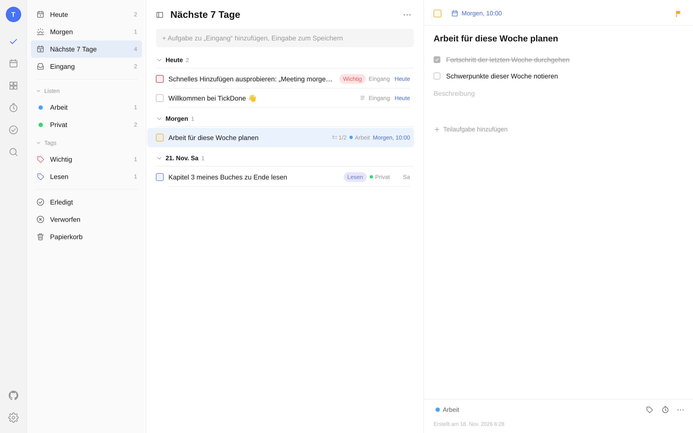

<div align="center">

<a href="https://tickdone.pages.dev"></a>

<h1>TickDone</h1>

<p><b>Plane deinen Tag, konzentriere dich aufs Wesentliche und bleib an guten Gewohnheiten dran – direkt im Browser.</b></p>

<p>
  <a href="https://github.com/suica/tickdone/actions/workflows/ci.yml"></a>
  <a href="LICENSE"></a>
  <a href="https://tickdone.pages.dev"></a>
  <a href="#-sprachen"></a>
  <a href="#-mitwirken"></a>
</p>

<p>
  <a href="README.md">English</a> ·
  <a href="README.zh-CN.md">简体中文</a> ·
  <a href="README.zh-TW.md">繁體中文</a> ·
  <a href="README.ja.md">日本語</a> ·
  <a href="README.ko.md">한국어</a> ·
  <a href="README.es.md">Español</a> ·
  <a href="README.fr.md">Français</a> ·
  <b>Deutsch</b> ·
  <a href="README.pt-BR.md">Português (Brasil)</a> ·
  <a href="README.ru.md">Русский</a>
</p>

<a href="https://tickdone.pages.dev"></a>

<p>
  <a href="https://tickdone.pages.dev"><b>App öffnen</b></a> ·
  <a href="#-funktionen"><b>Funktionen</b></a> ·
  <a href="#-schnellstart"><b>Schnellstart</b></a> ·
  <a href="#️-roadmap"><b>Roadmap</b></a> ·
  <a href="#-mitwirken"><b>Mitwirken</b></a>
</p>

</div>

TickDone ist eine kostenlose Open-Source-Aufgabenliste mit Zeitmanagement, die in deinem Browser läuft. Schreib Aufgaben einfach so auf, wie sie dir einfallen, plane sie im Kalender, ordne sie nach Dringlichkeit und Wichtigkeit, arbeite sie mit dem Fokus-Timer ab und bleib bei deinen Gewohnheiten – alles an einem Ort.

> [!NOTE]
> **Deine Daten bleiben bei dir.** Alles wird im lokalen Speicher deines Browsers gesichert: kein Konto, keine Anmeldung, und deine Aufgaben verlassen nie dein Gerät. Über den Server von TickDone läuft nur die Adresse eines abonnierten Kalenders: Ein kleiner Proxy ruft ihn für dich ab und speichert nichts. Eine Sicherungsdatei kannst du jederzeit in den Einstellungen exportieren.

## ✨ Funktionen

- ✅ **Aufgaben und Listen**: Heute, Morgen, Nächste 7 Tage und Eingang, dazu Erledigt, Verworfen und Papierkorb; eigene Listen, Ordner und Tags; Unteraufgaben, Notizen, Prioritäten, Fälligkeitsdatum und -uhrzeit, Erinnerungen und Wiederholungsregeln; Anheften und ein Kontextmenü für jede Aufgabe.
- ⚡ **Smarte Schnelleingabe**: Tippe `call mom tomorrow 3pm !high #family ~Personal`, und TickDone setzt Datum, Uhrzeit, Priorität, Tag und Liste und hebt jeden erkannten Teil schon beim Tippen hervor. Chinesisch versteht sie auch.
- 🗂️ **Listen- und Kanban-Ansicht** mit Gruppierung und Sortierung.
- 📅 **Kalender** mit Monats-, Wochen-, Tages- und Listenansicht. Zieh eine Aufgabe auf einen anderen Tag oder eine andere Uhrzeit, oder zieh die Unterkante eines Blocks, um die Dauer zu ändern.
- 🔔 **Kalenderabos**: Abonniere jeden Kalender mit einer iCal-Adresse (.ics oder webcal://), etwa für Arbeit, Schule, Team oder Feiertage, und sieh seine Termine schreibgeschützt und in eigener Farbe im Kalender. Sie aktualisieren sich von selbst und bleiben auch offline verfügbar.
- 🧭 **Eisenhower-Matrix**: Ordne Aufgaben nach Dringlichkeit und Wichtigkeit ein und zieh sie in einen anderen Quadranten, um ihre Priorität zu ändern.
- 🍅 **Fokus-Timer** mit Pomodoro- und Stoppuhr-Modus und einem Verlauf vergangener Sitzungen.
- 🔥 **Gewohnheitstracker** mit Check-ins, Serien und Statistiken.
- 🔍 **Suche** in Aufgaben, Tags und Listen.
- ↩️ **Rückgängig** über die Meldung, nachdem du eine Aufgabe erledigt, gelöscht oder verschoben hast.
- ⌨️ **Tastenkürzel** und 🌙 **dunkles Design**.
- 💾 **Sichern und Wiederherstellen**: Exportiere alles als JSON-Datei und importiere sie später wieder.

## 📸 Screenshots

<table>
  <tr>
    <td colspan="2"></td>
  </tr>
  <tr>
    <th>Kalender</th>
    <th>Matrix</th>
  </tr>
  <tr>
    <td></td>
    <td></td>
  </tr>
  <tr>
    <th>Fokus</th>
    <th>Gewohnheiten</th>
  </tr>
  <tr>
    <td></td>
    <td></td>
  </tr>
</table>

<table>
  <tr>
    <td></td>
    <td></td>
    <td></td>
    <td></td>
    <td></td>
  </tr>
</table>

## 🚀 Schnellstart

**Online nutzen:** Öffne [tickdone.pages.dev](https://tickdone.pages.dev). Es gibt nichts zu installieren.

**Lokal ausführen** (Node.js 24 erforderlich):

```sh
git clone https://github.com/suica/tickdone.git
cd tickdone
npm install
npm run dev        # http://localhost:5173
```

## ⌨️ Tastenkürzel

| Taste | Aktion |
|---|---|
| `N` | Neue Aufgabe |
| `Ctrl/⌘ F` | Suche |
| `Alt 1`–`Alt 6` | Modul wechseln |
| `Ctrl/⌘ Z` | Rückgängig, solange die Rückgängig-Meldung angezeigt wird |
| `Esc` | Aufgabendetails schließen |
| `?` | Alle Tastenkürzel anzeigen |

## 🌍 Sprachen

Diese README gibt es in 10 Sprachen: English, 简体中文, 繁體中文, 日本語, 한국어, Español, Français, Deutsch, Português (Brasil) und Русский. Die gesamte Oberfläche ist in dieselben 10 Sprachen übersetzt. TickDone folgt der Sprache deines Browsers, und du kannst sie jederzeit in den Einstellungen wechseln. Die Schnelleingabe versteht Datumsangaben auf Englisch oder Chinesisch und Prioritätswörter in allen 10 Sprachen.

Eine Übersetzung klingt holprig? Englisch ist die Ausgangssprache: Korrigiere den Text in `src/i18n/` oder in `README.<locale>.md` und öffne einen Pull Request.

## 🗺️ Roadmap

Jeder Punkt verlinkt auf sein Issue. Abgehakte Punkte sind auf [tickdone.pages.dev](https://tickdone.pages.dev) bereits live.

- [x] Aufgaben, Listen, Tags, Schnelleingabe, Kalender, Eisenhower-Matrix, Fokus-Timer und Gewohnheitstracker
- [x] CI mit Unit- und End-to-End-Tests ([#7](https://github.com/suica/tickdone/issues/7))
- [x] Open Source: README in 10 Sprachen, MIT-Lizenz, Projektregeln ([#10](https://github.com/suica/tickdone/issues/10))
- [x] Layouts für Smartphones, Tablets und große Bildschirme ([#8](https://github.com/suica/tickdone/issues/8))
- [x] Drag-and-drop überall ([#9](https://github.com/suica/tickdone/issues/9))
- [x] Animationen ([#3](https://github.com/suica/tickdone/issues/3))
- [x] GitHub-Link und Info-Bereich in der App ([#4](https://github.com/suica/tickdone/issues/4))
- [x] Oberfläche in 10 Sprachen ([#14](https://github.com/suica/tickdone/issues/14))
- [x] UI-Feinschliff, Bildschirm für Bildschirm ([#11](https://github.com/suica/tickdone/issues/11))
- [ ] Mehrfachauswahl und Stapelbearbeitung ([#15](https://github.com/suica/tickdone/issues/15))
- [ ] Tastaturnavigation in Aufgabenlisten ([#16](https://github.com/suica/tickdone/issues/16))
- [ ] Benachrichtigungen für Erinnerungen ([#17](https://github.com/suica/tickdone/issues/17))
- [ ] Als App installieren und offline nutzen ([#18](https://github.com/suica/tickdone/issues/18))
- [ ] Gespeicherte Filter ([#19](https://github.com/suica/tickdone/issues/19))
- [ ] Statistiken zu Aufgaben, Fokus-Timer und Gewohnheitstracker ([#20](https://github.com/suica/tickdone/issues/20))
- [ ] Markdown in Aufgabennotizen ([#21](https://github.com/suica/tickdone/issues/21))
- [ ] Zeitleistenansicht ([#22](https://github.com/suica/tickdone/issues/22))
- [ ] Mehr Wiederholungsregeln ([#23](https://github.com/suica/tickdone/issues/23))
- [ ] Listen archivieren ([#24](https://github.com/suica/tickdone/issues/24))
- [ ] Barrierefreiheit ([#25](https://github.com/suica/tickdone/issues/25))
- [ ] Schnell auch bei Tausenden von Aufgaben ([#26](https://github.com/suica/tickdone/issues/26))
- [ ] Designs und Akzentfarben ([#27](https://github.com/suica/tickdone/issues/27))
- [ ] Kalender: Aufgaben ohne Datum einplanen, Agenda-Ansicht ([#28](https://github.com/suica/tickdone/issues/28))
- [x] Kalenderabos ([#51](https://github.com/suica/tickdone/issues/51))

## 🧰 Technik

| Bereich | Gebaut mit |
|---|---|
| ⚛️ Oberfläche | React 19 und TypeScript |
| 📆 Datum | date-fns, neben React die einzige Laufzeitabhängigkeit |
| ⚡ Build | Vite |
| 💾 Speicher | `localStorage` im Browser, kein Backend |
| 🧪 Tests | Vitest (Unit-Tests) und Playwright (End-to-End-Tests) |
| 🧹 Lint | oxlint |
| ☁️ Hosting | Cloudflare Pages |

## 🛠️ Entwicklung

```sh
npm install
npm run dev        # dev server at http://localhost:5173
npm run lint       # oxlint
npm test           # unit tests (Vitest)
npx playwright install chromium
npm run e2e        # end-to-end tests (Playwright)
npm run build      # type check and production build into dist/
```

- 🖼️ Banner und Screenshots in den READMEs entstehen aus einem Produktions-Build: `npm run build`, danach `node scripts/promo/render.mjs` (die Optionen stehen oben im [Skript](scripts/promo/render.mjs)).
- 🗺️ `node scripts/roadmap.mjs done <issue>` hakt einen Roadmap-Punkt in allen READMEs ab.

## 🚢 Deployment

Die Live-Seite läuft auf Cloudflare Pages:

```sh
npm run build
npx wrangler pages deploy dist --project-name tickdone --branch main
```

## 🤝 Mitwirken

Issues und Pull Requests sind willkommen! Lies vorher bitte [AGENTS.md](AGENTS.md). Dort stehen die Projektregeln, für Menschen wie für Coding-Agents:

- 💬 Jede Änderung beginnt mit einem Issue und kommt über einen Pull Request, der darauf verweist.
- 🌐 Arbeitssprache ist Englisch, und jeder Text, den Nutzer sehen, wird in alle 10 Sprachen übersetzt.
- 📐 Jeder Bildschirm funktioniert in jeder Breite, vom 360-px-Smartphone bis zum 2560-px-Monitor, mit gemeinsamen Regeln für Animationen und Drag-and-drop.
- ✅ Die CI (Lint, Typprüfung und Build, Unit- und End-to-End-Tests) ist grün, bevor etwas gemergt wird.

Wenn dir TickDone hilft, Dinge zu erledigen, hilft ein ⭐ auf GitHub anderen, es zu finden.

## 📄 Lizenz

[MIT](LICENSE) © 2026 suica
