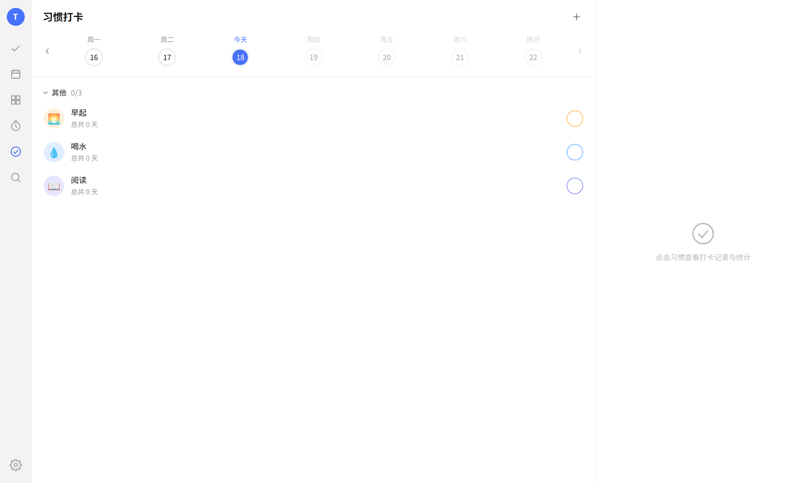

<p align="center"></p>

<h1 align="center">TickDone</h1>

<p align="center">To-do-Liste und Zeitmanagement-Tool, das in deinem Browser läuft: Aufgaben, Kalender, Eisenhower-Matrix, Fokus-Timer und Gewohnheitstracker.</p>

<p align="center"><a href="https://tickdone.pages.dev"><b>TickDone öffnen → tickdone.pages.dev</b></a></p>

<p align="center">
  <a href="README.md">English</a> ·
  <a href="README.zh-CN.md">简体中文</a> ·
  <a href="README.zh-TW.md">繁體中文</a> ·
  <a href="README.ja.md">日本語</a> ·
  <a href="README.ko.md">한국어</a> ·
  <a href="README.es.md">Español</a> ·
  <a href="README.fr.md">Français</a> ·
  <b>Deutsch</b> ·
  <a href="README.pt-BR.md">Português (Brasil)</a> ·
  <a href="README.ru.md">Русский</a>
</p>


| Kalender | Eisenhower-Matrix |
|---|---|
|  |  |
| **Fokus-Timer** | **Gewohnheitstracker** |
|  |  |

## Funktionen

- **Aufgaben**: Eingang, Heute, Morgen, Nächste 7 Tage, Alle, Erledigt, Verworfen und Papierkorb; eigene Listen, Ordner und Tags; Unteraufgaben, Notizen, Prioritäten, Fälligkeitsdatum und -uhrzeit, Erinnerungen und Wiederholungsregeln; Anheften; ein Kontextmenü für jede Aufgabe; Rückgängigmachen nach dem Erledigen oder Löschen.
- **Schnelleingabe**, die versteht, was du tippst, und es hervorhebt: `call mom tomorrow 3pm !high #family ~Personal` setzt Datum, Uhrzeit, Priorität, Tag und Liste in einer Zeile.
- **Listen- und Kanban-Ansicht** mit Gruppierung und Sortierung.
- **Kalender** mit Monats-, Wochen- und Tagesansicht.
- **Eisenhower-Matrix**, um Aufgaben nach Dringlichkeit und Wichtigkeit einzuordnen.
- **Fokus-Timer** mit Pomodoro- und Stoppuhr-Modus und einem Verlauf vergangener Sitzungen.
- **Gewohnheitstracker** mit Check-ins, Serien und Statistiken.
- **Suche**, Tastenkürzel und dunkles Design.

Deine Daten bleiben in deinem Browser (localStorage). Es gibt kein Konto, und nichts wird an einen Server gesendet.

### Tastenkürzel

| Taste | Aktion |
|---|---|
| `N` | Neue Aufgabe |
| `Ctrl/⌘ F` | Suche |
| `Alt 1`–`Alt 6` | Modul wechseln |
| `Ctrl/⌘ Z` | Rückgängig, solange die Rückgängig-Meldung angezeigt wird |
| `Esc` | Aufgabendetails schließen |
| `?` | Alle Tastenkürzel anzeigen |

## Roadmap

Jeder Punkt verlinkt auf sein Issue. Abgehakte Punkte sind auf [tickdone.pages.dev](https://tickdone.pages.dev) bereits live.

- [x] Aufgaben, Listen, Tags, Schnelleingabe, Kalender, Eisenhower-Matrix, Fokus-Timer und Gewohnheitstracker
- [x] CI mit Unit- und End-to-End-Tests ([#7](https://github.com/suica/tickdone/issues/7))
- [x] Open Source: README in 10 Sprachen, MIT-Lizenz, Projektregeln ([#10](https://github.com/suica/tickdone/issues/10))
- [ ] Layouts für Smartphones, Tablets und große Bildschirme ([#8](https://github.com/suica/tickdone/issues/8))
- [ ] Drag-and-drop überall ([#9](https://github.com/suica/tickdone/issues/9))
- [ ] Animationen ([#3](https://github.com/suica/tickdone/issues/3))
- [ ] GitHub-Link und Info-Bereich in der App ([#4](https://github.com/suica/tickdone/issues/4))
- [ ] Oberfläche in 10 Sprachen ([#14](https://github.com/suica/tickdone/issues/14))
- [ ] UI-Feinschliff, Bildschirm für Bildschirm ([#11](https://github.com/suica/tickdone/issues/11))
- [ ] Mehrfachauswahl und Stapelbearbeitung ([#15](https://github.com/suica/tickdone/issues/15))
- [ ] Tastaturnavigation in Aufgabenlisten ([#16](https://github.com/suica/tickdone/issues/16))
- [ ] Benachrichtigungen für Erinnerungen ([#17](https://github.com/suica/tickdone/issues/17))
- [ ] Als App installieren und offline nutzen ([#18](https://github.com/suica/tickdone/issues/18))
- [ ] Gespeicherte Filter ([#19](https://github.com/suica/tickdone/issues/19))
- [ ] Statistiken zu Aufgaben, Fokus-Timer und Gewohnheitstracker ([#20](https://github.com/suica/tickdone/issues/20))
- [ ] Markdown in Aufgabennotizen ([#21](https://github.com/suica/tickdone/issues/21))
- [ ] Zeitleistenansicht ([#22](https://github.com/suica/tickdone/issues/22))
- [ ] Mehr Wiederholungsregeln ([#23](https://github.com/suica/tickdone/issues/23))
- [ ] Listen archivieren ([#24](https://github.com/suica/tickdone/issues/24))
- [ ] Barrierefreiheit ([#25](https://github.com/suica/tickdone/issues/25))
- [ ] Schnell auch bei Tausenden von Aufgaben ([#26](https://github.com/suica/tickdone/issues/26))
- [ ] Designs und Akzentfarben ([#27](https://github.com/suica/tickdone/issues/27))
- [ ] Kalender: Aufgaben ohne Datum einplanen, Agenda-Ansicht ([#28](https://github.com/suica/tickdone/issues/28))

## Entwicklung

Benötigt Node.js 24.

```sh
npm install
npm run dev        # dev server at http://localhost:5173
npm run lint       # oxlint
npm test           # unit tests (Vitest)
npx playwright install chromium
npm run e2e        # end-to-end tests (Playwright)
npm run build      # type check and production build into dist/
```

Gebaut mit React 19, TypeScript, Vite und date-fns.

## Deployment

Die Live-Seite läuft auf Cloudflare Pages:

```sh
npm run build
npx wrangler pages deploy dist --project-name tickdone --branch main
```

## Mitwirken

Issues und Pull Requests sind willkommen. Bitte lies zuerst [AGENTS.md](AGENTS.md): Dort stehen die Projektregeln (Englisch als Arbeitssprache, Übersetzungen für alle unterstützten Sprachen, responsive Layouts, Konventionen für Animationen und Drag-and-drop sowie die CI, die jeder PR bestehen muss).

## Lizenz

[MIT](LICENSE)
