<div align="center">

<a href="https://tickdone.pages.dev"></a>

<h1>TickDone</h1>

<p><b>Planifica tu día, céntrate en lo importante y crea hábitos que duren, directamente en tu navegador.</b></p>

<p>
  <a href="https://github.com/suica/tickdone/actions/workflows/ci.yml"></a>
  <a href="LICENSE"></a>
  <a href="https://tickdone.pages.dev"></a>
  <a href="#-idiomas"></a>
  <a href="#-cómo-contribuir"></a>
</p>

<p>
  <a href="README.md">English</a> ·
  <a href="README.zh-CN.md">简体中文</a> ·
  <a href="README.zh-TW.md">繁體中文</a> ·
  <a href="README.ja.md">日本語</a> ·
  <a href="README.ko.md">한국어</a> ·
  <b>Español</b> ·
  <a href="README.fr.md">Français</a> ·
  <a href="README.de.md">Deutsch</a> ·
  <a href="README.pt-BR.md">Português (Brasil)</a> ·
  <a href="README.ru.md">Русский</a>
</p>

<a href="https://tickdone.pages.dev">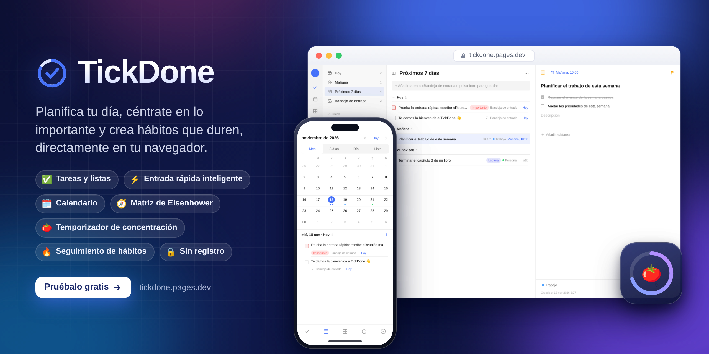</a>

<p>
  <a href="https://tickdone.pages.dev"><b>Abrir la app</b></a> ·
  <a href="#-funciones"><b>Funciones</b></a> ·
  <a href="#-inicio-rápido"><b>Inicio rápido</b></a> ·
  <a href="#️-hoja-de-ruta"><b>Hoja de ruta</b></a> ·
  <a href="#-cómo-contribuir"><b>Cómo contribuir</b></a>
</p>

</div>

TickDone es una lista de tareas y un gestor del tiempo gratuito y de código abierto que funciona en tu navegador. Apunta tus tareas tal como las dirías, organízalas en el calendario, clasifícalas por urgencia e importancia, sácalas adelante con un temporizador de concentración y mantén tus hábitos, todo en un mismo lugar.

> [!NOTE]
> **Tus datos son tuyos.** Todo se guarda en el almacenamiento local de tu navegador: no hay cuenta ni registro, y tus tareas nunca salen de tu dispositivo. Lo único que pasa por el servidor de TickDone es la dirección de un calendario al que te suscribes, que un pequeño proxy descarga por ti sin guardar nada. Puedes exportar una copia de seguridad cuando quieras desde Ajustes.

## ✨ Funciones

- ✅ **Tareas y listas**: Hoy, Mañana, Próximos 7 días y Bandeja de entrada, además de Completadas, Descartadas y Papelera; tus propias listas, carpetas y etiquetas; subtareas, notas, prioridades, fechas y horas de vencimiento, recordatorios y reglas de repetición; tareas fijadas y menú contextual en cada tarea.
- ⚡ **Entrada rápida inteligente**: escribe `call mom tomorrow 3pm !high #family ~Personal` y TickDone asigna la fecha, la hora, la prioridad, la etiqueta y la lista, y resalta cada parte mientras escribes. También entiende chino.
- 🗂️ **Vistas de lista y kanban**, con agrupación y ordenación.
- 📅 **Calendario** con vistas de mes, semana, día y lista. Arrastra una tarea a otro día u otra hora, o arrastra el borde inferior de un bloque para cambiar su duración.
- 🔔 **Suscripciones a calendarios**: suscríbete a cualquier calendario que publique una dirección iCal (.ics o webcal://), como los de trabajo, clase, equipo o festivos, y ve sus eventos en el calendario, en solo lectura y con su propio color. Se actualizan solos y siguen disponibles sin conexión.
- 🧭 **Matriz de Eisenhower**: clasifica las tareas según su urgencia e importancia, y arrástralas entre cuadrantes para cambiar su prioridad.
- 🍅 **Temporizador de concentración** con modos Pomodoro y cronómetro, y un historial de sesiones anteriores.
- 🔥 **Seguimiento de hábitos** con registros, rachas y estadísticas.
- 🔍 **Búsqueda** en tareas, etiquetas y listas.
- ↩️ **Deshacer** desde el aviso después de completar, eliminar o mover una tarea.
- ⌨️ **Atajos de teclado** y 🌙 **tema oscuro**.
- 💾 **Copia de seguridad y restauración**: exporta todo a un archivo JSON y vuelve a importarlo.

## 📸 Capturas de pantalla

<table>
  <tr>
    <td colspan="2">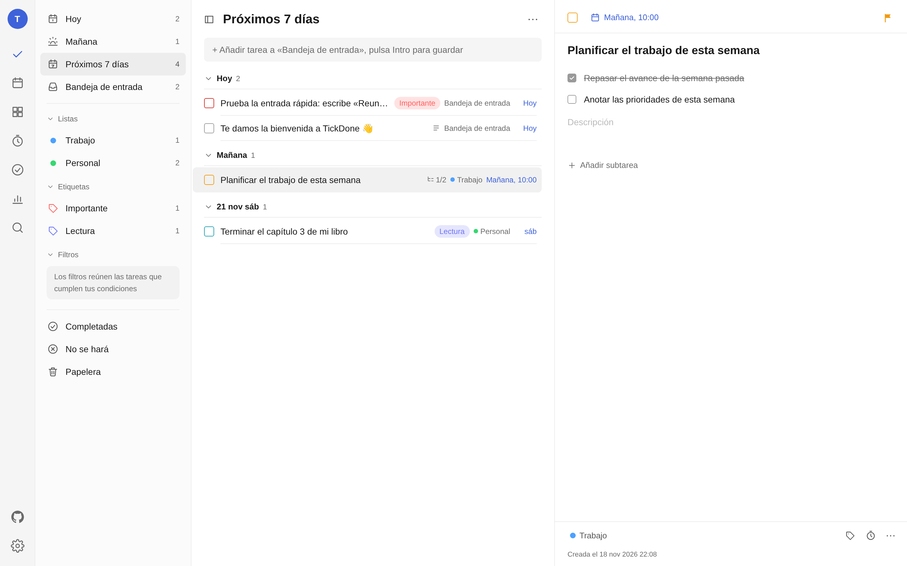</td>
  </tr>
  <tr>
    <th>Calendario</th>
    <th>Matriz</th>
  </tr>
  <tr>
    <td>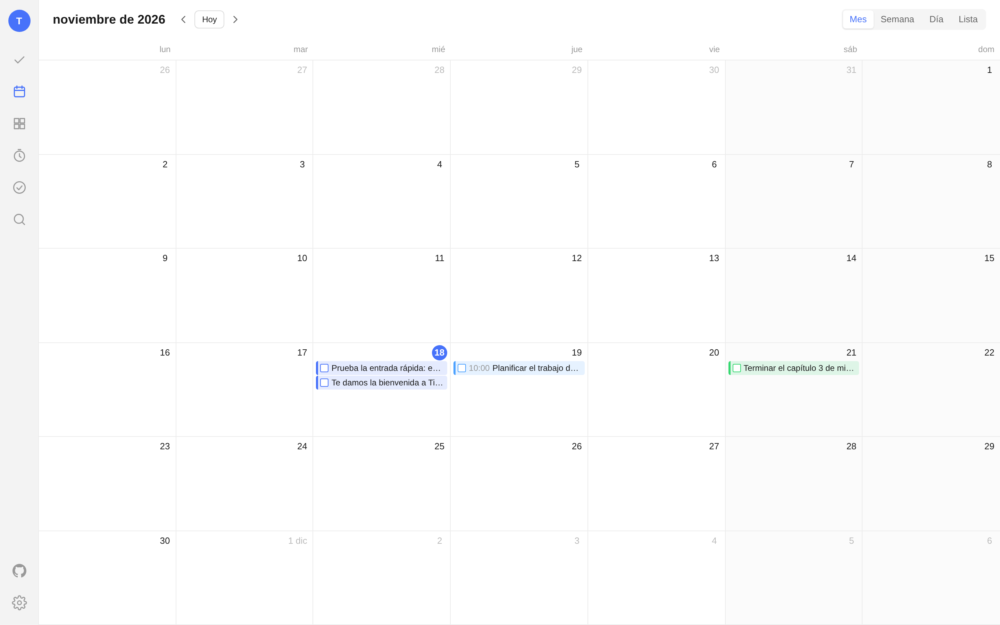</td>
    <td>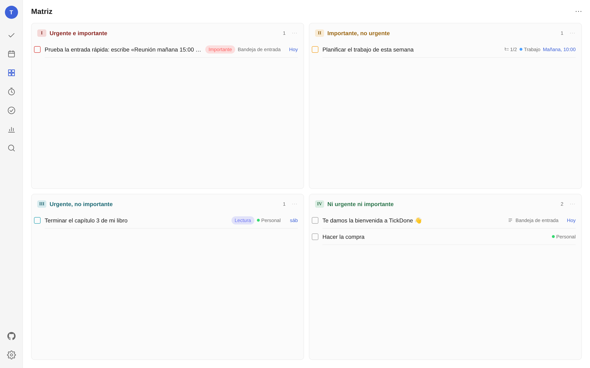</td>
  </tr>
  <tr>
    <th>Concentración</th>
    <th>Hábitos</th>
  </tr>
  <tr>
    <td>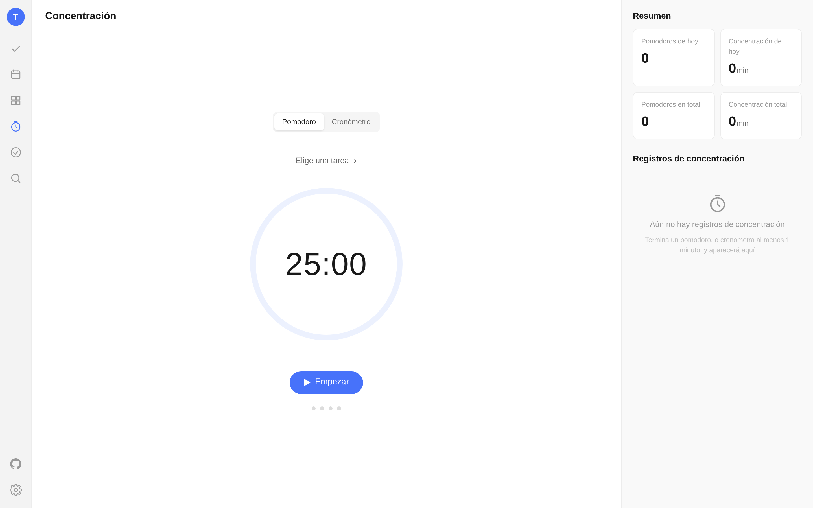</td>
    <td>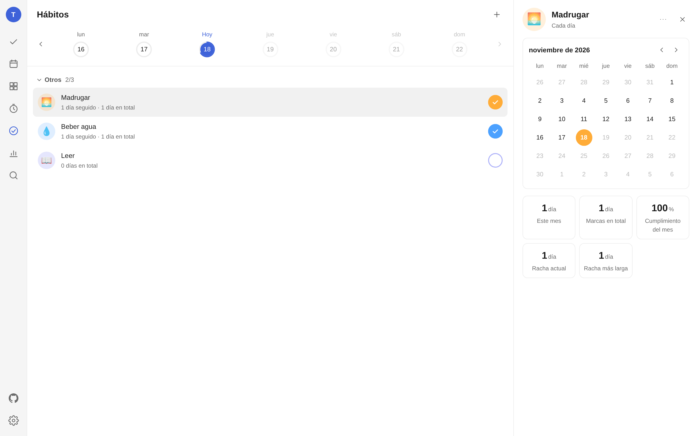</td>
  </tr>
</table>

<table>
  <tr>
    <td>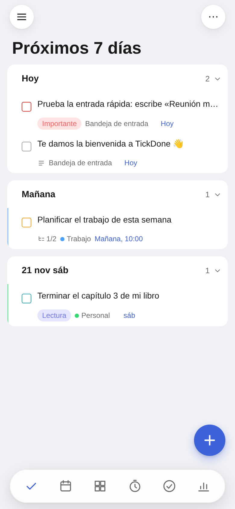</td>
    <td>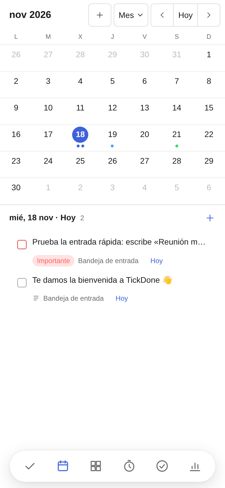</td>
    <td>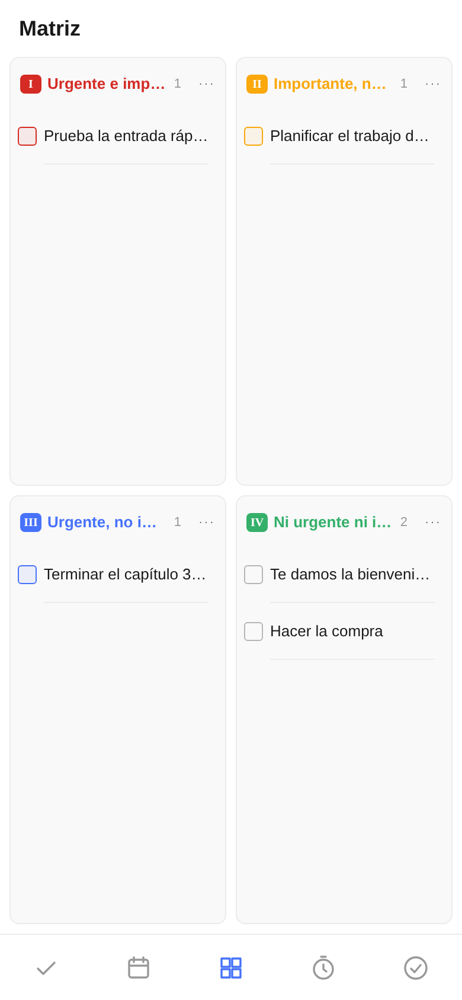</td>
    <td>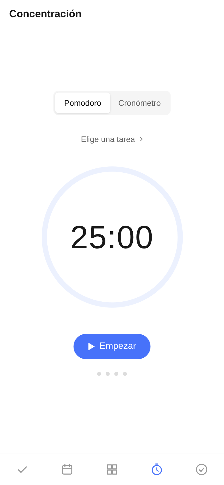</td>
    <td>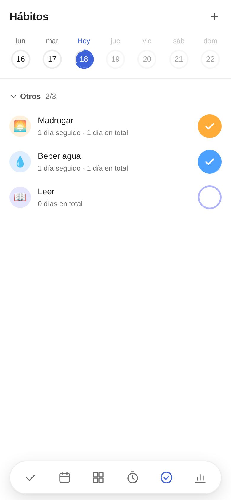</td>
  </tr>
</table>

## 🚀 Inicio rápido

**Úsala en línea:** abre [tickdone.pages.dev](https://tickdone.pages.dev). No hay nada que instalar.

**Ejecútala en local** (requiere Node.js 24):

```sh
git clone https://github.com/suica/tickdone.git
cd tickdone
npm install
npm run dev        # http://localhost:5173
```

## ⌨️ Atajos de teclado

| Tecla | Acción |
|---|---|
| `N` | Nueva tarea |
| `Ctrl/⌘ F` | Buscar |
| `Alt 1`–`Alt 6` | Cambiar de módulo |
| `Ctrl/⌘ Z` | Deshacer, mientras se muestra el aviso para deshacer |
| `Esc` | Cerrar los detalles de la tarea |
| `?` | Ver todos los atajos |

## 🌍 Idiomas

Este README está disponible en 10 idiomas: English, 简体中文, 繁體中文, 日本語, 한국어, Español, Français, Deutsch, Português (Brasil) y Русский. Toda la interfaz está traducida a esos mismos 10 idiomas. TickDone usa el idioma de tu navegador y puedes cambiarlo cuando quieras en Ajustes. La entrada rápida entiende fechas escritas en inglés o chino y palabras de prioridad en los 10 idiomas.

¿Has visto una traducción poco natural? El inglés es el idioma de origen: corrige el texto en `src/i18n/` o en `README.<locale>.md` y abre una pull request.

## 🗺️ Hoja de ruta

Cada elemento enlaza a su issue. Los elementos marcados ya están disponibles en [tickdone.pages.dev](https://tickdone.pages.dev).

- [x] Tareas, listas, etiquetas, entrada rápida, calendario, matriz de Eisenhower, temporizador de concentración y seguimiento de hábitos
- [x] CI con pruebas unitarias y de extremo a extremo ([#7](https://github.com/suica/tickdone/issues/7))
- [x] Código abierto: README en 10 idiomas, licencia MIT, reglas del proyecto ([#10](https://github.com/suica/tickdone/issues/10))
- [ ] Diseños para móviles, tabletas y pantallas grandes ([#8](https://github.com/suica/tickdone/issues/8))
- [ ] Arrastrar y soltar en toda la app ([#9](https://github.com/suica/tickdone/issues/9))
- [ ] Animaciones ([#3](https://github.com/suica/tickdone/issues/3))
- [x] Enlace a GitHub y sección Acerca de en la app ([#4](https://github.com/suica/tickdone/issues/4))
- [x] Interfaz en 10 idiomas ([#14](https://github.com/suica/tickdone/issues/14))
- [ ] Pulido de la interfaz, pantalla por pantalla ([#11](https://github.com/suica/tickdone/issues/11))
- [ ] Selección múltiple y edición en lote ([#15](https://github.com/suica/tickdone/issues/15))
- [ ] Navegación con el teclado en las listas de tareas ([#16](https://github.com/suica/tickdone/issues/16))
- [ ] Notificaciones de recordatorios ([#17](https://github.com/suica/tickdone/issues/17))
- [ ] Instalar como app y usar sin conexión ([#18](https://github.com/suica/tickdone/issues/18))
- [ ] Filtros guardados ([#19](https://github.com/suica/tickdone/issues/19))
- [ ] Estadísticas de tareas, del temporizador de concentración y del seguimiento de hábitos ([#20](https://github.com/suica/tickdone/issues/20))
- [ ] Markdown en las notas de las tareas ([#21](https://github.com/suica/tickdone/issues/21))
- [ ] Vista de línea de tiempo ([#22](https://github.com/suica/tickdone/issues/22))
- [ ] Más reglas de repetición ([#23](https://github.com/suica/tickdone/issues/23))
- [ ] Archivar listas ([#24](https://github.com/suica/tickdone/issues/24))
- [ ] Accesibilidad ([#25](https://github.com/suica/tickdone/issues/25))
- [ ] Rápido incluso con miles de tareas ([#26](https://github.com/suica/tickdone/issues/26))
- [ ] Temas y colores de acento ([#27](https://github.com/suica/tickdone/issues/27))
- [ ] Calendario: planificar tareas sin fecha, vista de agenda ([#28](https://github.com/suica/tickdone/issues/28))
- [x] Suscripciones a calendarios ([#51](https://github.com/suica/tickdone/issues/51))

## 🧰 Tecnologías

| Parte | Hecho con |
|---|---|
| ⚛️ Interfaz | React 19 y TypeScript |
| 📆 Fechas | date-fns, la única dependencia en tiempo de ejecución además de React |
| ⚡ Compilación | Vite |
| 💾 Almacenamiento | `localStorage` en el navegador, sin backend |
| 🧪 Pruebas | Vitest (unitarias) y Playwright (de extremo a extremo) |
| 🧹 Lint | oxlint |
| ☁️ Alojamiento | Cloudflare Pages |

## 🛠️ Desarrollo

```sh
npm install
npm run dev        # dev server at http://localhost:5173
npm run lint       # oxlint
npm test           # unit tests (Vitest)
npx playwright install chromium
npm run e2e        # end-to-end tests (Playwright)
npm run build      # type check and production build into dist/
```

- 🖼️ El banner y las capturas de los README se generan a partir de una compilación de producción: `npm run build` y después `node scripts/promo/render.mjs` (las opciones están al principio del [script](scripts/promo/render.mjs)).
- 🗺️ `node scripts/roadmap.mjs done <issue>` marca un elemento de la hoja de ruta en todos los README.

## 🚢 Despliegue

El sitio en producción está en Cloudflare Pages:

```sh
npm run build
npx wrangler pages deploy dist --project-name tickdone --branch main
```

## 🤝 Cómo contribuir

¡Las issues y las pull requests son bienvenidas! Antes de empezar, lee [AGENTS.md](AGENTS.md). Ahí están las reglas del proyecto, tanto para personas como para agentes de programación:

- 💬 cada cambio empieza con una issue y entra mediante una pull request que la menciona;
- 🌐 el inglés es el idioma de trabajo, y cada texto visible para el usuario se traduce a los 10 idiomas;
- 📐 las pantallas funcionan en cualquier ancho, de un móvil de 360 px a una pantalla de 2560 px, con convenciones comunes para las animaciones y el arrastrar y soltar;
- ✅ la CI (lint, comprobación de tipos y compilación, pruebas unitarias y de extremo a extremo) tiene que estar en verde antes de fusionar.

Si TickDone te ayuda a sacar las cosas adelante, una ⭐ en GitHub ayuda a que otras personas lo encuentren.

## 📄 Licencia

[MIT](LICENSE) © 2026 suica
