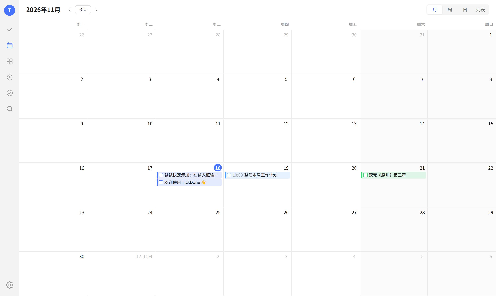
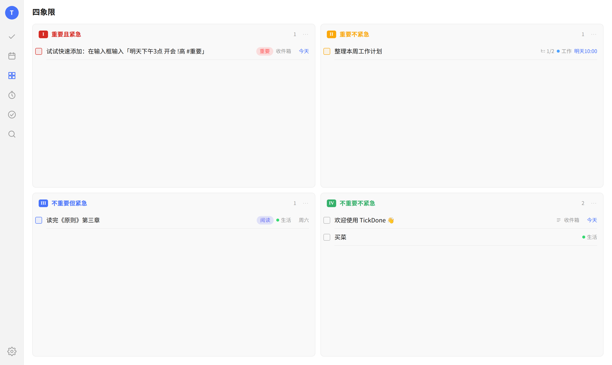

<p align="center"></p>

<h1 align="center">TickDone</h1>

<p align="center">Liste de tâches et gestion du temps, directement dans votre navigateur : tâches, calendrier, matrice d'Eisenhower, minuteur de concentration et suivi des habitudes.</p>

<p align="center"><a href="https://tickdone.pages.dev"><b>Ouvrir TickDone → tickdone.pages.dev</b></a></p>

<p align="center">
  <a href="README.md">English</a> ·
  <a href="README.zh-CN.md">简体中文</a> ·
  <a href="README.zh-TW.md">繁體中文</a> ·
  <a href="README.ja.md">日本語</a> ·
  <a href="README.ko.md">한국어</a> ·
  <a href="README.es.md">Español</a> ·
  <b>Français</b> ·
  <a href="README.de.md">Deutsch</a> ·
  <a href="README.pt-BR.md">Português (Brasil)</a> ·
  <a href="README.ru.md">Русский</a>
</p>


| Calendrier | Matrice d'Eisenhower |
|---|---|
|  |  |
| **Minuteur de concentration** | **Suivi des habitudes** |
|  |  |

## Fonctionnalités

- **Tâches** : Boîte de réception, Aujourd'hui, Demain, 7 prochains jours, Toutes, Terminées, Abandonnées et Corbeille ; vos propres listes, dossiers et étiquettes ; sous-tâches, notes, priorités, dates et heures d'échéance, rappels et règles de répétition ; épinglage ; un menu contextuel sur chaque tâche ; annulation après avoir terminé ou supprimé une tâche.
- **Ajout rapide** qui comprend ce que vous tapez et le met en surbrillance : `call mom tomorrow 3pm !high #family ~Personal` définit la date, l'heure, la priorité, l'étiquette et la liste en une seule ligne.
- **Vues liste et kanban**, avec regroupement et tri.
- **Calendrier** avec vues mois, semaine et jour.
- **Matrice d'Eisenhower** pour classer les tâches selon leur urgence et leur importance.
- **Minuteur de concentration** avec modes Pomodoro et chronomètre, et un historique des sessions passées.
- **Suivi des habitudes** avec validations, séries et statistiques.
- **Recherche**, raccourcis clavier et thème sombre.

Vos données restent dans votre navigateur (localStorage). Pas de compte, et rien n'est envoyé à un serveur.

### Raccourcis clavier

| Touche | Action |
|---|---|
| `N` | Nouvelle tâche |
| `Ctrl/⌘ F` | Rechercher |
| `Alt 1`–`Alt 6` | Changer de module |
| `Ctrl/⌘ Z` | Annuler, tant que la notification d'annulation est affichée |
| `Esc` | Fermer les détails de la tâche |
| `?` | Afficher tous les raccourcis |

## Développement

Nécessite Node.js 24.

```sh
npm install
npm run dev        # dev server at http://localhost:5173
npm run lint       # oxlint
npm test           # unit tests (Vitest)
npx playwright install chromium
npm run e2e        # end-to-end tests (Playwright)
npm run build      # type check and production build into dist/
```

Développé avec React 19, TypeScript, Vite et date-fns.

## Déploiement

Le site en ligne est hébergé sur Cloudflare Pages :

```sh
npm run build
npx wrangler pages deploy dist --project-name tickdone --branch main
```

## Contribuer

Les issues et les pull requests sont les bienvenues. Lisez d'abord [AGENTS.md](AGENTS.md) : vous y trouverez les règles du projet (l'anglais comme langue de travail, des traductions pour chaque langue prise en charge, des mises en page adaptatives, les conventions d'animation et de glisser-déposer, et la CI que chaque PR doit passer).

## Licence

[MIT](LICENSE)
