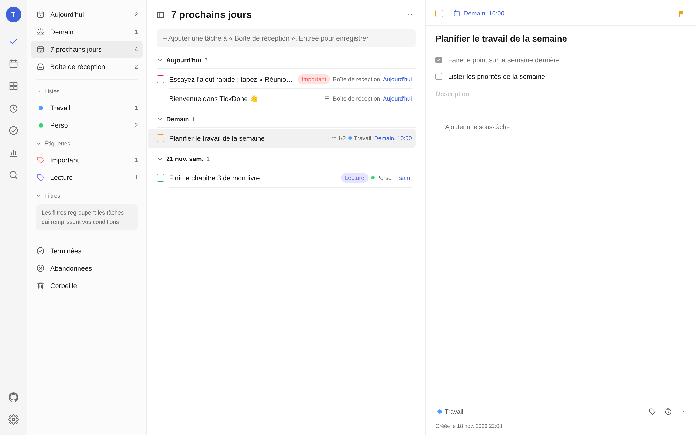
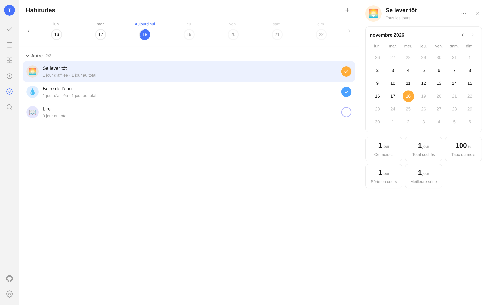
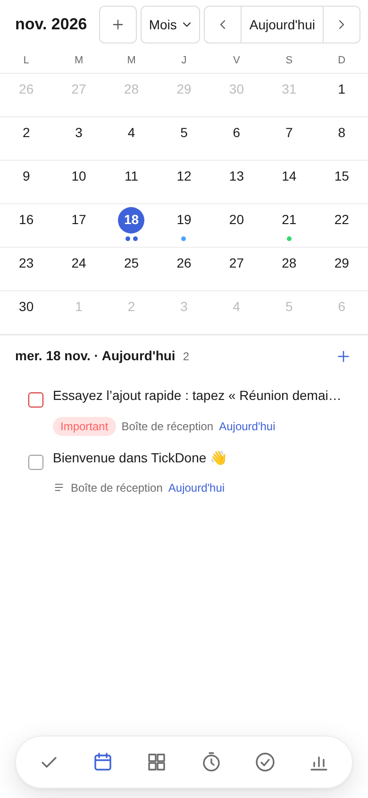
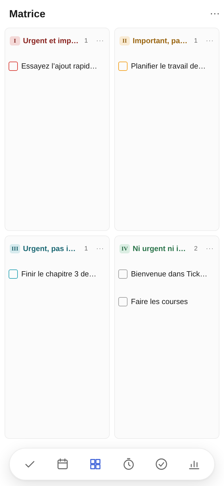
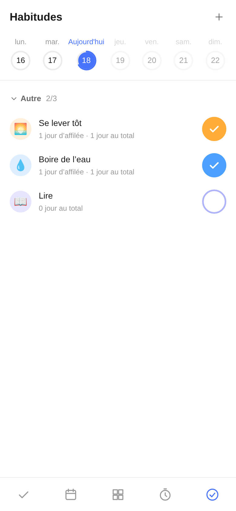

<div align="center">

<a href="https://tickdone.pages.dev"></a>

<h1>TickDone</h1>

<p><b>Planifiez votre journée, concentrez-vous sur l'essentiel et gardez de bonnes habitudes, directement dans votre navigateur.</b></p>

<p>
  <a href="https://github.com/suica/tickdone/actions/workflows/ci.yml"></a>
  <a href="LICENSE"></a>
  <a href="https://tickdone.pages.dev"></a>
  <a href="#-langues"></a>
  <a href="#-contribuer"></a>
</p>

<p>
  <a href="README.md">English</a> ·
  <a href="README.zh-CN.md">简体中文</a> ·
  <a href="README.zh-TW.md">繁體中文</a> ·
  <a href="README.ja.md">日本語</a> ·
  <a href="README.ko.md">한국어</a> ·
  <a href="README.es.md">Español</a> ·
  <b>Français</b> ·
  <a href="README.de.md">Deutsch</a> ·
  <a href="README.pt-BR.md">Português (Brasil)</a> ·
  <a href="README.ru.md">Русский</a>
</p>

<a href="https://tickdone.pages.dev"></a>

<p>
  <a href="https://tickdone.pages.dev"><b>Ouvrir l'application</b></a> ·
  <a href="#-fonctionnalités"><b>Fonctionnalités</b></a> ·
  <a href="#-démarrage-rapide"><b>Démarrage rapide</b></a> ·
  <a href="#️-feuille-de-route"><b>Feuille de route</b></a> ·
  <a href="#-contribuer"><b>Contribuer</b></a>
</p>

</div>

TickDone est une liste de tâches et un outil de gestion du temps, gratuit et open source, qui fonctionne dans votre navigateur. Notez vos tâches comme elles vous viennent, placez-les dans le calendrier, classez-les selon leur urgence et leur importance, avancez avec un minuteur de concentration et tenez vos habitudes, le tout au même endroit.

> [!NOTE]
> **Vos données restent chez vous.** Tout est enregistré dans le stockage local de votre navigateur : pas de compte, pas d'inscription, et vos tâches ne quittent jamais votre appareil. Seule l'adresse d'un calendrier auquel vous vous abonnez passe par le serveur de TickDone : un petit proxy le récupère pour vous sans rien conserver. Vous pouvez exporter une sauvegarde à tout moment depuis les Réglages.

## ✨ Fonctionnalités

- ✅ **Tâches et listes** : Aujourd'hui, Demain, 7 prochains jours et Boîte de réception, ainsi que Terminées, Abandonnées et Corbeille ; vos propres listes, dossiers et étiquettes ; sous-tâches, notes, priorités, dates et heures d'échéance, rappels et règles de répétition ; épinglage et menu contextuel sur chaque tâche.
- ⚡ **Ajout rapide intelligent** : tapez `call mom tomorrow 3pm !high #family ~Personal` et TickDone définit la date, l'heure, la priorité, l'étiquette et la liste, en surlignant chaque élément pendant la saisie. Il comprend aussi le chinois.
- 🗂️ **Vues liste et kanban**, avec regroupement et tri.
- 📅 **Calendrier** avec vues mois, semaine, jour et liste. Faites glisser une tâche vers un autre jour ou une autre heure, ou tirez le bord inférieur d'un bloc pour changer sa durée.
- 🔔 **Abonnements à des calendriers** : abonnez-vous à tout calendrier qui publie une adresse iCal (.ics ou webcal://), comme ceux du travail, de l’école, de l’équipe ou des jours fériés, et voyez ses événements dans le calendrier, en lecture seule et dans leur propre couleur. Ils se mettent à jour d’eux-mêmes et restent disponibles hors ligne.
- 🧭 **Matrice d'Eisenhower** : classez les tâches selon leur urgence et leur importance, et faites-les glisser d'un quadrant à l'autre pour changer leur priorité.
- 🍅 **Minuteur de concentration** avec modes Pomodoro et chronomètre, et un historique des sessions passées.
- 🔥 **Suivi des habitudes** avec validations, séries et statistiques.
- 🔍 **Recherche** dans les tâches, les étiquettes et les listes.
- ↩️ **Annulation** depuis la notification après avoir terminé, supprimé ou déplacé une tâche.
- ⌨️ **Raccourcis clavier** et 🌙 **thème sombre**.
- 💾 **Sauvegarde et restauration** : exportez tout dans un fichier JSON et réimportez-le.

## 📸 Captures d'écran

<table>
  <tr>
    <td colspan="2"></td>
  </tr>
  <tr>
    <th>Calendrier</th>
    <th>Matrice</th>
  </tr>
  <tr>
    <td></td>
    <td></td>
  </tr>
  <tr>
    <th>Concentration</th>
    <th>Habitudes</th>
  </tr>
  <tr>
    <td></td>
    <td></td>
  </tr>
</table>

<table>
  <tr>
    <td></td>
    <td></td>
    <td></td>
    <td></td>
    <td></td>
  </tr>
</table>

## 🚀 Démarrage rapide

**En ligne :** ouvrez [tickdone.pages.dev](https://tickdone.pages.dev). Rien à installer.

**En local** (Node.js 24 requis) :

```sh
git clone https://github.com/suica/tickdone.git
cd tickdone
npm install
npm run dev        # http://localhost:5173
```

## ⌨️ Raccourcis clavier

| Touche | Action |
|---|---|
| `N` | Nouvelle tâche |
| `Ctrl/⌘ F` | Rechercher |
| `Alt 1`–`Alt 6` | Changer de module |
| `Ctrl/⌘ Z` | Annuler, tant que la notification d'annulation est affichée |
| `Esc` | Fermer les détails de la tâche |
| `?` | Afficher tous les raccourcis |

## 🌍 Langues

Ce README existe en 10 langues : English, 简体中文, 繁體中文, 日本語, 한국어, Español, Français, Deutsch, Português (Brasil) et Русский. Toute l'interface est traduite dans ces 10 langues. TickDone suit la langue de votre navigateur, et vous pouvez en changer à tout moment dans les Réglages. L'ajout rapide comprend les dates écrites en anglais ou en chinois, et les mots de priorité dans les 10 langues.

Une traduction vous semble maladroite ? L'anglais fait foi : corrigez le texte dans `src/i18n/` ou dans `README.<locale>.md` et ouvrez une pull request.

## 🗺️ Feuille de route

Chaque élément renvoie vers son issue. Les éléments cochés sont déjà en ligne sur [tickdone.pages.dev](https://tickdone.pages.dev).

- [x] Tâches, listes, étiquettes, ajout rapide, calendrier, matrice d'Eisenhower, minuteur de concentration et suivi des habitudes
- [x] CI avec tests unitaires et de bout en bout ([#7](https://github.com/suica/tickdone/issues/7))
- [x] Open source : README en 10 langues, licence MIT, règles du projet ([#10](https://github.com/suica/tickdone/issues/10))
- [x] Mises en page pour téléphones, tablettes et grands écrans ([#8](https://github.com/suica/tickdone/issues/8))
- [x] Glisser-déposer partout ([#9](https://github.com/suica/tickdone/issues/9))
- [x] Animations ([#3](https://github.com/suica/tickdone/issues/3))
- [x] Lien GitHub et section « À propos » dans l'app ([#4](https://github.com/suica/tickdone/issues/4))
- [x] Interface en 10 langues ([#14](https://github.com/suica/tickdone/issues/14))
- [x] Finitions de l'interface, écran par écran ([#11](https://github.com/suica/tickdone/issues/11))
- [ ] Sélection multiple et modification groupée ([#15](https://github.com/suica/tickdone/issues/15))
- [ ] Navigation au clavier dans les listes de tâches ([#16](https://github.com/suica/tickdone/issues/16))
- [ ] Notifications de rappel ([#17](https://github.com/suica/tickdone/issues/17))
- [ ] Installation comme application et utilisation hors ligne ([#18](https://github.com/suica/tickdone/issues/18))
- [ ] Filtres enregistrés ([#19](https://github.com/suica/tickdone/issues/19))
- [ ] Statistiques des tâches, du minuteur de concentration et du suivi des habitudes ([#20](https://github.com/suica/tickdone/issues/20))
- [ ] Markdown dans les notes des tâches ([#21](https://github.com/suica/tickdone/issues/21))
- [ ] Vue chronologique ([#22](https://github.com/suica/tickdone/issues/22))
- [ ] Plus de règles de répétition ([#23](https://github.com/suica/tickdone/issues/23))
- [ ] Archivage des listes ([#24](https://github.com/suica/tickdone/issues/24))
- [ ] Accessibilité ([#25](https://github.com/suica/tickdone/issues/25))
- [ ] Rapide même avec des milliers de tâches ([#26](https://github.com/suica/tickdone/issues/26))
- [ ] Thèmes et couleurs d'accentuation ([#27](https://github.com/suica/tickdone/issues/27))
- [ ] Calendrier : planifier les tâches sans date, vue agenda ([#28](https://github.com/suica/tickdone/issues/28))
- [x] Abonnements à des calendriers ([#51](https://github.com/suica/tickdone/issues/51))

## 🧰 Technologies

| Partie | Réalisée avec |
|---|---|
| ⚛️ Interface | React 19 et TypeScript |
| 📆 Dates | date-fns, la seule dépendance d'exécution en dehors de React |
| ⚡ Build | Vite |
| 💾 Stockage | `localStorage` dans le navigateur, sans backend |
| 🧪 Tests | Vitest (unitaires) et Playwright (de bout en bout) |
| 🧹 Lint | oxlint |
| ☁️ Hébergement | Cloudflare Pages |

## 🛠️ Développement

```sh
npm install
npm run dev        # dev server at http://localhost:5173
npm run lint       # oxlint
npm test           # unit tests (Vitest)
npx playwright install chromium
npm run e2e        # end-to-end tests (Playwright)
npm run build      # type check and production build into dist/
```

- 🖼️ La bannière et les captures des README sont générées à partir d'un build de production : `npm run build`, puis `node scripts/promo/render.mjs` (les options sont décrites en tête du [script](scripts/promo/render.mjs)).
- 🗺️ `node scripts/roadmap.mjs done <issue>` coche un élément de la feuille de route dans tous les README.

## 🚢 Déploiement

Le site en ligne est hébergé sur Cloudflare Pages :

```sh
npm run build
npx wrangler pages deploy dist --project-name tickdone --branch main
```

## 🤝 Contribuer

Les issues et les pull requests sont les bienvenues ! Avant de commencer, lisez [AGENTS.md](AGENTS.md) : il réunit les règles du projet, pour les personnes comme pour les agents de programmation.

- 💬 chaque changement part d'une issue et arrive par une pull request qui la mentionne ;
- 🌐 l'anglais est la langue de travail, et chaque texte visible par l'utilisateur est traduit dans les 10 langues ;
- 📐 les écrans fonctionnent à toutes les largeurs, d'un téléphone de 360 px à un écran de 2560 px, avec des conventions communes pour les animations et le glisser-déposer ;
- ✅ la CI (lint, vérification des types et build, tests unitaires et de bout en bout) doit être au vert avant toute fusion.

Si TickDone vous aide à avancer, une ⭐ sur GitHub aide d'autres personnes à le découvrir.

## 📄 Licence

[MIT](LICENSE) © 2026 suica
