<div align="center">

<a href="https://tickdone.pages.dev"></a>

<h1>TickDone</h1>

<p><b>1日の計画、大切なことへの集中、続く習慣づくりをブラウザひとつで。</b></p>

<p>
  <a href="https://github.com/suica/tickdone/actions/workflows/ci.yml"></a>
  <a href="LICENSE"></a>
  <a href="https://tickdone.pages.dev"></a>
  <a href="#-言語"></a>
  <a href="#-コントリビュート"></a>
</p>

<p>
  <a href="README.md">English</a> ·
  <a href="README.zh-CN.md">简体中文</a> ·
  <a href="README.zh-TW.md">繁體中文</a> ·
  <b>日本語</b> ·
  <a href="README.ko.md">한국어</a> ·
  <a href="README.es.md">Español</a> ·
  <a href="README.fr.md">Français</a> ·
  <a href="README.de.md">Deutsch</a> ·
  <a href="README.pt-BR.md">Português (Brasil)</a> ·
  <a href="README.ru.md">Русский</a>
</p>

<a href="https://tickdone.pages.dev">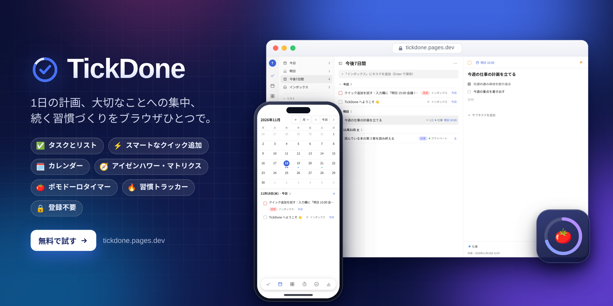</a>

<p>
  <a href="https://tickdone.pages.dev"><b>アプリを開く</b></a> ·
  <a href="#-機能"><b>機能</b></a> ·
  <a href="#-クイックスタート"><b>クイックスタート</b></a> ·
  <a href="#️-ロードマップ"><b>ロードマップ</b></a> ·
  <a href="#-コントリビュート"><b>コントリビュート</b></a>
</p>

</div>

TickDone は、ブラウザで動く無料・オープンソースの ToDo リスト兼時間管理アプリです。思いついたタスクをそのまま書き留め、カレンダーで予定を立て、緊急度と重要度で仕分けし、ポモドーロタイマーで集中して片づけ、習慣も続けられます。すべてがひとつの場所で完結します。

> [!NOTE]
> **データはあなたの手元に。** すべてブラウザのローカルストレージ（localStorage）に保存されます。アカウントも登録も不要で、タスクが端末の外に出ることはありません。TickDone のサーバーを通るのは購読するカレンダーのアドレスだけで、小さなプロキシがカレンダーを代わりに取得し、何も保存しません。バックアップファイルは「設定」からいつでも書き出せます。

## ✨ 機能

- ✅ **タスクとリスト**：今日、明日、今後7日間、インボックスに加えて、完了済み、やらない、ゴミ箱。自分で作れるリスト・フォルダ・タグ。サブタスク、メモ、優先度、期日と時刻、リマインダー、繰り返し設定。ピン留めと、すべてのタスクで使えるコンテキストメニュー。
- ⚡ **スマートなクイック追加**：`call mom tomorrow 3pm !high #family ~Personal` と入力するだけで、日付・時刻・優先度・タグ・リストが設定され、読み取った部分は入力中にハイライト表示されます。中国語での入力にも対応しています。
- 🗂️ **リスト表示とカンバン表示**：グループ化と並べ替えに対応。
- 📏 **タイムライン表示**：タスクは期間にわたるバー（1 日だけならひし形）で、セクションごとに並び、今日の線と日・週・月のズームがあります。バーをドラッグして移動、両端をドラッグして開始日と終了日を変更、「日付なし」パネルからタスクをドラッグして予定に入れられます。どの操作も元に戻せます。スマホではリストで表示します。
- 🗄️ **リストのアーカイブ**：終わったリストをメニューからアーカイブ。折りたたまれた「アーカイブ済みリスト」に移り、タスクはスマートリスト・カレンダー・マトリックス・検索から外れ、解除するまで読み取り専用で開きます。
- 🔎 **フィルター**：リスト、タグ、優先度、日付（期限切れ、今日、今週、期間指定など）、キーワード、完了したタスクを組み合わせて自分だけのスマートリストを作り、名前・アイコン・色付きでサイドバーに表示。
- 📝 **メモで Markdown**：見出し、太字、斜体、取り消し線、コード、リンク、リスト、引用、その場でチェックできるチェックリストに対応。`**太字**`、`# `、`- [ ] ` は入力した時点で書式に変わり、メモは Markdown のまま保存されます。
- 🔁 **繰り返しルール**：N 日・週・か月・年ごと、指定した曜日、毎月の N 日・月末・第 N／最終の曜日、毎年の日付、平日のみ。N 回後や指定日で終了、期日または完了日から計算、今回をスキップでき、クイック追加では「every 2 weeks」などの英語・中国語の表現も認識します。
- 📅 **カレンダー**：月・週・日・リストの表示。タスクを別の日や時刻へドラッグしたり、ブロックの下端をドラッグして所要時間を変えたりできます。
- 🗓️ **カレンダーで計画**：週表示と日表示の横にある「未定」パネル（スマートフォンでは下からのシート）に、日付のない未完了タスクがリストごとに絞り込んで表示されます。日付や時間にドラッグすれば予定に入り、パネルに戻せば日付が外れます。どちらもトーストから元に戻せます。予定一覧表示では、これからの日々のタスクと購読カレンダーの予定を1つのスクロールリストで見られます。
- 🔔 **カレンダー購読**：仕事、学校、チーム、祝日など、iCal アドレス（.ics または webcal://）を公開しているカレンダーを購読すると、その予定がそれぞれの色で閲覧専用としてカレンダーに表示されます。自動で更新され、オフラインでも見られます。
- 🧭 **アイゼンハワー・マトリクス**：緊急度と重要度でタスクを仕分け。象限をまたいでドラッグすると優先度が変わります。
- 🍅 **ポモドーロタイマー**：ポモドーロとストップウォッチの2つのモードを備え、過去のセッションも記録します。
- 🔥 **習慣トラッカー**：チェックイン、連続達成日数、統計。
- 📊 **統計**：日・週・月ごとの完了タスク数、完了率、期限切れのタスク、リスト・優先度・タグ別の内訳、連続日数。1日の集中時間、セッション数、タスク・リスト別の集中時間、集中しやすい時間帯。習慣の達成率と連続記録。週・月・年・30日間・任意の期間で表示でき、グラフにカーソルを合わせるかタップすると詳細が出ます。
- 🔍 **検索**：タスク・タグ・リストをまとめて検索。
- ↩️ **元に戻す**：タスクの完了・削除・移動のあと、通知から取り消せます。
- ⌨️ **キーボードショートカット**。
- ☑️ **複数選択と一括編集**：Ctrl/⌘ クリック、Shift クリック、Ctrl/⌘+A でタスクを選び、日付・優先度・リスト・タグをまとめて変更、まとめて完了・削除・ドラッグできます。一度の取り消しで全体を元に戻せます。スマートフォンでは長押しで選択を開始します。
- 🎨 **テーマとアクセントカラー**：ライト、ダーク、またはシステムに合わせる。ボタン、チェックボックス、選択状態、フォーカスリングに使うアクセントカラーは 8 色から選べます。変更はすぐに反映され、設定でライブプレビューでき、起動画面とタブのアイコンも追従します。
- ⏰ **リマインダー**：タスクのリマインダー時刻になると、完了・スヌーズ（5 分、15 分、1 時間、明日）・開くを選べるカードを表示し、許可すればシステム通知も出します。TickDone にはサーバーがないため、リマインダーはタブで開いているか、インストールして起動している間に届きます。閉じている間に時刻になったものは、次に開いたときに表示されます。
- 📲 **アプリとしてインストール**：「設定 → このアプリについて」から TickDone をホーム画面や Dock に追加でき、一度開けばオフラインでも起動します。新しいバージョンが出ると、再読み込みを案内します。
- 💾 **バックアップと復元**：すべてのデータを JSON ファイルに書き出し、あとで読み込み直せます。
- 🚀 **何千件のタスクでも軽快**：長いリストと検索結果は画面に見えている行だけを描画するので、5,000 件のタスクでもスクロール、切り替え、操作への反応が短いリストと同じ速さです。ドラッグ＆ドロップ、キーボード操作、複数選択、完了アニメーションもそのまま使えます。変更はバックグラウンドで保存されます。
- ♿ **アクセシビリティ**：すべての操作がキーボードででき、フォーカスがはっきり見え、メインコンテンツへのスキップリンクもあります。ダイアログ、メニュー、シートはフォーカスを中に保ち、閉じると元の場所に戻します。スクリーンリーダーにはランドマーク、見出し、名前付きのボタンとチェックボックスが伝わり、トーストはすべて読み上げられます。タスクは Alt+↑ / Alt+↓ やメニューから上下に移動でき、ドラッグの代わりになります。文字はライトでもダークでも WCAG AA のコントラストを満たし、ハイコントラストモードと視差効果を減らす設定にも対応します。すべての画面を自動でチェックしています。

## 📸 スクリーンショット

<table>
  <tr>
    <td colspan="2">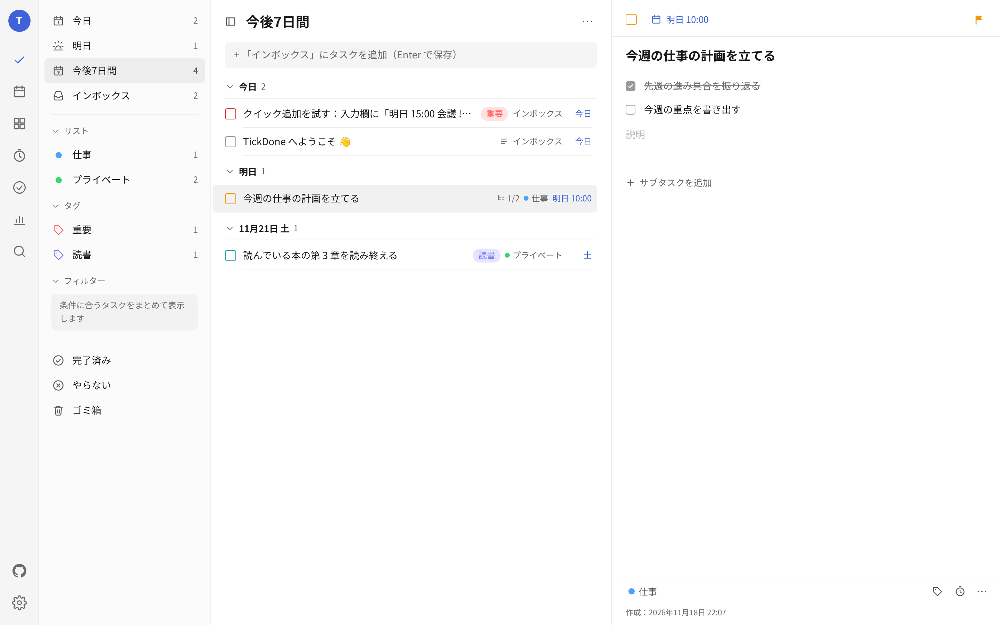</td>
  </tr>
  <tr>
    <th>カレンダー</th>
    <th>マトリクス</th>
  </tr>
  <tr>
    <td>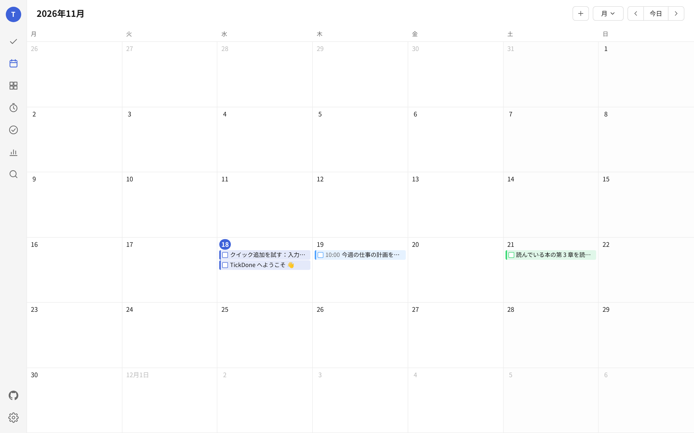</td>
    <td>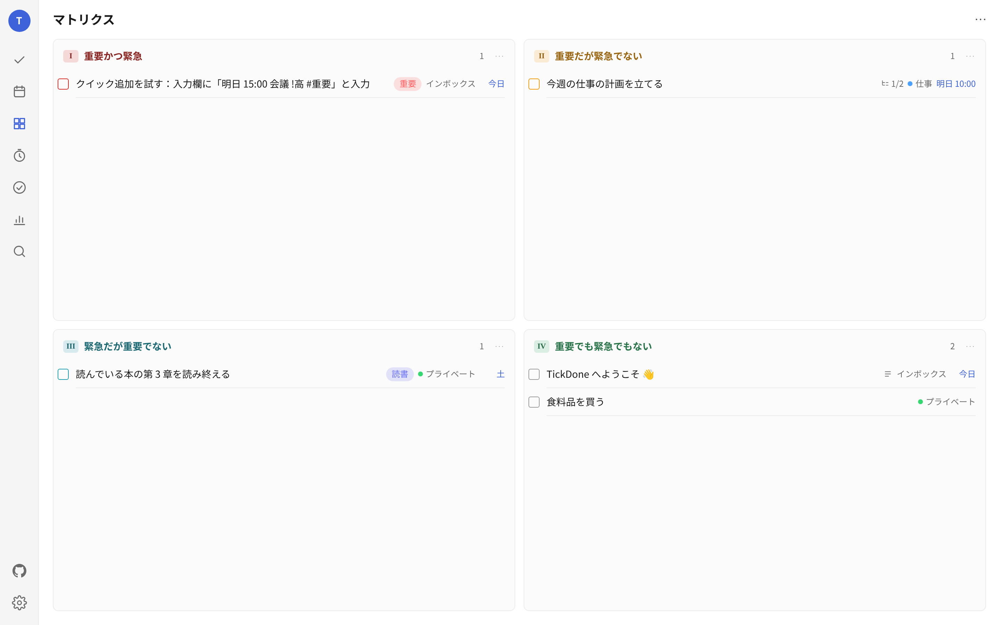</td>
  </tr>
  <tr>
    <th>集中</th>
    <th>習慣</th>
  </tr>
  <tr>
    <td>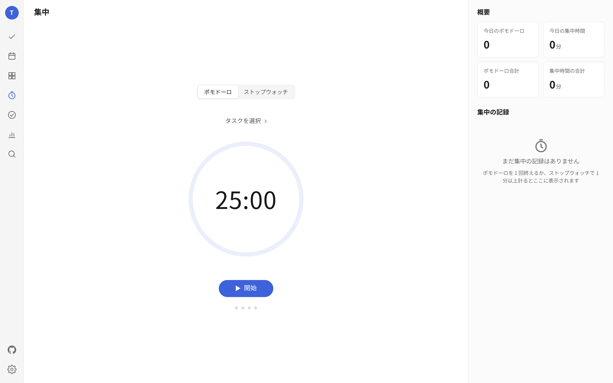</td>
    <td>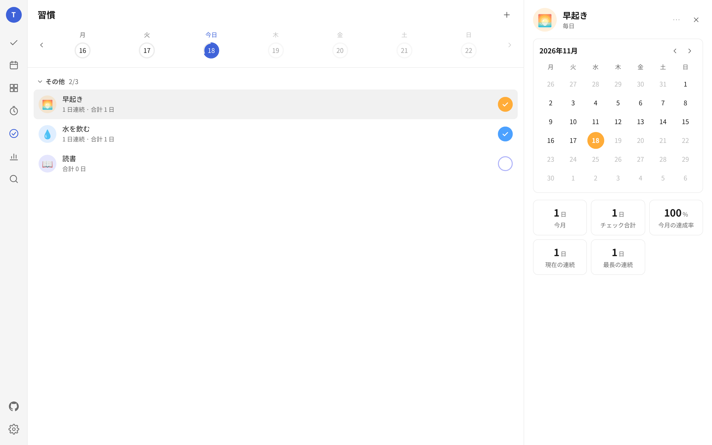</td>
  </tr>
  <tr>
    <th colspan="2">統計</th>
  </tr>
  <tr>
    <td colspan="2">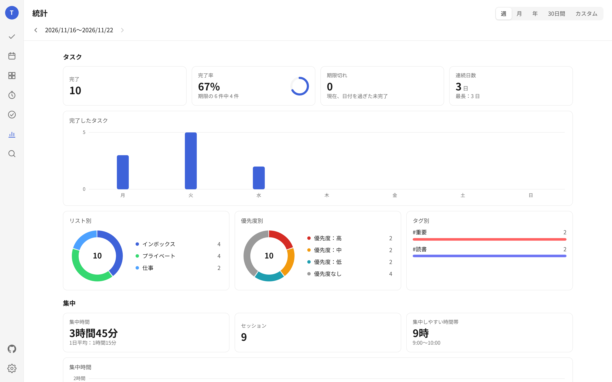</td>
  </tr>
</table>

<table>
  <tr>
    <td>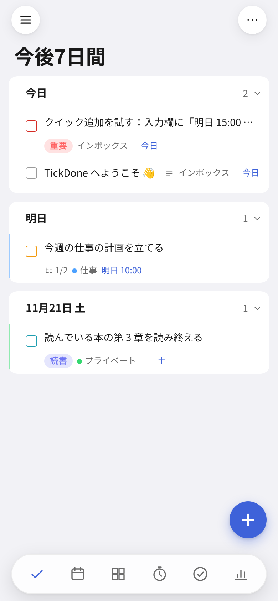</td>
    <td>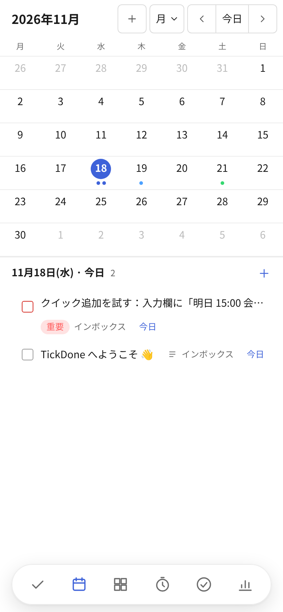</td>
    <td>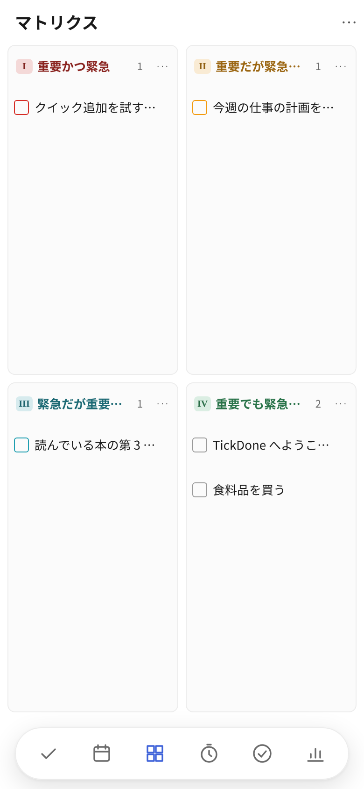</td>
    <td>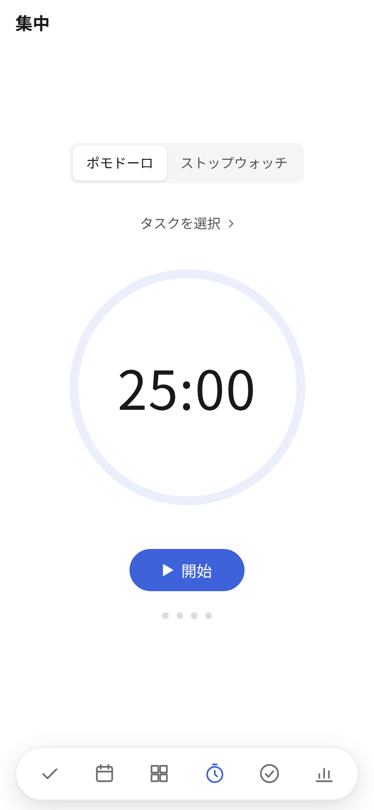</td>
    <td>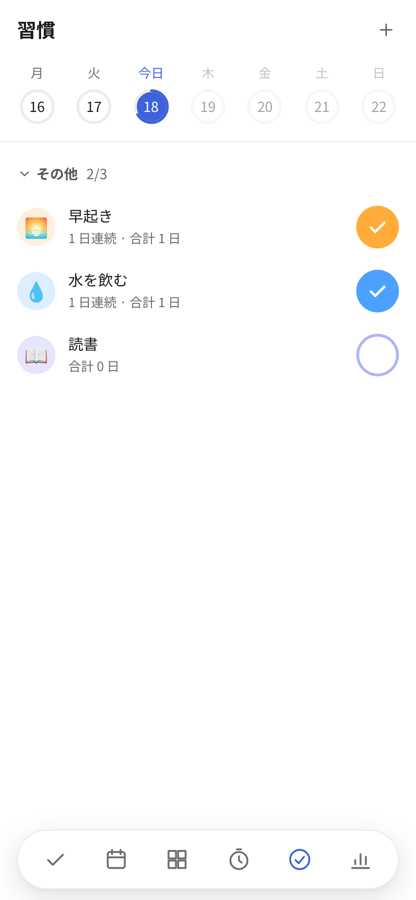</td>
    <td>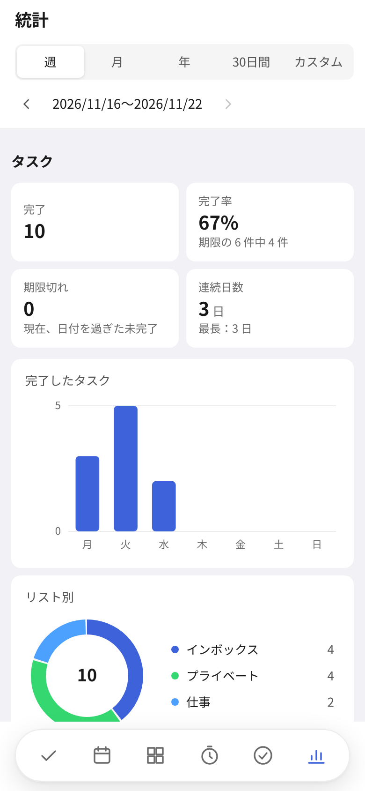</td>
  </tr>
</table>

## 🚀 クイックスタート

**オンラインで使う**：[tickdone.pages.dev](https://tickdone.pages.dev) を開くだけ。インストールは不要です。

**ローカルで動かす**（Node.js 24 が必要）：

```sh
git clone https://github.com/suica/tickdone.git
cd tickdone
npm install
npm run dev        # http://localhost:5173
```

## ⌨️ キーボードショートカット

| キー | 操作 |
|---|---|
| `N` | 新規タスク |
| `Ctrl/⌘ F` | 検索 |
| `Alt 1`–`Alt 6` | モジュールの切り替え |
| `Ctrl/⌘ Z` | 元に戻す（取り消し通知の表示中） |
| `Esc` | 選択を解除、またはタスク詳細を閉じる |
| `↑` `↓` / `J` `K` | リストの前 / 次のタスク |
| `Shift ↑` `Shift ↓` | 選択範囲を広げる |
| `Ctrl/⌘ Click` | タスクを選択に追加・選択から外す |
| `Shift Click` | タスクを範囲選択 |
| `Ctrl/⌘ A` | リストのタスクをすべて選択 |
| `Enter` | タイトルを編集 |
| `Space` / `Ctrl/⌘ Enter` | 完了 / 未完了に戻す |
| `1` `2` `3` `4` | 優先度: 高・中・低・なし |
| `T` / `M` / `W` | 日付: 今日・明日・来週 |
| `D` / `Shift D` | 日付を選ぶ / 日付をクリア |
| `Delete` / `Backspace` | ゴミ箱へ移動（通知から元に戻せます） |
| `?` | ショートカット一覧を表示 |

## 🌍 言語

この README は 10 言語で読めます：English、简体中文、繁體中文、日本語、한국어、Español、Français、Deutsch、Português (Brasil)、Русский。インターフェースはすべて同じ 10 言語に翻訳されています。TickDone はブラウザの言語に合わせて表示され、設定からいつでも切り替えられます。クイック追加は英語・中国語で書いた日付と、10 言語の優先度キーワードを認識します。

不自然な訳を見つけたら：原文は英語です。`src/i18n/` か該当する `README.<locale>.md` を直して、プルリクエストを送ってください。

## 🗺️ ロードマップ

各項目は対応する Issue にリンクしています。チェック済みの項目は [tickdone.pages.dev](https://tickdone.pages.dev) で公開中です。

- [x] タスク、リスト、タグ、クイック追加、カレンダー、アイゼンハワー・マトリクス、ポモドーロタイマー、習慣トラッカー
- [x] 単体テストと E2E テストを備えた CI ([#7](https://github.com/suica/tickdone/issues/7))
- [x] オープンソース化：10 言語の README、MIT ライセンス、プロジェクトのルール ([#10](https://github.com/suica/tickdone/issues/10))
- [x] スマートフォン・タブレット・大画面向けのレイアウト ([#8](https://github.com/suica/tickdone/issues/8))
- [x] あらゆる場面でドラッグ＆ドロップ ([#9](https://github.com/suica/tickdone/issues/9))
- [x] モーション ([#3](https://github.com/suica/tickdone/issues/3))
- [x] アプリ内の GitHub リンクと「このアプリについて」 ([#4](https://github.com/suica/tickdone/issues/4))
- [x] UI の 10 言語対応 ([#14](https://github.com/suica/tickdone/issues/14))
- [x] 画面ごとの UI のブラッシュアップ ([#11](https://github.com/suica/tickdone/issues/11))
- [x] 複数選択と一括編集 ([#15](https://github.com/suica/tickdone/issues/15))
- [x] タスクリストのキーボード操作 ([#16](https://github.com/suica/tickdone/issues/16))
- [x] リマインダー通知 ([#17](https://github.com/suica/tickdone/issues/17))
- [x] アプリとしてインストールしてオフラインでも使用 ([#18](https://github.com/suica/tickdone/issues/18))
- [x] 保存済みフィルター ([#19](https://github.com/suica/tickdone/issues/19))
- [x] タスク・ポモドーロタイマー・習慣トラッカーの統計 ([#20](https://github.com/suica/tickdone/issues/20))
- [x] タスクのメモで Markdown に対応 ([#21](https://github.com/suica/tickdone/issues/21))
- [x] タイムライン表示 ([#22](https://github.com/suica/tickdone/issues/22))
- [x] 繰り返し設定の拡充 ([#23](https://github.com/suica/tickdone/issues/23))
- [x] リストのアーカイブ ([#24](https://github.com/suica/tickdone/issues/24))
- [x] アクセシビリティ ([#25](https://github.com/suica/tickdone/issues/25))
- [x] 数千件のタスクでも高速に動作 ([#26](https://github.com/suica/tickdone/issues/26))
- [x] テーマとアクセントカラー ([#27](https://github.com/suica/tickdone/issues/27))
- [x] カレンダー：日付のないタスクの計画、予定リスト表示 ([#28](https://github.com/suica/tickdone/issues/28))
- [x] カレンダー購読 ([#51](https://github.com/suica/tickdone/issues/51))

## 🧰 技術スタック

| 部分 | 使用技術 |
|---|---|
| ⚛️ UI | React 19 と TypeScript |
| 📆 日付 | date-fns（React 以外で唯一のランタイム依存） |
| ⚡ ビルド | Vite |
| 💾 保存先 | ブラウザの `localStorage`（バックエンドなし） |
| 🧪 テスト | Vitest（単体テスト）と Playwright（E2E テスト） |
| 🧹 静的解析 | oxlint |
| ☁️ ホスティング | Cloudflare Pages |

## 🛠️ 開発

```sh
npm install
npm run dev        # dev server at http://localhost:5173
npm run lint       # oxlint
npm test           # unit tests (Vitest)
npx playwright install chromium
npm run e2e        # end-to-end tests (Playwright)
npm run build      # type check and production build into dist/
```

- 🖼️ README のバナーとスクリーンショットは本番ビルドから生成します。`npm run build` のあとに `node scripts/promo/render.mjs` を実行してください（オプションは[スクリプト](scripts/promo/render.mjs)の冒頭にあります）。
- 🗺️ `node scripts/roadmap.mjs done <issue>` を実行すると、すべての README でロードマップの項目にチェックが付きます。

## 🚢 デプロイ

本番サイトは Cloudflare Pages で公開しています。

```sh
npm run build
npx wrangler pages deploy dist --project-name tickdone --branch main
```

## 🤝 コントリビュート

Issue やプルリクエストを歓迎します！始める前に [AGENTS.md](AGENTS.md) をお読みください。人にもコーディングエージェントにも共通のプロジェクトのルールがまとめてあります。

- 💬 変更はすべて Issue から始め、その Issue を参照するプルリクエストでマージします。
- 🌐 作業言語は英語で、ユーザーの目に触れる文字列はすべて 10 言語に翻訳します。
- 📐 360 px のスマートフォンから 2560 px のディスプレイまで、どの幅でも画面が崩れないようにし、モーションとドラッグ＆ドロップは共通の規約に従います。
- ✅ CI（Lint、型チェックとビルド、単体テスト、E2E テスト）がすべて通ってからマージします。

TickDone が役に立ったら、GitHub で ⭐ を付けていただけると、ほかの人にも見つけてもらいやすくなります。

## 📄 ライセンス

[MIT](LICENSE) © 2026 suica
