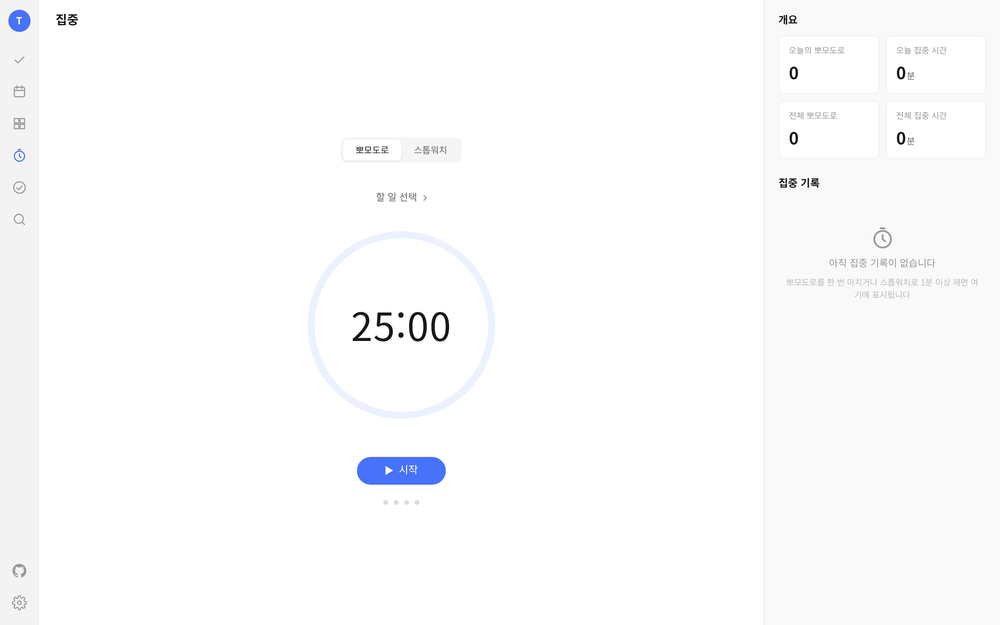
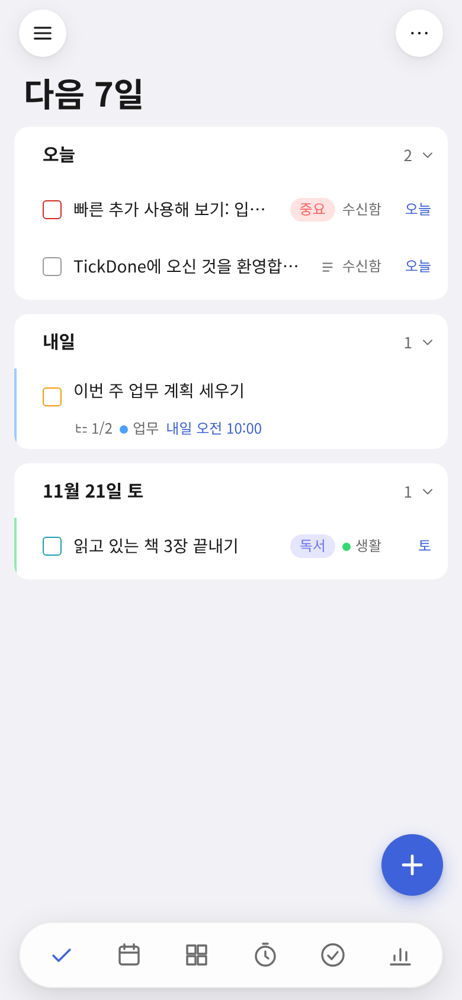
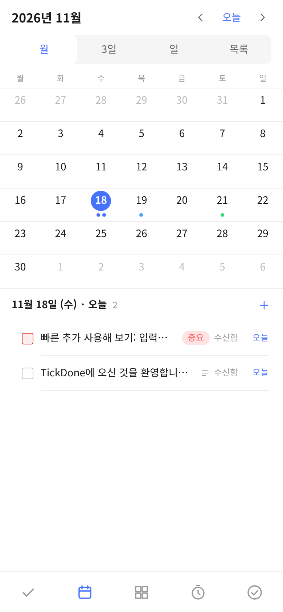
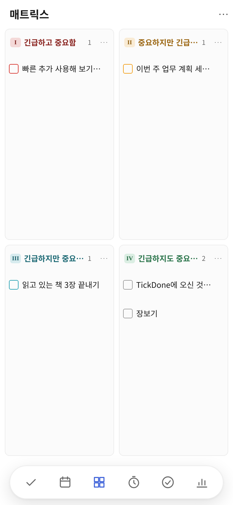
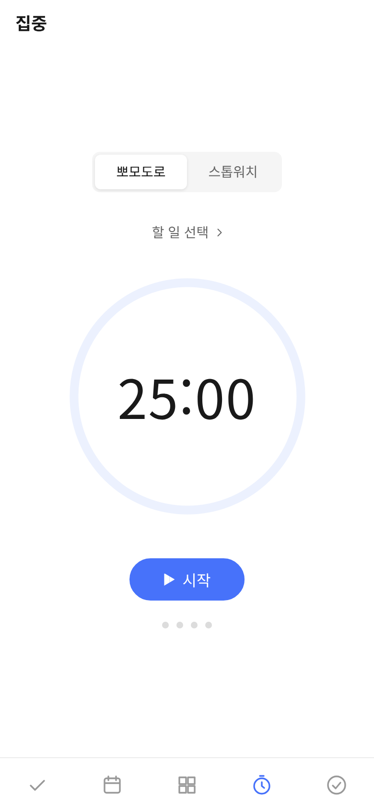
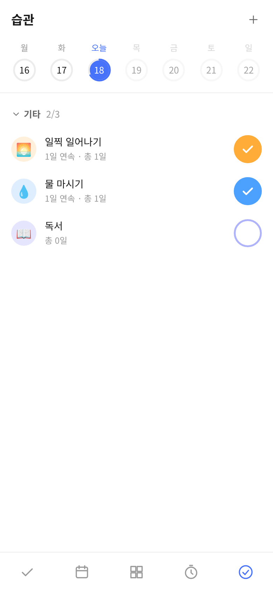

<div align="center">

<a href="https://tickdone.pages.dev"></a>

<h1>TickDone</h1>

<p><b>하루를 계획하고, 중요한 일에 집중하고, 좋은 습관을 이어 가세요. 브라우저에서 바로 쓸 수 있습니다.</b></p>

<p>
  <a href="https://github.com/suica/tickdone/actions/workflows/ci.yml"></a>
  <a href="LICENSE"></a>
  <a href="https://tickdone.pages.dev"></a>
  <a href="#-언어"></a>
  <a href="#-기여하기"></a>
</p>

<p>
  <a href="README.md">English</a> ·
  <a href="README.zh-CN.md">简体中文</a> ·
  <a href="README.zh-TW.md">繁體中文</a> ·
  <a href="README.ja.md">日本語</a> ·
  <b>한국어</b> ·
  <a href="README.es.md">Español</a> ·
  <a href="README.fr.md">Français</a> ·
  <a href="README.de.md">Deutsch</a> ·
  <a href="README.pt-BR.md">Português (Brasil)</a> ·
  <a href="README.ru.md">Русский</a>
</p>

<a href="https://tickdone.pages.dev"></a>

<p>
  <a href="https://tickdone.pages.dev"><b>앱 열기</b></a> ·
  <a href="#-기능"><b>기능</b></a> ·
  <a href="#-빠르게-시작하기"><b>빠르게 시작하기</b></a> ·
  <a href="#️-로드맵"><b>로드맵</b></a> ·
  <a href="#-기여하기"><b>기여하기</b></a>
</p>

</div>

TickDone은 브라우저에서 실행되는 무료 오픈 소스 할 일 목록이자 시간 관리 도구입니다. 떠오른 할 일을 문장 그대로 적고, 캘린더에서 일정을 잡고, 긴급도와 중요도에 따라 분류하고, 집중 타이머로 하나씩 끝내고, 습관까지 꾸준히 이어 갈 수 있습니다. 모든 것이 한곳에 있습니다.

> [!NOTE]
> **데이터는 내 기기에만 있습니다.** 모든 내용은 브라우저의 로컬 저장소(localStorage)에 저장됩니다. 계정도 가입도 필요 없고, 할 일은 기기 밖으로 나가지 않습니다. TickDone 서버를 거치는 것은 구독한 캘린더 주소뿐이며, 작은 프록시가 캘린더를 대신 가져올 뿐 아무것도 저장하지 않습니다. 백업 파일은 언제든 설정에서 내보낼 수 있습니다.

## ✨ 기능

- ✅ **할 일과 목록**: 오늘, 내일, 다음 7일, 수신함, 그리고 완료됨, 하지 않음, 휴지통; 직접 만드는 목록, 폴더, 태그; 하위 작업, 메모, 우선순위, 마감 날짜와 시간, 알림, 반복 규칙; 고정과 모든 할 일의 컨텍스트 메뉴.
- ⚡ **스마트 빠른 추가**: `call mom tomorrow 3pm !high #family ~Personal`처럼 입력하면 날짜, 시간, 우선순위, 태그, 목록이 한 번에 설정되고, 인식한 부분은 입력하는 동안 강조 표시됩니다. 중국어 입력도 지원합니다.
- 🗂️ **목록 보기와 칸반 보기**: 그룹화와 정렬을 지원합니다.
- 📏 **타임라인 보기**: 작업이 기간에 걸친 막대(하루짜리는 마름모)로 섹션별로 표시되고, 오늘 선과 일·주·월 확대/축소가 있습니다. 막대를 끌어 옮기고, 양 끝을 끌어 시작일과 종료일을 바꾸고, ‘날짜 없음’ 패널에서 작업을 끌어와 일정을 잡을 수 있으며, 모든 드롭은 실행 취소할 수 있습니다. 휴대폰에서는 목록으로 표시됩니다.
- 🗄️ **목록 보관**: 끝난 목록을 메뉴에서 보관하면 접힌 "보관된 목록" 섹션으로 옮겨지고, 작업은 스마트 목록·캘린더·매트릭스·검색에서 빠지며, 보관을 해제할 때까지 읽기 전용으로 열립니다.
- 🔎 **필터**: 목록, 태그, 우선순위, 날짜(기한 지남, 오늘, 이번 주, 사용자 지정 기간 등), 키워드, 완료된 작업을 조합해 나만의 스마트 목록을 만들고, 이름·아이콘·색상과 함께 사이드바에 표시합니다.
- 📝 **메모에 Markdown**: 제목, 굵게, 기울임, 취소선, 코드, 링크, 목록, 인용, 메모에서 바로 체크할 수 있는 체크리스트를 지원합니다. `**굵게**`, `# `, `- [ ] `를 입력하면 바로 서식이 적용되고, 메모는 그대로 Markdown으로 저장됩니다.
- 🔁 **반복 규칙**: N일·주·개월·년마다, 지정한 요일, 매월 N일·마지막 날·N번째/마지막 요일, 매년 특정 날짜, 평일만. N회 후 또는 특정 날짜에 종료, 마감일 또는 완료일 기준, 이번 회차 건너뛰기를 지원하며 빠른 추가에서 "every 2 weeks" 같은 문구도 인식합니다.
- 📅 **캘린더**: 월, 주, 일, 목록 보기. 할 일을 다른 날이나 시간으로 끌어 옮기거나, 블록의 아래쪽 가장자리를 끌어 걸리는 시간을 바꿀 수 있습니다.
- 🗓️ **캘린더에서 계획하기**: 주 보기와 일 보기 옆의 「미정」 패널(휴대폰에서는 아래쪽 시트)에 아직 날짜가 없는 미완료 작업이 목록별로 나옵니다. 작업을 날짜나 시간으로 끌면 일정이 잡히고, 패널로 다시 끌면 날짜가 지워지며, 둘 다 알림에서 실행 취소할 수 있습니다. 일정 보기는 앞으로의 날들을 작업과 구독한 캘린더의 일정과 함께 하나의 스크롤 목록으로 보여 줍니다.
- 🔔 **캘린더 구독**: 업무, 학교, 팀, 공휴일 캘린더처럼 iCal 주소(.ics 또는 webcal://)를 제공하는 캘린더를 구독하면 그 일정이 각자의 색으로 캘린더에 읽기 전용으로 표시됩니다. 자동으로 새로 고쳐지고 오프라인에서도 볼 수 있습니다.
- 🧭 **아이젠하워 매트릭스**: 긴급도와 중요도에 따라 할 일을 분류하고, 사분면 사이로 끌어 옮기면 우선순위가 바뀝니다.
- 🍅 **집중 타이머**: 뽀모도로와 스톱워치 모드, 지난 세션 기록을 제공합니다.
- 🔥 **습관 트래커**: 체크인, 연속 달성 기록, 통계를 제공합니다.
- 📊 **통계**: 일·주·월별 완료한 작업 수, 완료율, 기한이 지난 작업, 목록·우선순위·태그별 분포, 연속 기록, 하루 집중 시간, 세션 수, 작업·목록별 집중 시간, 가장 집중한 시간대, 습관 체크인 비율과 연속 기록을 보여 줍니다. 주, 월, 년, 최근 30일 또는 직접 정한 기간으로 볼 수 있고, 차트에 마우스를 올리거나 탭하면 자세한 내용이 나옵니다.
- 🔍 **검색**: 할 일, 태그, 목록을 한 번에 찾습니다.
- ↩️ **실행 취소**: 할 일을 완료하거나 삭제하거나 옮긴 뒤 알림에서 되돌릴 수 있습니다.
- ⌨️ **키보드 단축키**.
- 🎨 **테마와 강조 색상**: 라이트, 다크 또는 시스템 설정 따르기, 그리고 버튼·체크박스·선택·포커스 링에 쓰이는 8가지 강조 색상. 바꾸면 바로 적용되고 설정에서 미리 볼 수 있으며, 시작 화면과 탭 아이콘도 함께 바뀝니다.
- ⏰ **알림**: 할 일의 알림 시간이 되면 완료, 다시 알림(5분, 15분, 1시간, 내일), 열기를 고를 수 있는 카드를 보여 주고, 허용하면 시스템 알림도 띄웁니다. TickDone에는 서버가 없어 알림은 탭에서 열려 있거나 설치되어 실행 중일 때만 울리며, 닫혀 있는 동안 시간이 된 알림은 다음에 열 때 표시됩니다.
- 📲 **앱으로 설치**: 설정 → 정보에서 TickDone을 홈 화면이나 Dock에 추가할 수 있고, 한 번 방문하면 오프라인에서도 열립니다. 새 버전이 나오면 새로고침을 안내합니다.
- 💾 **백업과 복원**: 모든 데이터를 JSON 파일로 내보내고 다시 가져올 수 있습니다.
- 🚀 **수천 개의 작업도 빠르게**: 긴 목록과 검색 결과는 화면에 보이는 행만 그리므로, 작업 5,000개짜리 목록도 짧은 목록처럼 빠르게 스크롤하고 전환하고 반응합니다. 드래그 앤 드롭, 키보드, 다중 선택, 완료 애니메이션도 그대로 작동합니다. 변경 사항은 백그라운드에서 저장됩니다.
- ♿ **접근성**: 모든 기능을 키보드로 쓸 수 있고, 포커스 표시가 잘 보이며 본문으로 건너뛰는 링크가 있습니다. 대화상자, 메뉴, 시트는 포커스를 안에 두고 닫히면 원래 자리로 돌려줍니다. 화면 낭독기는 랜드마크, 제목, 이름 있는 버튼과 체크박스를 읽고, 모든 알림을 읽어 줍니다. 작업은 Alt+↑ / Alt+↓ 나 메뉴로 위아래로 옮길 수 있어 끌어 놓기를 대신합니다. 글자는 라이트와 다크 테마 모두 WCAG AA 대비를 지키고, 고대비 모드와 동작 줄이기 설정도 따릅니다. 모든 화면을 자동으로 검사합니다.

## 📸 스크린샷

<table>
  <tr>
    <td colspan="2"></td>
  </tr>
  <tr>
    <th>캘린더</th>
    <th>매트릭스</th>
  </tr>
  <tr>
    <td></td>
    <td></td>
  </tr>
  <tr>
    <th>집중</th>
    <th>습관</th>
  </tr>
  <tr>
    <td></td>
    <td></td>
  </tr>
</table>

<table>
  <tr>
    <td></td>
    <td></td>
    <td></td>
    <td></td>
    <td></td>
  </tr>
</table>

## 🚀 빠르게 시작하기

**온라인에서 사용하기**: [tickdone.pages.dev](https://tickdone.pages.dev)를 열면 됩니다. 설치할 것이 없습니다.

**로컬에서 실행하기**(Node.js 24 필요):

```sh
git clone https://github.com/suica/tickdone.git
cd tickdone
npm install
npm run dev        # http://localhost:5173
```

## ⌨️ 키보드 단축키

| 키 | 동작 |
|---|---|
| `N` | 새 할 일 |
| `Ctrl/⌘ F` | 검색 |
| `Alt 1`–`Alt 6` | 모듈 전환 |
| `Ctrl/⌘ Z` | 실행 취소(실행 취소 알림이 떠 있는 동안) |
| `Esc` | 선택 해제 또는 할 일 상세 닫기 |
| `↑` `↓` / `J` `K` | 목록의 이전 / 다음 작업 |
| `Shift ↑` `Shift ↓` | 선택 범위 넓히기 |
| `Ctrl/⌘ Click` | 작업을 선택에 추가하거나 빼기 |
| `Shift Click` | 작업 범위 선택 |
| `Ctrl/⌘ A` | 목록의 모든 작업 선택 |
| `Enter` | 제목 편집 |
| `Space` / `Ctrl/⌘ Enter` | 완료 또는 다시 열기 |
| `1` `2` `3` `4` | 우선순위: 높음, 중간, 낮음, 없음 |
| `T` / `M` / `W` | 날짜: 오늘, 내일, 다음 주 |
| `D` / `Shift D` | 날짜 고르기 / 날짜 지우기 |
| `Delete` / `Backspace` | 휴지통으로 이동 (알림에서 되돌리기) |
| `?` | 모든 단축키 보기 |

## 🌍 언어

이 README는 10개 언어로 제공됩니다: English, 简体中文, 繁體中文, 日本語, 한국어, Español, Français, Deutsch, Português (Brasil), Русский. 인터페이스 전체가 같은 10개 언어로 번역되어 있습니다. TickDone은 브라우저 언어를 따르며, 설정에서 언제든 바꿀 수 있습니다. 빠른 추가는 영어나 중국어로 쓴 날짜와 10개 언어의 우선순위 단어를 알아듣습니다.

어색한 번역을 발견했나요? 원문은 영어입니다. `src/i18n/` 또는 해당 `README.<locale>.md`를 고친 뒤 풀 리퀘스트를 보내 주세요.

## 🗺️ 로드맵

각 항목은 해당 이슈로 연결됩니다. 체크된 항목은 [tickdone.pages.dev](https://tickdone.pages.dev)에서 이미 사용할 수 있습니다.

- [x] 작업, 목록, 태그, 빠른 추가, 캘린더, 아이젠하워 매트릭스, 집중 타이머, 습관 트래커
- [x] 단위 테스트와 E2E 테스트를 갖춘 CI ([#7](https://github.com/suica/tickdone/issues/7))
- [x] 오픈 소스 공개: 10개 언어 README, MIT 라이선스, 프로젝트 규칙 ([#10](https://github.com/suica/tickdone/issues/10))
- [x] 휴대폰, 태블릿, 대형 화면용 레이아웃 ([#8](https://github.com/suica/tickdone/issues/8))
- [x] 어디서나 드래그 앤 드롭 ([#9](https://github.com/suica/tickdone/issues/9))
- [x] 모션 ([#3](https://github.com/suica/tickdone/issues/3))
- [x] 앱 내 GitHub 링크와 정보 화면 ([#4](https://github.com/suica/tickdone/issues/4))
- [x] 10개 언어 인터페이스 ([#14](https://github.com/suica/tickdone/issues/14))
- [x] 화면별 UI 다듬기 ([#11](https://github.com/suica/tickdone/issues/11))
- [x] 다중 선택과 일괄 편집 ([#15](https://github.com/suica/tickdone/issues/15))
- [x] 작업 목록 키보드 탐색 ([#16](https://github.com/suica/tickdone/issues/16))
- [x] 알림 시간에 맞춘 알림 표시 ([#17](https://github.com/suica/tickdone/issues/17))
- [x] 앱으로 설치하고 오프라인에서도 사용 ([#18](https://github.com/suica/tickdone/issues/18))
- [x] 저장된 필터 ([#19](https://github.com/suica/tickdone/issues/19))
- [x] 작업, 집중 타이머, 습관 트래커 통계 ([#20](https://github.com/suica/tickdone/issues/20))
- [x] 작업 메모에서 Markdown 지원 ([#21](https://github.com/suica/tickdone/issues/21))
- [x] 타임라인 보기 ([#22](https://github.com/suica/tickdone/issues/22))
- [x] 더 많은 반복 규칙 ([#23](https://github.com/suica/tickdone/issues/23))
- [x] 목록 보관 ([#24](https://github.com/suica/tickdone/issues/24))
- [ ] 더 많은 반복 규칙 ([#23](https://github.com/suica/tickdone/issues/23))
- [x] 목록 보관 ([#24](https://github.com/suica/tickdone/issues/24))
- [x] 접근성 ([#25](https://github.com/suica/tickdone/issues/25))
- [x] 작업이 수천 개여도 빠르게 ([#26](https://github.com/suica/tickdone/issues/26))
- [x] 테마와 강조 색상 ([#27](https://github.com/suica/tickdone/issues/27))
- [x] 캘린더: 날짜 없는 작업 계획, 일정 목록 보기 ([#28](https://github.com/suica/tickdone/issues/28))
- [x] 캘린더 구독 ([#51](https://github.com/suica/tickdone/issues/51))

## 🧰 기술 스택

| 영역 | 사용 기술 |
|---|---|
| ⚛️ 인터페이스 | React 19, TypeScript |
| 📆 날짜 | date-fns(React 외에 유일한 런타임 의존성) |
| ⚡ 빌드 | Vite |
| 💾 저장소 | 브라우저의 `localStorage`, 백엔드 없음 |
| 🧪 테스트 | Vitest(단위 테스트), Playwright(엔드 투 엔드 테스트) |
| 🧹 린트 | oxlint |
| ☁️ 호스팅 | Cloudflare Pages |

## 🛠️ 개발

```sh
npm install
npm run dev        # dev server at http://localhost:5173
npm run lint       # oxlint
npm test           # unit tests (Vitest)
npx playwright install chromium
npm run e2e        # end-to-end tests (Playwright)
npm run build      # type check and production build into dist/
```

- 🖼️ README의 배너와 스크린샷은 프로덕션 빌드에서 만듭니다. `npm run build` 다음에 `node scripts/promo/render.mjs`를 실행하세요(옵션은 [스크립트](scripts/promo/render.mjs) 맨 위에 있습니다).
- 🗺️ `node scripts/roadmap.mjs done <issue>`를 실행하면 모든 README에서 해당 로드맵 항목이 체크됩니다.

## 🚢 배포

라이브 사이트는 Cloudflare Pages에서 운영합니다.

```sh
npm run build
npx wrangler pages deploy dist --project-name tickdone --branch main
```

## 🤝 기여하기

이슈와 풀 리퀘스트를 환영합니다! 시작하기 전에 [AGENTS.md](AGENTS.md)를 먼저 읽어 주세요. 사람과 코딩 에이전트 모두에게 적용되는 프로젝트 규칙이 담겨 있습니다.

- 💬 모든 변경은 이슈에서 시작하고, 그 이슈를 참조하는 풀 리퀘스트로 병합합니다.
- 🌐 작업 언어는 영어이며, 사용자에게 보이는 모든 문구는 10개 언어로 번역합니다.
- 📐 360 px 휴대폰부터 2560 px 디스플레이까지 어떤 너비에서도 화면이 제대로 보여야 하며, 모션과 드래그 앤 드롭은 공통 규칙을 따릅니다.
- ✅ CI(린트, 타입 검사와 빌드, 단위 테스트, 엔드 투 엔드 테스트)를 모두 통과해야 병합합니다.

TickDone이 일을 끝내는 데 도움이 되었다면 GitHub에서 ⭐를 눌러 주세요. 다른 사람들이 이 프로젝트를 찾는 데 도움이 됩니다.

## 📄 라이선스

[MIT](LICENSE) © 2026 suica
