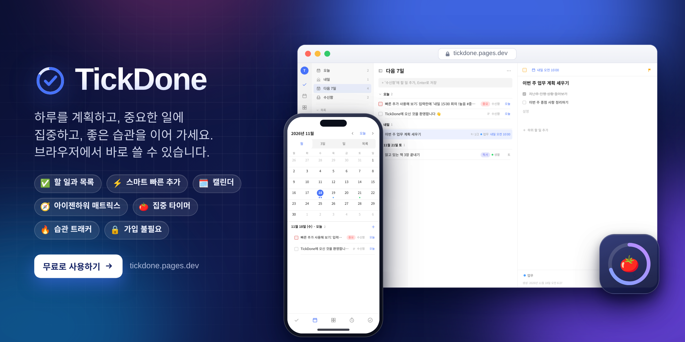
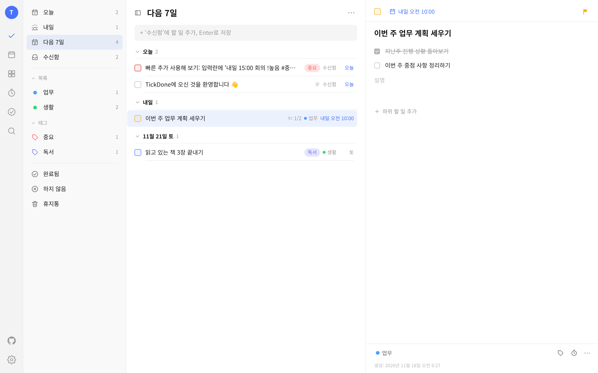
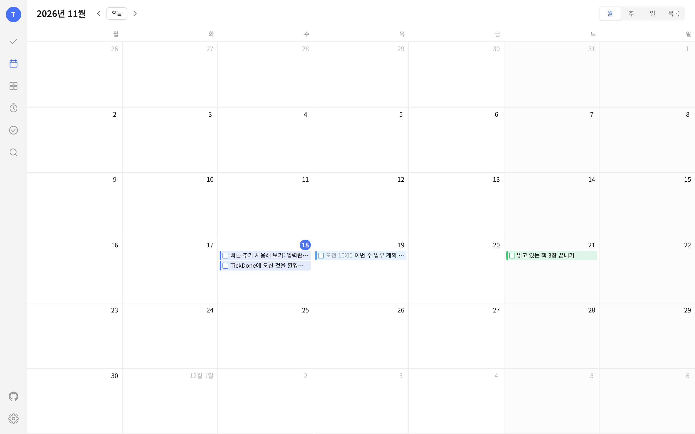
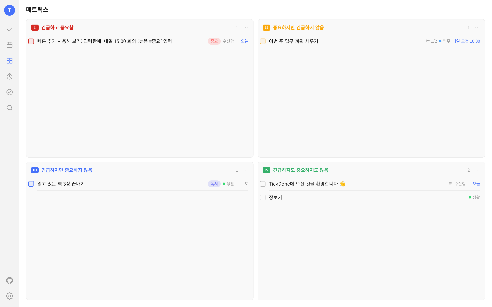
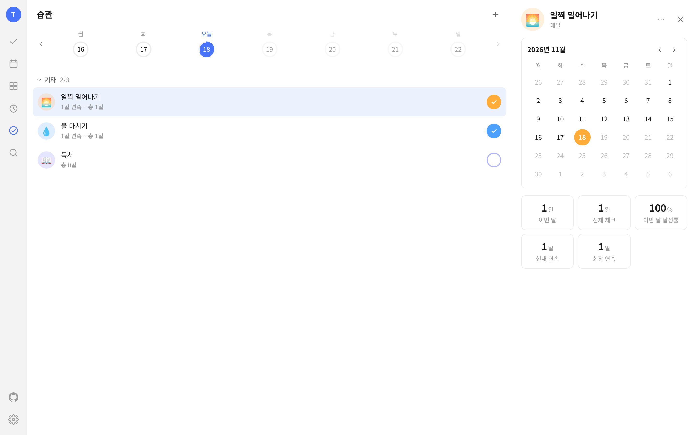

<div align="center">

<a href="https://tickdone.pages.dev"></a>

<h1>TickDone</h1>

<p><b>하루를 계획하고, 중요한 일에 집중하고, 좋은 습관을 이어 가세요. 브라우저에서 바로 쓸 수 있습니다.</b></p>

<p>
  <a href="https://github.com/suica/tickdone/actions/workflows/ci.yml"></a>
  <a href="LICENSE"></a>
  <a href="https://tickdone.pages.dev"></a>
  <a href="#-언어"></a>
  <a href="#-기여하기"></a>
</p>

<p>
  <a href="README.md">English</a> ·
  <a href="README.zh-CN.md">简体中文</a> ·
  <a href="README.zh-TW.md">繁體中文</a> ·
  <a href="README.ja.md">日本語</a> ·
  <b>한국어</b> ·
  <a href="README.es.md">Español</a> ·
  <a href="README.fr.md">Français</a> ·
  <a href="README.de.md">Deutsch</a> ·
  <a href="README.pt-BR.md">Português (Brasil)</a> ·
  <a href="README.ru.md">Русский</a>
</p>

<a href="https://tickdone.pages.dev"></a>

<p>
  <a href="https://tickdone.pages.dev"><b>앱 열기</b></a> ·
  <a href="#-기능"><b>기능</b></a> ·
  <a href="#-빠르게-시작하기"><b>빠르게 시작하기</b></a> ·
  <a href="#️-로드맵"><b>로드맵</b></a> ·
  <a href="#-기여하기"><b>기여하기</b></a>
</p>

</div>

TickDone은 브라우저에서 실행되는 무료 오픈 소스 할 일 목록이자 시간 관리 도구입니다. 떠오른 할 일을 문장 그대로 적고, 캘린더에서 일정을 잡고, 긴급도와 중요도에 따라 분류하고, 집중 타이머로 하나씩 끝내고, 습관까지 꾸준히 이어 갈 수 있습니다. 모든 것이 한곳에 있습니다.

> [!NOTE]
> **데이터는 내 기기에만 있습니다.** 모든 내용은 브라우저의 로컬 저장소(localStorage)에 저장됩니다. 계정도, 가입도, 서버도 없으며 입력한 내용은 기기 밖으로 나가지 않습니다. 백업 파일은 언제든 설정에서 내보낼 수 있습니다.

## ✨ 기능

- ✅ **할 일과 목록**: 오늘, 내일, 다음 7일, 수신함, 그리고 완료됨, 하지 않음, 휴지통; 직접 만드는 목록, 폴더, 태그; 하위 작업, 메모, 우선순위, 마감 날짜와 시간, 알림, 반복 규칙; 고정과 모든 할 일의 컨텍스트 메뉴.
- ⚡ **스마트 빠른 추가**: `call mom tomorrow 3pm !high #family ~Personal`처럼 입력하면 날짜, 시간, 우선순위, 태그, 목록이 한 번에 설정되고, 인식한 부분은 입력하는 동안 강조 표시됩니다. 중국어 입력도 지원합니다.
- 🗂️ **목록 보기와 칸반 보기**: 그룹화와 정렬을 지원합니다.
- 📅 **캘린더**: 월, 주, 일, 목록 보기. 할 일을 다른 날이나 시간으로 끌어 옮기거나, 블록의 아래쪽 가장자리를 끌어 걸리는 시간을 바꿀 수 있습니다.
- 🧭 **아이젠하워 매트릭스**: 긴급도와 중요도에 따라 할 일을 분류하고, 사분면 사이로 끌어 옮기면 우선순위가 바뀝니다.
- 🍅 **집중 타이머**: 뽀모도로와 스톱워치 모드, 지난 세션 기록을 제공합니다.
- 🔥 **습관 트래커**: 체크인, 연속 달성 기록, 통계를 제공합니다.
- 🔍 **검색**: 할 일, 태그, 목록을 한 번에 찾습니다.
- ↩️ **실행 취소**: 할 일을 완료하거나 삭제하거나 옮긴 뒤 알림에서 되돌릴 수 있습니다.
- ⌨️ **키보드 단축키**와 🌙 **다크 테마**.
- 💾 **백업과 복원**: 모든 데이터를 JSON 파일로 내보내고 다시 가져올 수 있습니다.

## 📸 스크린샷

<table>
  <tr>
    <td colspan="2"></td>
  </tr>
  <tr>
    <th>캘린더</th>
    <th>매트릭스</th>
  </tr>
  <tr>
    <td></td>
    <td></td>
  </tr>
  <tr>
    <th>집중</th>
    <th>습관</th>
  </tr>
  <tr>
    <td></td>
    <td></td>
  </tr>
</table>

<table>
  <tr>
    <td></td>
    <td></td>
    <td></td>
    <td></td>
    <td></td>
  </tr>
</table>

## 🚀 빠르게 시작하기

**온라인에서 사용하기**: [tickdone.pages.dev](https://tickdone.pages.dev)를 열면 됩니다. 설치할 것이 없습니다.

**로컬에서 실행하기**(Node.js 24 필요):

```sh
git clone https://github.com/suica/tickdone.git
cd tickdone
npm install
npm run dev        # http://localhost:5173
```

## ⌨️ 키보드 단축키

| 키 | 동작 |
|---|---|
| `N` | 새 할 일 |
| `Ctrl/⌘ F` | 검색 |
| `Alt 1`–`Alt 6` | 모듈 전환 |
| `Ctrl/⌘ Z` | 실행 취소(실행 취소 알림이 떠 있는 동안) |
| `Esc` | 할 일 상세 닫기 |
| `?` | 모든 단축키 보기 |

## 🌍 언어

이 README는 10개 언어로 제공됩니다: English, 简体中文, 繁體中文, 日本語, 한국어, Español, Français, Deutsch, Português (Brasil), Русский. 인터페이스 전체가 같은 10개 언어로 번역되어 있습니다. TickDone은 브라우저 언어를 따르며, 설정에서 언제든 바꿀 수 있습니다. 빠른 추가는 영어나 중국어로 쓴 날짜와 10개 언어의 우선순위 단어를 알아듣습니다.

어색한 번역을 발견했나요? 원문은 영어입니다. `src/i18n/` 또는 해당 `README.<locale>.md`를 고친 뒤 풀 리퀘스트를 보내 주세요.

## 🗺️ 로드맵

각 항목은 해당 이슈로 연결됩니다. 체크된 항목은 [tickdone.pages.dev](https://tickdone.pages.dev)에서 이미 사용할 수 있습니다.

- [x] 작업, 목록, 태그, 빠른 추가, 캘린더, 아이젠하워 매트릭스, 집중 타이머, 습관 트래커
- [x] 단위 테스트와 E2E 테스트를 갖춘 CI ([#7](https://github.com/suica/tickdone/issues/7))
- [x] 오픈 소스 공개: 10개 언어 README, MIT 라이선스, 프로젝트 규칙 ([#10](https://github.com/suica/tickdone/issues/10))
- [ ] 휴대폰, 태블릿, 대형 화면용 레이아웃 ([#8](https://github.com/suica/tickdone/issues/8))
- [ ] 어디서나 드래그 앤 드롭 ([#9](https://github.com/suica/tickdone/issues/9))
- [ ] 모션 ([#3](https://github.com/suica/tickdone/issues/3))
- [x] 앱 내 GitHub 링크와 정보 화면 ([#4](https://github.com/suica/tickdone/issues/4))
- [x] 10개 언어 인터페이스 ([#14](https://github.com/suica/tickdone/issues/14))
- [ ] 화면별 UI 다듬기 ([#11](https://github.com/suica/tickdone/issues/11))
- [ ] 다중 선택과 일괄 편집 ([#15](https://github.com/suica/tickdone/issues/15))
- [ ] 작업 목록 키보드 탐색 ([#16](https://github.com/suica/tickdone/issues/16))
- [ ] 알림 시간에 맞춘 알림 표시 ([#17](https://github.com/suica/tickdone/issues/17))
- [ ] 앱으로 설치하고 오프라인에서도 사용 ([#18](https://github.com/suica/tickdone/issues/18))
- [ ] 저장된 필터 ([#19](https://github.com/suica/tickdone/issues/19))
- [ ] 작업, 집중 타이머, 습관 트래커 통계 ([#20](https://github.com/suica/tickdone/issues/20))
- [ ] 작업 메모에서 Markdown 지원 ([#21](https://github.com/suica/tickdone/issues/21))
- [ ] 타임라인 보기 ([#22](https://github.com/suica/tickdone/issues/22))
- [ ] 더 많은 반복 규칙 ([#23](https://github.com/suica/tickdone/issues/23))
- [ ] 목록 보관 ([#24](https://github.com/suica/tickdone/issues/24))
- [ ] 접근성 ([#25](https://github.com/suica/tickdone/issues/25))
- [ ] 작업이 수천 개여도 빠르게 ([#26](https://github.com/suica/tickdone/issues/26))
- [ ] 테마와 강조 색상 ([#27](https://github.com/suica/tickdone/issues/27))
- [ ] 캘린더: 날짜 없는 작업 계획, 일정 목록 보기 ([#28](https://github.com/suica/tickdone/issues/28))

## 🧰 기술 스택

| 영역 | 사용 기술 |
|---|---|
| ⚛️ 인터페이스 | React 19, TypeScript |
| 📆 날짜 | date-fns(React 외에 유일한 런타임 의존성) |
| ⚡ 빌드 | Vite |
| 💾 저장소 | 브라우저의 `localStorage`, 백엔드 없음 |
| 🧪 테스트 | Vitest(단위 테스트), Playwright(엔드 투 엔드 테스트) |
| 🧹 린트 | oxlint |
| ☁️ 호스팅 | Cloudflare Pages |

## 🛠️ 개발

```sh
npm install
npm run dev        # dev server at http://localhost:5173
npm run lint       # oxlint
npm test           # unit tests (Vitest)
npx playwright install chromium
npm run e2e        # end-to-end tests (Playwright)
npm run build      # type check and production build into dist/
```

- 🖼️ README의 배너와 스크린샷은 프로덕션 빌드에서 만듭니다. `npm run build` 다음에 `node scripts/promo/render.mjs`를 실행하세요(옵션은 [스크립트](scripts/promo/render.mjs) 맨 위에 있습니다).
- 🗺️ `node scripts/roadmap.mjs done <issue>`를 실행하면 모든 README에서 해당 로드맵 항목이 체크됩니다.

## 🚢 배포

라이브 사이트는 Cloudflare Pages에서 운영합니다.

```sh
npm run build
npx wrangler pages deploy dist --project-name tickdone --branch main
```

## 🤝 기여하기

이슈와 풀 리퀘스트를 환영합니다! 시작하기 전에 [AGENTS.md](AGENTS.md)를 먼저 읽어 주세요. 사람과 코딩 에이전트 모두에게 적용되는 프로젝트 규칙이 담겨 있습니다.

- 💬 모든 변경은 이슈에서 시작하고, 그 이슈를 참조하는 풀 리퀘스트로 병합합니다.
- 🌐 작업 언어는 영어이며, 사용자에게 보이는 모든 문구는 10개 언어로 번역합니다.
- 📐 360 px 휴대폰부터 2560 px 디스플레이까지 어떤 너비에서도 화면이 제대로 보여야 하며, 모션과 드래그 앤 드롭은 공통 규칙을 따릅니다.
- ✅ CI(린트, 타입 검사와 빌드, 단위 테스트, 엔드 투 엔드 테스트)를 모두 통과해야 병합합니다.

TickDone이 일을 끝내는 데 도움이 되었다면 GitHub에서 ⭐를 눌러 주세요. 다른 사람들이 이 프로젝트를 찾는 데 도움이 됩니다.

## 📄 라이선스

[MIT](LICENSE) © 2026 suica
