<div align="center">

<a href="https://tickdone.pages.dev"></a>

<h1>TickDone</h1>

<p><b>Plan your day, focus on what matters and build habits that stick, right in your browser.</b></p>

<p>
  <a href="https://github.com/suica/tickdone/actions/workflows/ci.yml"></a>
  <a href="LICENSE"></a>
  <a href="https://tickdone.pages.dev"></a>
  <a href="#-languages"></a>
  <a href="#-contributing"></a>
</p>

<p>
  <b>English</b> ·
  <a href="README.zh-CN.md">简体中文</a> ·
  <a href="README.zh-TW.md">繁體中文</a> ·
  <a href="README.ja.md">日本語</a> ·
  <a href="README.ko.md">한국어</a> ·
  <a href="README.es.md">Español</a> ·
  <a href="README.fr.md">Français</a> ·
  <a href="README.de.md">Deutsch</a> ·
  <a href="README.pt-BR.md">Português (Brasil)</a> ·
  <a href="README.ru.md">Русский</a>
</p>

<a href="https://tickdone.pages.dev">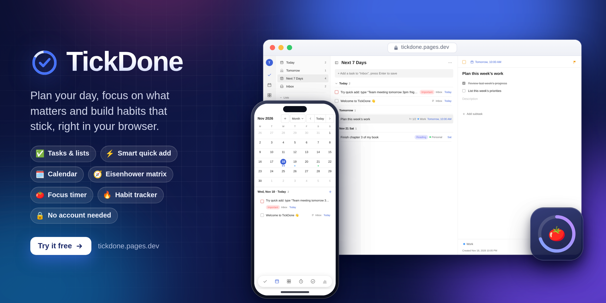</a>

<p>
  <a href="https://tickdone.pages.dev"><b>Open the app</b></a> ·
  <a href="#-features"><b>Features</b></a> ·
  <a href="#-quick-start"><b>Quick start</b></a> ·
  <a href="#️-roadmap"><b>Roadmap</b></a> ·
  <a href="#-contributing"><b>Contributing</b></a>
</p>

</div>

TickDone is a free, open-source to-do list and time manager that runs in your browser. Jot tasks down in plain words, see them on a calendar, sort them by urgency and importance, work through them with a focus timer and keep your habits going, all in one place.

> [!NOTE]
> **Your data stays with you.** Everything is saved in your browser's local storage: there is no account and no sign-up, and your tasks never leave your device. The only thing that goes through TickDone's server is a calendar subscription address, which a small proxy fetches for you without storing anything. You can export a backup file at any time from Settings.

## ✨ Features

- ✅ **Tasks and lists**: Today, Tomorrow, Next 7 Days and Inbox, plus Completed, Won't Do and Trash; your own lists, folders and tags; subtasks, notes, priorities, due dates and times, reminders and repeat rules; pinning and a context menu on every task.
- ⚡ **Smart quick add**: type `call mom tomorrow 3pm !high #family ~Personal` and TickDone sets the date, time, priority, tag and list, highlighting each part as you type.
- 🗂️ **List and kanban views**, with grouping and sorting.
- 📏 **Timeline view** for lists: tasks are bars across their days (a diamond for a single day), grouped by section, with a today line and day, week and month zoom. Drag a bar to move it, drag its ends to change the start and end, and drag undated tasks in from the No date panel; every drop can be undone. On phones the list is shown instead.
- 🗄️ **Archived lists**: archive a finished list from its menu to keep it out of the way. It moves to a collapsed "Archived lists" section, its tasks leave smart lists, the calendar, the matrix and search, and it opens read-only until you unarchive it.
- 🔎 **Saved filters**: combine lists, tags, priorities, dates (overdue, today, this week, a custom range…), keywords and completed tasks into a smart list of your own, with its name, icon and color in the sidebar.
- 📝 **Markdown in notes**: headings, bold, italics, strikethrough, code, links, lists, quotes and checklists you can tick right in the note; type `**bold**`, `# ` or `- [ ] ` and it is formatted as you type, while the note is still saved as Markdown.
- 🔁 **Repeat rules**: every N days, weeks, months or years; chosen weekdays; day N, the last day or the Nth/last weekday of the month; a date each year; weekdays only. End after N times or on a date, count from the due date or the completion date, skip an occurrence, and type "every 2 weeks" or "every last Friday" in quick add.
- 📅 **Calendar** with month, week, day and list views. Drag a task to another day or time, or drag the bottom edge of a block to change how long it takes.
- 🗓️ **Plan in the calendar**: an Unscheduled panel next to the week and day views (a bottom sheet on phones) lists the open tasks that have no date yet, filtered by list. Drag one onto a day or a time to schedule it, or drop a task back on the panel to clear its date, with undo from the toast. The agenda view shows the coming days in one scrolling list, with your tasks and the events of your subscribed calendars.
- 🔔 **Calendar subscriptions**: subscribe to any calendar that publishes an iCal (.ics or webcal://) address, such as work, school, team or holiday calendars, and see its events read-only in the calendar, in its own color. They refresh on their own and stay available offline.
- 🧭 **Eisenhower matrix**: sort tasks by urgency and importance, and drag them between quadrants to change their priority.
- 🍅 **Focus timer** with Pomodoro and stopwatch modes and a record of past sessions.
- 🔥 **Habit tracker** with check-ins, streaks and statistics.
- 📊 **Statistics**: tasks completed per day, week or month, completion rate, overdue tasks, a breakdown by list, priority and tag, and your streak; focus time per day, sessions, time per task and list, and your best time of day; habit check-in rates and streaks. Pick a week, a month, a year, the last 30 days or your own range, and hover or tap a chart for the details.
- 🔍 **Search** across tasks, tags and lists.
- ↩️ **Undo** from the toast after completing, deleting or moving a task.
- ⌨️ **Keyboard shortcuts**.
- ☑️ **Multi-select and batch edit**: Ctrl/⌘-click, Shift-click or Ctrl/⌘+A to select tasks, then change their date, priority, list or tags, complete or delete them all at once, or drag them together; one undo reverts the whole batch. On a phone, long-press to start selecting.
- 🎨 **Themes and accent colors**: light, dark or follow your system, and eight accent colors for buttons, checkboxes, selection and focus rings. Changes apply at once, with a live preview in Settings, and the launch screen and tab icon follow along.
- ⏰ **Reminders**: at a task's reminder time TickDone shows a card with Complete, Snooze (5 min, 15 min, 1 hour, tomorrow) and Open, plus a system notification if you allow it. TickDone has no server, so reminders fire while it is open in a tab or installed and running; ones that came due while it was closed show up when you open it again.
- 📲 **Install it as an app**: add TickDone to your home screen or dock from Settings → About, and it opens offline after the first visit. When a new version is out, a toast offers to reload.
- 💾 **Backup and restore**: export everything to a JSON file and import it again.
- 🚀 **Fast with thousands of tasks**: long lists and search results draw only the rows on screen, so a list of 5,000 tasks scrolls, switches and responds as quickly as a short one, with drag and drop, the keyboard, multi-select and the completion animation working as before. Changes are saved in the background.
- ♿ **Accessible**: everything works from the keyboard, with a visible focus ring and a skip link; dialogs, menus and sheets keep the focus inside and give it back when they close; screen readers get landmarks, headings, named buttons and checkboxes, and every toast is announced. Tasks move up and down with Alt+↑ / Alt+↓ or from their menu, the alternative to dragging. Text meets WCAG AA contrast in light and dark, and high-contrast modes and reduced motion are respected. An automated check runs on every screen.

## 📸 Screenshots

<table>
  <tr>
    <td colspan="2">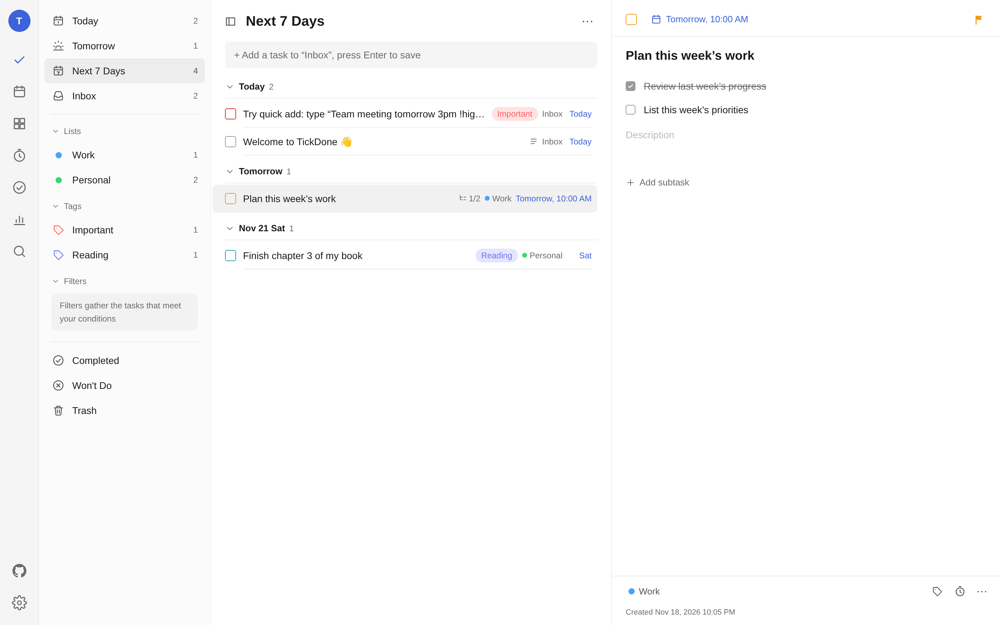</td>
  </tr>
  <tr>
    <th>Calendar</th>
    <th>Matrix</th>
  </tr>
  <tr>
    <td>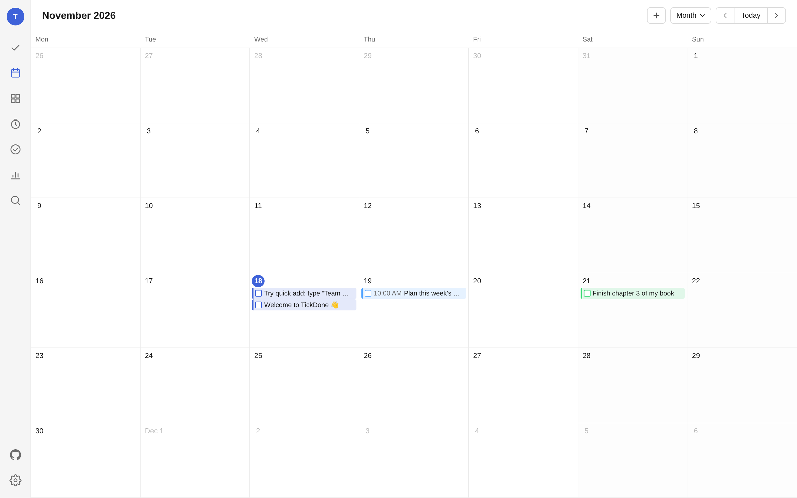</td>
    <td>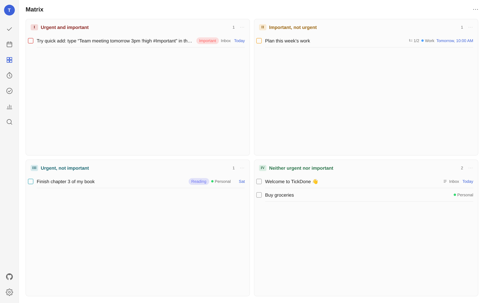</td>
  </tr>
  <tr>
    <th>Focus</th>
    <th>Habits</th>
  </tr>
  <tr>
    <td>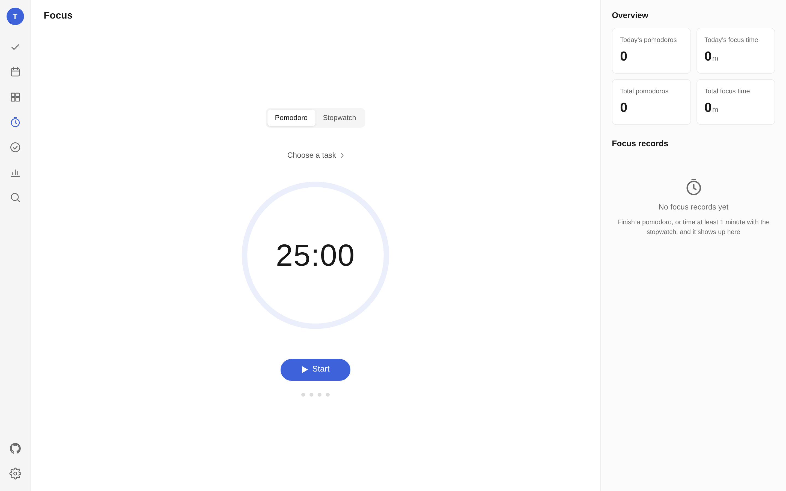</td>
    <td>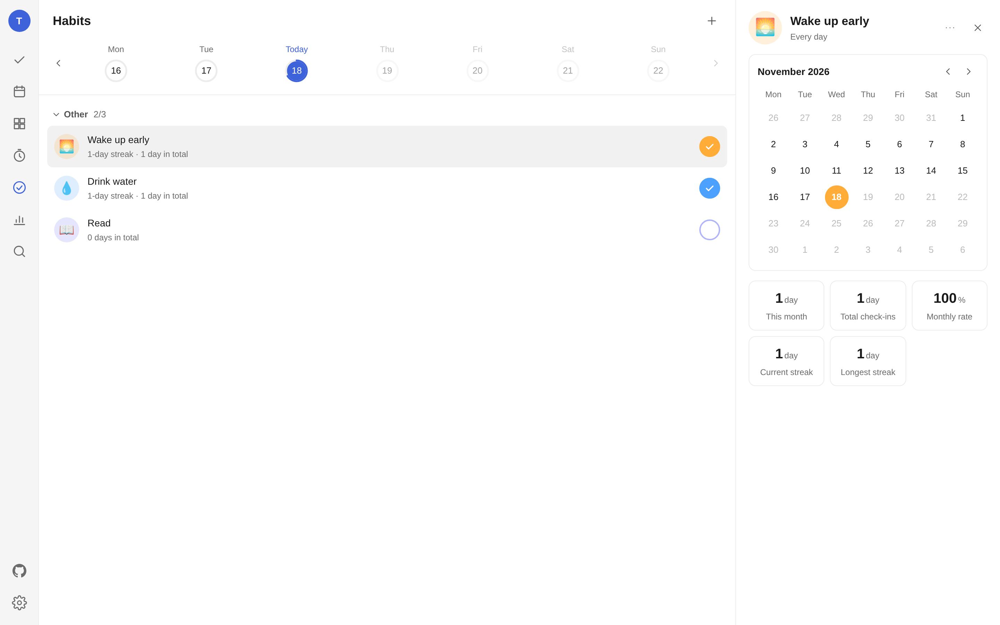</td>
  </tr>
  <tr>
    <th colspan="2">Statistics</th>
  </tr>
  <tr>
    <td colspan="2">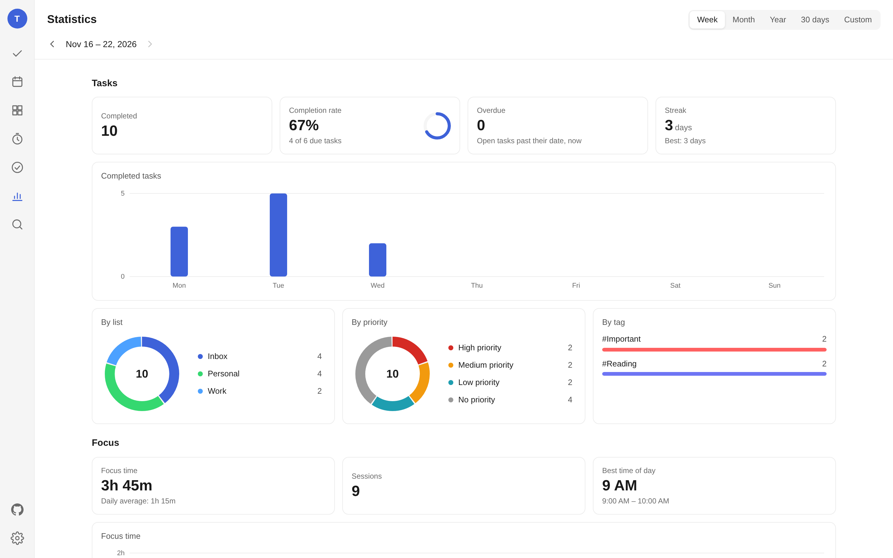</td>
  </tr>
</table>

<table>
  <tr>
    <td>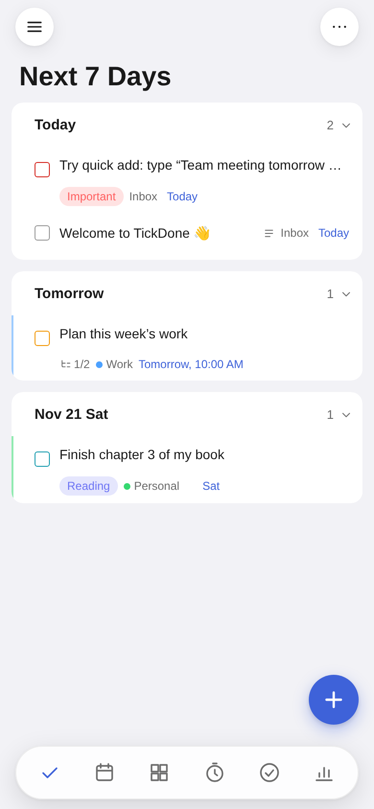</td>
    <td>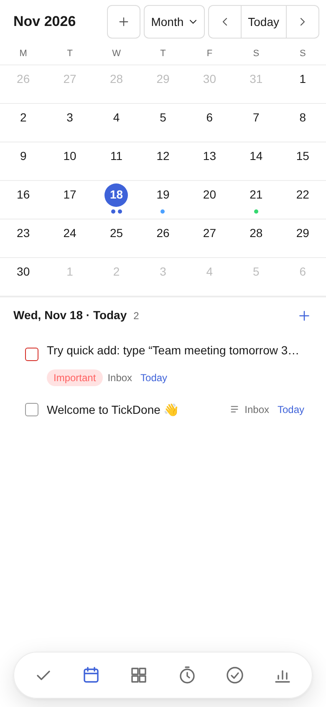</td>
    <td>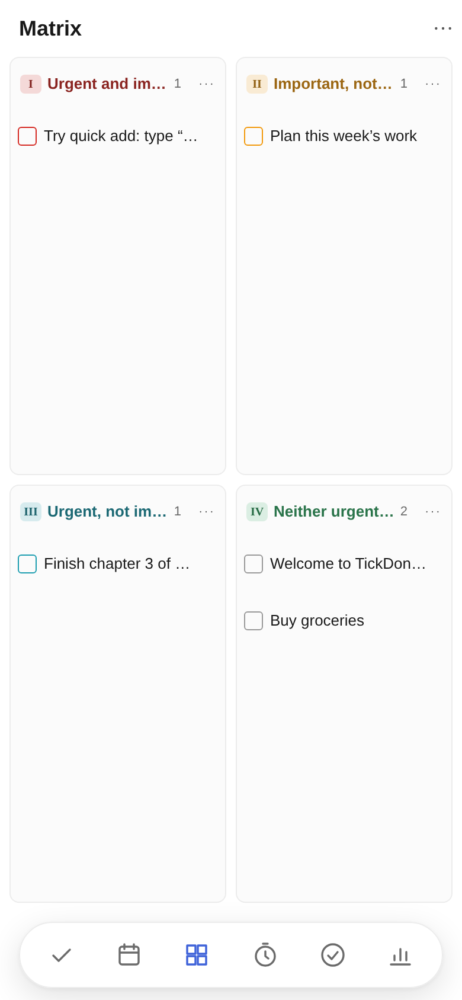</td>
    <td>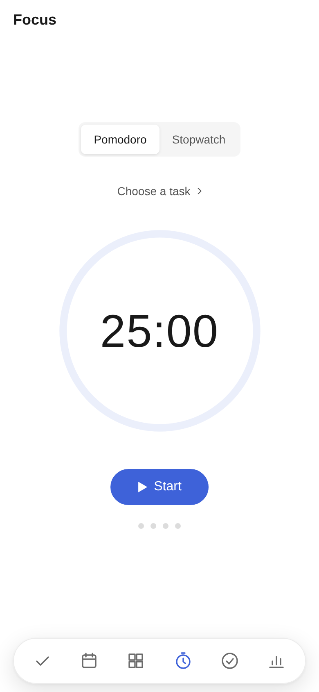</td>
    <td>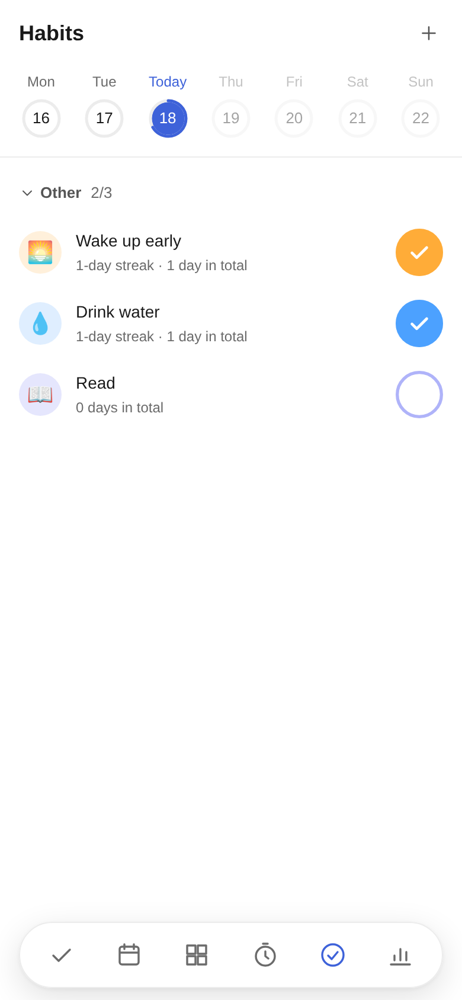</td>
    <td>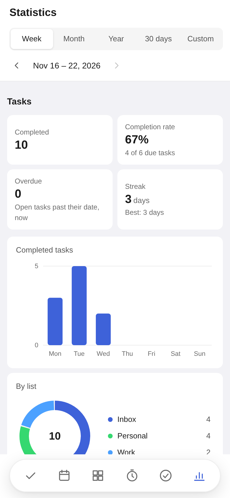</td>
  </tr>
</table>

## 🚀 Quick start

**Use it online:** open [tickdone.pages.dev](https://tickdone.pages.dev). There is nothing to install.

**Run it locally** (requires Node.js 24):

```sh
git clone https://github.com/suica/tickdone.git
cd tickdone
npm install
npm run dev        # http://localhost:5173
```

## ⌨️ Keyboard shortcuts

| Key | Action |
|---|---|
| `N` | New task |
| `Ctrl/⌘ F` | Search |
| `Alt 1`–`Alt 6` | Switch module |
| `Ctrl/⌘ Z` | Undo, while the undo toast is showing |
| `Esc` | Clear the selection, or close task details |
| `↑` `↓` / `J` `K` | Previous / next task in the list |
| `Shift ↑` `Shift ↓` | Extend the selection |
| `Ctrl/⌘ Click` | Add a task to the selection, or take it out |
| `Shift Click` | Select a range of tasks |
| `Ctrl/⌘ A` | Select all tasks in the list |
| `Enter` | Edit the title |
| `Space` / `Ctrl/⌘ Enter` | Complete or reopen |
| `1` `2` `3` `4` | Priority: high, medium, low, none |
| `T` / `M` / `W` | Date: today, tomorrow, next week |
| `D` / `Shift D` | Pick a date / clear the date |
| `Delete` / `Backspace` | Move to the Trash (undo from the toast) |
| `?` | Show all shortcuts |

## 🌍 Languages

This README is available in 10 languages: English, 简体中文, 繁體中文, 日本語, 한국어, Español, Français, Deutsch, Português (Brasil) and Русский. The whole interface is translated into the same 10 languages. TickDone follows your browser's language, and you can switch it any time in Settings. Quick add understands dates written in English or Chinese, and priority words in all 10 languages.

Spotted a clumsy translation? English is the source: fix the text in `src/i18n/` or in `README.<locale>.md` and open a pull request.

## 🗺️ Roadmap

Each item links to its issue. Ticked items are live at [tickdone.pages.dev](https://tickdone.pages.dev).

- [x] Tasks, lists, tags, quick add, calendar, matrix, focus timer and habits
- [x] CI with unit and end-to-end tests ([#7](https://github.com/suica/tickdone/issues/7))
- [x] Open source: README in 10 languages, MIT license, project rules ([#10](https://github.com/suica/tickdone/issues/10))
- [x] Layouts for phones, tablets and large screens ([#8](https://github.com/suica/tickdone/issues/8))
- [x] Drag and drop everywhere ([#9](https://github.com/suica/tickdone/issues/9))
- [x] Motion ([#3](https://github.com/suica/tickdone/issues/3))
- [x] GitHub link and About in the app ([#4](https://github.com/suica/tickdone/issues/4))
- [x] Interface in 10 languages ([#14](https://github.com/suica/tickdone/issues/14))
- [x] UI polish, screen by screen ([#11](https://github.com/suica/tickdone/issues/11))
- [x] Multi-select and batch edit ([#15](https://github.com/suica/tickdone/issues/15))
- [x] Keyboard navigation in task lists ([#16](https://github.com/suica/tickdone/issues/16))
- [x] Reminder notifications ([#17](https://github.com/suica/tickdone/issues/17))
- [x] Install as an app and work offline ([#18](https://github.com/suica/tickdone/issues/18))
- [x] Saved filters ([#19](https://github.com/suica/tickdone/issues/19))
- [x] Statistics for tasks, focus and habits ([#20](https://github.com/suica/tickdone/issues/20))
- [x] Markdown in task notes ([#21](https://github.com/suica/tickdone/issues/21))
- [x] Timeline view ([#22](https://github.com/suica/tickdone/issues/22))
- [x] More repeat rules ([#23](https://github.com/suica/tickdone/issues/23))
- [x] Archive lists ([#24](https://github.com/suica/tickdone/issues/24))
- [x] Accessibility ([#25](https://github.com/suica/tickdone/issues/25))
- [x] Fast with thousands of tasks ([#26](https://github.com/suica/tickdone/issues/26))
- [x] Themes and accent colors ([#27](https://github.com/suica/tickdone/issues/27))
- [x] Calendar: plan undated tasks, agenda view ([#28](https://github.com/suica/tickdone/issues/28))
- [x] Calendar subscriptions ([#51](https://github.com/suica/tickdone/issues/51))

## 🧰 Tech stack

| Part | Built with |
|---|---|
| ⚛️ Interface | React 19 and TypeScript |
| 📆 Dates | date-fns, the only runtime dependency besides React |
| ⚡ Build | Vite |
| 💾 Storage | `localStorage` in the browser, no backend |
| 🧪 Tests | Vitest (unit) and Playwright (end-to-end) |
| 🧹 Lint | oxlint |
| ☁️ Hosting | Cloudflare Pages |

## 🛠️ Development

```sh
npm install
npm run dev        # dev server at http://localhost:5173
npm run lint       # oxlint
npm test           # unit tests (Vitest)
npx playwright install chromium
npm run e2e        # end-to-end tests (Playwright)
npm run build      # type check and production build into dist/
```

- 🖼️ The banner and screenshots in the READMEs come from a production build: `npm run build`, then `node scripts/promo/render.mjs` (options are at the top of [the script](scripts/promo/render.mjs)).
- 🗺️ `node scripts/roadmap.mjs done <issue>` ticks a roadmap item in every README.

## 🚢 Deployment

The live site runs on Cloudflare Pages:

```sh
npm run build
npx wrangler pages deploy dist --project-name tickdone --branch main
```

## 🤝 Contributing

Issues and pull requests are welcome! Please read [AGENTS.md](AGENTS.md) first. It holds the project rules for people and coding agents alike:

- 💬 every change starts from an issue and lands through a pull request that references it;
- 🌐 English is the working language, and every user-facing string is translated into all 10 languages;
- 📐 screens work at every width from a 360 px phone to a 2560 px display, with shared motion and drag-and-drop conventions;
- ✅ CI (lint, type check and build, unit and end-to-end tests) is green before anything is merged.

If TickDone helps you get things done, a ⭐ on GitHub helps other people find it.

## 📄 License

[MIT](LICENSE) © 2026 suica
