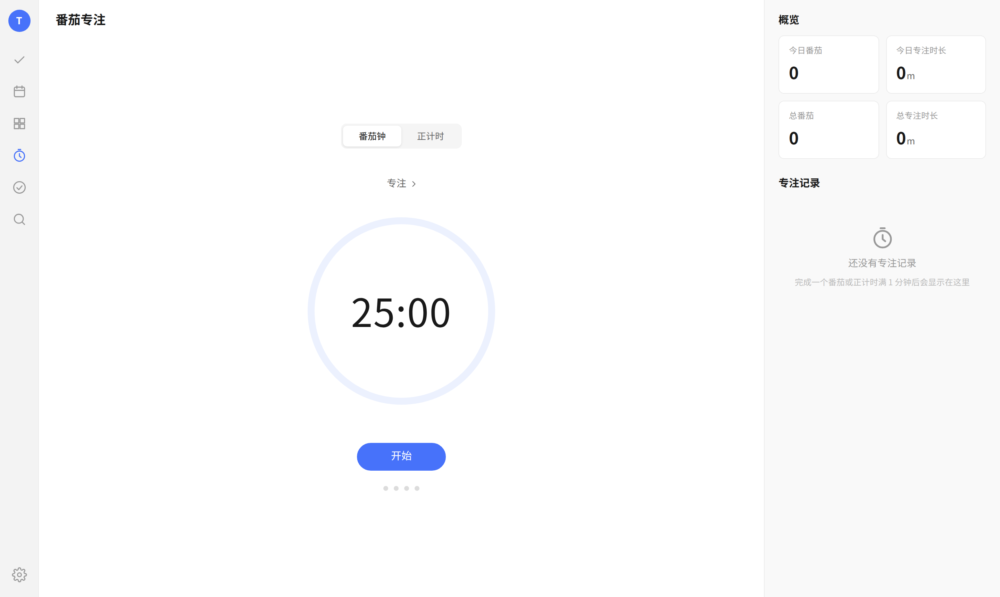

<p align="center"></p>

<h1 align="center">TickDone</h1>

<p align="center">A to-do list and time manager that runs in your browser: tasks, calendar, Eisenhower matrix, focus timer and habit tracker.</p>

<p align="center"><a href="https://tickdone.pages.dev"><b>Open TickDone → tickdone.pages.dev</b></a></p>

<p align="center">
  <b>English</b> ·
  <a href="README.zh-CN.md">简体中文</a> ·
  <a href="README.zh-TW.md">繁體中文</a> ·
  <a href="README.ja.md">日本語</a> ·
  <a href="README.ko.md">한국어</a> ·
  <a href="README.es.md">Español</a> ·
  <a href="README.fr.md">Français</a> ·
  <a href="README.de.md">Deutsch</a> ·
  <a href="README.pt-BR.md">Português (Brasil)</a> ·
  <a href="README.ru.md">Русский</a>
</p>


| Calendar | Eisenhower matrix |
|---|---|
|  |  |
| **Focus timer** | **Habit tracker** |
|  |  |

## Features

- **Tasks**: Inbox, Today, Tomorrow, Next 7 Days, All, Completed, Won't Do and Trash; your own lists, folders and tags; subtasks, notes, priorities, due dates and times, reminders and repeat rules; pinning; a context menu on every task; undo after completing or deleting.
- **Quick add** that understands what you type and highlights it: `call mom tomorrow 3pm !high #family ~Personal` sets the date, time, priority, tag and list in one line.
- **List and kanban views**, with grouping and sorting.
- **Calendar** with month, week and day views.
- **Eisenhower matrix** to sort tasks by urgency and importance.
- **Focus timer** with Pomodoro and stopwatch modes and a record of past sessions.
- **Habit tracker** with check-ins, streaks and statistics.
- **Search**, keyboard shortcuts and a dark theme.

Your data stays in your browser (localStorage). There is no account and nothing is sent to a server.

### Keyboard shortcuts

| Key | Action |
|---|---|
| `N` | New task |
| `Ctrl/⌘ F` | Search |
| `Alt 1`–`Alt 6` | Switch module |
| `Ctrl/⌘ Z` | Undo, while the undo toast is showing |
| `Esc` | Close task details |
| `?` | Show all shortcuts |

## Development

Requires Node.js 24.

```sh
npm install
npm run dev        # dev server at http://localhost:5173
npm run lint       # oxlint
npm test           # unit tests (Vitest)
npx playwright install chromium
npm run e2e        # end-to-end tests (Playwright)
npm run build      # type check and production build into dist/
```

Built with React 19, TypeScript, Vite and date-fns.

## Deployment

The live site is on Cloudflare Pages:

```sh
npm run build
npx wrangler pages deploy dist --project-name tickdone --branch main
```

## Contributing

Issues and pull requests are welcome. Please read [AGENTS.md](AGENTS.md) first: it has the project rules (English as the working language, translations for every supported language, responsive layouts, motion and drag-and-drop conventions, and the CI that every PR must pass).

## License

[MIT](LICENSE)
