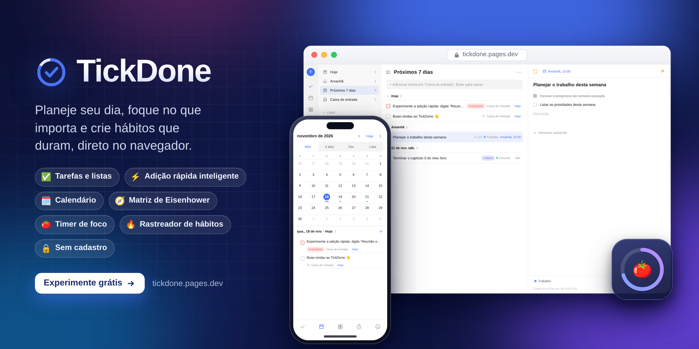

<div align="center">

<a href="https://tickdone.pages.dev"></a>

<h1>TickDone</h1>

<p><b>Planeje seu dia, foque no que importa e crie hábitos que duram, direto no navegador.</b></p>

<p>
  <a href="https://github.com/suica/tickdone/actions/workflows/ci.yml"></a>
  <a href="LICENSE"></a>
  <a href="https://tickdone.pages.dev"></a>
  <a href="#-idiomas"></a>
  <a href="#-como-contribuir"></a>
</p>

<p>
  <a href="README.md">English</a> ·
  <a href="README.zh-CN.md">简体中文</a> ·
  <a href="README.zh-TW.md">繁體中文</a> ·
  <a href="README.ja.md">日本語</a> ·
  <a href="README.ko.md">한국어</a> ·
  <a href="README.es.md">Español</a> ·
  <a href="README.fr.md">Français</a> ·
  <a href="README.de.md">Deutsch</a> ·
  <b>Português (Brasil)</b> ·
  <a href="README.ru.md">Русский</a>
</p>

<a href="https://tickdone.pages.dev"></a>

<p>
  <a href="https://tickdone.pages.dev"><b>Abrir o app</b></a> ·
  <a href="#-recursos"><b>Recursos</b></a> ·
  <a href="#-começo-rápido"><b>Começo rápido</b></a> ·
  <a href="#️-roadmap"><b>Roadmap</b></a> ·
  <a href="#-como-contribuir"><b>Como contribuir</b></a>
</p>

</div>

O TickDone é uma lista de tarefas e um gerenciador de tempo gratuito e de código aberto que roda no seu navegador. Anote tarefas do jeito que você falaria, organize-as no calendário, separe-as por urgência e importância, conclua-as com um timer de foco e mantenha seus hábitos, tudo em um só lugar.

> [!NOTE]
> **Seus dados ficam com você.** Tudo é salvo no armazenamento local do navegador: não há conta, nem cadastro, nem servidor, e nada do que você digita sai do seu dispositivo. Você pode exportar um arquivo de backup a qualquer momento em Configurações.

## ✨ Recursos

- ✅ **Tarefas e listas**: Hoje, Amanhã, Próximos 7 dias e Caixa de entrada, além de Concluídas, Descartadas e Lixeira; suas próprias listas, pastas e etiquetas; subtarefas, notas, prioridades, datas e horários de vencimento, lembretes e regras de repetição; tarefas fixadas e menu de contexto em cada tarefa.
- ⚡ **Adição rápida inteligente**: digite `call mom tomorrow 3pm !high #family ~Personal` e o TickDone define a data, o horário, a prioridade, a etiqueta e a lista, destacando cada parte enquanto você digita. Também entende chinês.
- 🗂️ **Visualizações em lista e kanban**, com agrupamento e ordenação.
- 📅 **Calendário** com visualizações de mês, semana, dia e lista. Arraste uma tarefa para outro dia ou horário, ou arraste a borda inferior de um bloco para mudar a duração.
- 🧭 **Matriz de Eisenhower**: organize as tarefas por urgência e importância e arraste-as entre os quadrantes para mudar a prioridade.
- 🍅 **Timer de foco** com modos Pomodoro e cronômetro e um histórico das sessões anteriores.
- 🔥 **Rastreador de hábitos** com check-ins, sequências e estatísticas.
- 🔍 **Busca** em tarefas, etiquetas e listas.
- ↩️ **Desfazer** pelo aviso depois de concluir, excluir ou mover uma tarefa.
- ⌨️ **Atalhos de teclado** e 🌙 **tema escuro**.
- 💾 **Backup e restauração**: exporte tudo para um arquivo JSON e importe de volta quando quiser.

## 📸 Capturas de tela

As capturas em português chegam com a [#14](https://github.com/suica/tickdone/issues/14), que passa todas as telas para a camada de tradução. Até lá a interface está em chinês simplificado, por isso o banner acima mostra o layout como ilustração. Para ver a interface de verdade, [abra o app](https://tickdone.pages.dev): é um clique, sem cadastro.

## 🚀 Começo rápido

**Use on-line:** abra [tickdone.pages.dev](https://tickdone.pages.dev). Não há nada para instalar.

**Rode localmente** (requer Node.js 24):

```sh
git clone https://github.com/suica/tickdone.git
cd tickdone
npm install
npm run dev        # http://localhost:5173
```

## ⌨️ Atalhos de teclado

| Tecla | Ação |
|---|---|
| `N` | Nova tarefa |
| `Ctrl/⌘ F` | Buscar |
| `Alt 1`–`Alt 6` | Trocar de módulo |
| `Ctrl/⌘ Z` | Desfazer, enquanto o aviso de desfazer estiver na tela |
| `Esc` | Fechar os detalhes da tarefa |
| `?` | Mostrar todos os atalhos |

## 🌍 Idiomas

Este README está disponível em 10 idiomas: English, 简体中文, 繁體中文, 日本語, 한국어, Español, Français, Deutsch, Português (Brasil) e Русский. O app tem uma camada de tradução para esses mesmos 10 idiomas, e a migração de todas as telas para ela é acompanhada na [#14](https://github.com/suica/tickdone/issues/14). Até lá a interface está em chinês simplificado; a adição rápida já entende inglês e chinês.

Encontrou uma tradução estranha? O inglês é o idioma de origem: corrija o texto em `src/i18n/` ou em `README.<locale>.md` e abra um pull request.

## 🗺️ Roadmap

Cada item tem link para a sua issue. Os itens marcados já estão no ar em [tickdone.pages.dev](https://tickdone.pages.dev).

- [x] Tarefas, listas, etiquetas, adição rápida, calendário, matriz de Eisenhower, timer de foco e rastreador de hábitos
- [x] CI com testes unitários e de ponta a ponta ([#7](https://github.com/suica/tickdone/issues/7))
- [x] Código aberto: README em 10 idiomas, licença MIT, regras do projeto ([#10](https://github.com/suica/tickdone/issues/10))
- [ ] Layouts para celulares, tablets e telas grandes ([#8](https://github.com/suica/tickdone/issues/8))
- [ ] Arrastar e soltar em todo o app ([#9](https://github.com/suica/tickdone/issues/9))
- [ ] Animações ([#3](https://github.com/suica/tickdone/issues/3))
- [x] Link do GitHub e seção Sobre no app ([#4](https://github.com/suica/tickdone/issues/4))
- [ ] Interface em 10 idiomas ([#14](https://github.com/suica/tickdone/issues/14))
- [ ] Refinamento da interface, tela por tela ([#11](https://github.com/suica/tickdone/issues/11))
- [ ] Seleção múltipla e edição em lote ([#15](https://github.com/suica/tickdone/issues/15))
- [ ] Navegação pelo teclado nas listas de tarefas ([#16](https://github.com/suica/tickdone/issues/16))
- [ ] Notificações de lembretes ([#17](https://github.com/suica/tickdone/issues/17))
- [ ] Instalar como app e usar offline ([#18](https://github.com/suica/tickdone/issues/18))
- [ ] Filtros salvos ([#19](https://github.com/suica/tickdone/issues/19))
- [ ] Estatísticas de tarefas, do timer de foco e do rastreador de hábitos ([#20](https://github.com/suica/tickdone/issues/20))
- [ ] Markdown nas notas das tarefas ([#21](https://github.com/suica/tickdone/issues/21))
- [ ] Visualização em linha do tempo ([#22](https://github.com/suica/tickdone/issues/22))
- [ ] Mais regras de repetição ([#23](https://github.com/suica/tickdone/issues/23))
- [ ] Arquivar listas ([#24](https://github.com/suica/tickdone/issues/24))
- [ ] Acessibilidade ([#25](https://github.com/suica/tickdone/issues/25))
- [ ] Rápido mesmo com milhares de tarefas ([#26](https://github.com/suica/tickdone/issues/26))
- [ ] Temas e cores de destaque ([#27](https://github.com/suica/tickdone/issues/27))
- [ ] Calendário: planejar tarefas sem data, visualização de agenda ([#28](https://github.com/suica/tickdone/issues/28))

## 🧰 Tecnologias

| Parte | Feito com |
|---|---|
| ⚛️ Interface | React 19 e TypeScript |
| 📆 Datas | date-fns, a única dependência de execução além do React |
| ⚡ Build | Vite |
| 💾 Armazenamento | `localStorage` no navegador, sem backend |
| 🧪 Testes | Vitest (unitários) e Playwright (ponta a ponta) |
| 🧹 Lint | oxlint |
| ☁️ Hospedagem | Cloudflare Pages |

## 🛠️ Desenvolvimento

```sh
npm install
npm run dev        # dev server at http://localhost:5173
npm run lint       # oxlint
npm test           # unit tests (Vitest)
npx playwright install chromium
npm run e2e        # end-to-end tests (Playwright)
npm run build      # type check and production build into dist/
```

- 🖼️ O banner e as capturas dos READMEs são gerados a partir de um build de produção: `npm run build` e depois `node scripts/promo/render.mjs` (as opções estão no início do [script](scripts/promo/render.mjs)).
- 🗺️ `node scripts/roadmap.mjs done <issue>` marca um item do roadmap em todos os READMEs.

## 🚢 Deploy

O site no ar está no Cloudflare Pages:

```sh
npm run build
npx wrangler pages deploy dist --project-name tickdone --branch main
```

## 🤝 Como contribuir

Issues e pull requests são bem-vindos! Antes de começar, leia o [AGENTS.md](AGENTS.md). Ele reúne as regras do projeto, tanto para pessoas quanto para agentes de programação:

- 💬 toda mudança começa com uma issue e entra por um pull request que a referencia;
- 🌐 o inglês é o idioma de trabalho, e todo texto visível para o usuário é traduzido para os 10 idiomas;
- 📐 as telas funcionam em qualquer largura, de um celular de 360 px a um monitor de 2560 px, com convenções comuns para animações e arrastar e soltar;
- ✅ a CI (lint, verificação de tipos e build, testes unitários e de ponta a ponta) precisa estar verde antes do merge.

Se o TickDone ajuda você a dar conta das coisas, uma ⭐ no GitHub ajuda outras pessoas a encontrá-lo.

## 📄 Licença

[MIT](LICENSE) © 2026 suica
