<div align="center">

<a href="https://tickdone.pages.dev"></a>

<h1>TickDone</h1>

<p><b>Planeje seu dia, foque no que importa e crie hábitos que duram, direto no navegador.</b></p>

<p>
  <a href="https://github.com/suica/tickdone/actions/workflows/ci.yml"></a>
  <a href="LICENSE"></a>
  <a href="https://tickdone.pages.dev"></a>
  <a href="#-idiomas"></a>
  <a href="#-como-contribuir"></a>
</p>

<p>
  <a href="README.md">English</a> ·
  <a href="README.zh-CN.md">简体中文</a> ·
  <a href="README.zh-TW.md">繁體中文</a> ·
  <a href="README.ja.md">日本語</a> ·
  <a href="README.ko.md">한국어</a> ·
  <a href="README.es.md">Español</a> ·
  <a href="README.fr.md">Français</a> ·
  <a href="README.de.md">Deutsch</a> ·
  <b>Português (Brasil)</b> ·
  <a href="README.ru.md">Русский</a>
</p>

<a href="https://tickdone.pages.dev"></a>

<p>
  <a href="https://tickdone.pages.dev"><b>Abrir o app</b></a> ·
  <a href="#-recursos"><b>Recursos</b></a> ·
  <a href="#-começo-rápido"><b>Começo rápido</b></a> ·
  <a href="#️-roadmap"><b>Roadmap</b></a> ·
  <a href="#-como-contribuir"><b>Como contribuir</b></a>
</p>

</div>

O TickDone é uma lista de tarefas e um gerenciador de tempo gratuito e de código aberto que roda no seu navegador. Anote tarefas do jeito que você falaria, organize-as no calendário, separe-as por urgência e importância, conclua-as com um timer de foco e mantenha seus hábitos, tudo em um só lugar.

> [!NOTE]
> **Seus dados ficam com você.** Tudo é salvo no armazenamento local do navegador: não há conta nem cadastro, e suas tarefas nunca saem do seu dispositivo. A única coisa que passa pelo servidor do TickDone é o endereço de um calendário assinado, que um pequeno proxy busca para você sem guardar nada. Você pode exportar um arquivo de backup a qualquer momento em Configurações.

## ✨ Recursos

- ✅ **Tarefas e listas**: Hoje, Amanhã, Próximos 7 dias e Caixa de entrada, além de Concluídas, Descartadas e Lixeira; suas próprias listas, pastas e etiquetas; subtarefas, notas, prioridades, datas e horários de vencimento, lembretes e regras de repetição; tarefas fixadas e menu de contexto em cada tarefa.
- ⚡ **Adição rápida inteligente**: digite `call mom tomorrow 3pm !high #family ~Personal` e o TickDone define a data, o horário, a prioridade, a etiqueta e a lista, destacando cada parte enquanto você digita. Também entende chinês.
- 🗂️ **Visualizações em lista e kanban**, com agrupamento e ordenação.
- 📏 **Visualização em linha do tempo** para listas: as tarefas são barras sobre seus dias (um losango para um único dia), agrupadas por seção, com linha de hoje e zoom por dia, semana e mês. Arraste uma barra para movê-la, as pontas para mudar início e fim, e as tarefas sem data a partir do painel Sem data; tudo pode ser desfeito. No celular, a lista aparece no lugar.
- 🗄️ **Listas arquivadas**: arquive uma lista concluída pelo menu dela. Ela vai para a seção recolhida "Listas arquivadas", as tarefas saem das listas inteligentes, do calendário, da matriz e da busca, e ela abre somente leitura até você desarquivá-la.
- 🔎 **Filtros salvos**: combine listas, etiquetas, prioridades, datas (atrasadas, hoje, esta semana, um período personalizado…), palavras-chave e tarefas concluídas em uma lista inteligente sua, com nome, ícone e cor na barra lateral.
- 📝 **Markdown nas notas**: títulos, negrito, itálico, tachado, código, links, listas, citações e listas de verificação que você marca na própria nota; digite `**negrito**`, `# ` ou `- [ ] ` e a formatação aparece enquanto você digita, com a nota ainda salva em Markdown.
- 🔁 **Regras de repetição**: a cada N dias, semanas, meses ou anos; dias da semana escolhidos; o dia N, o último dia ou o N-ésimo/último dia da semana do mês; uma data por ano; só dias úteis. Termina após N vezes ou em uma data, conta a partir do vencimento ou da conclusão, pula uma ocorrência e entende "every 2 weeks" na adição rápida.
- 📅 **Calendário** com visualizações de mês, semana, dia e lista. Arraste uma tarefa para outro dia ou horário, ou arraste a borda inferior de um bloco para mudar a duração.
- 🗓️ **Planeje no calendário**: um painel "Sem data" ao lado das visualizações de semana e dia (uma folha inferior no celular) lista as tarefas abertas que ainda não têm data, filtradas por lista. Arraste uma para um dia ou horário para agendá-la, ou solte uma tarefa de volta no painel para remover a data, com desfazer no aviso. A visualização de agenda mostra os próximos dias numa única lista rolável, com suas tarefas e os eventos dos calendários assinados.
- 🔔 **Assinaturas de calendários**: assine qualquer calendário que publique um endereço iCal (.ics ou webcal://), como os de trabalho, escola, equipe ou feriados, e veja os eventos no calendário, somente leitura e com a cor de cada um. Eles se atualizam sozinhos e continuam disponíveis off-line.
- 🧭 **Matriz de Eisenhower**: organize as tarefas por urgência e importância e arraste-as entre os quadrantes para mudar a prioridade.
- 🍅 **Timer de foco** com modos Pomodoro e cronômetro e um histórico das sessões anteriores.
- 🔥 **Rastreador de hábitos** com check-ins, sequências e estatísticas.
- 📊 **Estatísticas**: tarefas concluídas por dia, semana ou mês, taxa de conclusão, tarefas atrasadas, divisão por lista, prioridade e etiqueta, e sua sequência; tempo de foco por dia, sessões, tempo por tarefa e por lista, e seu melhor horário do dia; taxa de check-in e sequências dos seus hábitos. Escolha uma semana, um mês, um ano, os últimos 30 dias ou seu próprio período, e passe o mouse ou toque num gráfico para ver os detalhes.
- 🔍 **Busca** em tarefas, etiquetas e listas.
- ↩️ **Desfazer** pelo aviso depois de concluir, excluir ou mover uma tarefa.
- ⌨️ **Atalhos de teclado**.
- ☑️ **Seleção múltipla e edição em lote**: selecione tarefas com Ctrl/⌘+clique, Shift+clique ou Ctrl/⌘+A e mude data, prioridade, lista ou etiquetas, conclua, exclua ou arraste todas de uma vez; um único desfazer reverte o lote inteiro. No celular, toque e segure para começar a selecionar.
- 🎨 **Temas e cores de destaque**: claro, escuro ou seguir o sistema, e oito cores de destaque para botões, caixas de seleção, seleção e anéis de foco. As mudanças valem na hora, com prévia nas Configurações, e a tela de abertura e o ícone da aba acompanham.
- ⏰ **Lembretes**: na hora do lembrete de uma tarefa, o TickDone mostra um cartão para concluir, adiar (5 min, 15 min, 1 hora, amanhã) ou abrir a tarefa, e uma notificação do sistema se você permitir. O TickDone não tem servidor, então os lembretes tocam enquanto ele está aberto em uma aba ou instalado e em execução; os que venceram com ele fechado aparecem quando você o abre de novo.
- 📲 **Instale como app**: adicione o TickDone à tela inicial ou ao Dock em Configurações → Sobre, e ele abre off-line depois da primeira visita. Quando sai uma versão nova, um aviso oferece recarregar.
- 💾 **Backup e restauração**: exporte tudo para um arquivo JSON e importe de volta quando quiser.
- 🚀 **Rápido com milhares de tarefas**: listas longas e resultados de busca desenham só as linhas na tela, então uma lista de 5.000 tarefas rola, troca e responde tão rápido quanto uma curta, com arrastar e soltar, teclado, seleção múltipla e a animação de conclusão funcionando como antes. As alterações são salvas em segundo plano.
- ♿ **Acessível**: tudo funciona pelo teclado, com indicador de foco visível e um link para pular para o conteúdo; diálogos, menus e painéis mantêm o foco dentro e o devolvem ao fechar; leitores de tela recebem regiões, títulos, botões e caixas de seleção com nome, e cada aviso é anunciado. As tarefas sobem e descem com Alt+↑ / Alt+↓ ou pelo menu, como alternativa a arrastar. O texto atende ao contraste WCAG AA no claro e no escuro, e os modos de alto contraste e a redução de movimento são respeitados. Uma verificação automática roda em cada tela.

## 📸 Capturas de tela

<table>
  <tr>
    <td colspan="2">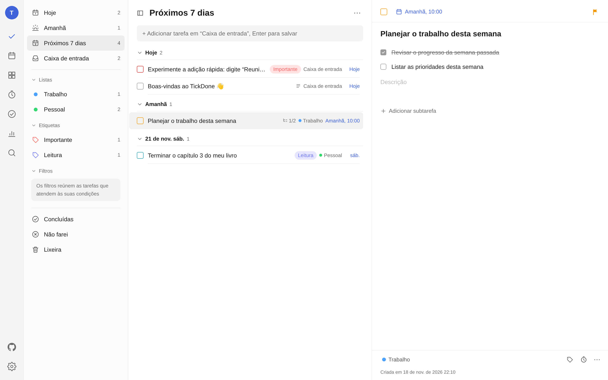</td>
  </tr>
  <tr>
    <th>Calendário</th>
    <th>Matriz</th>
  </tr>
  <tr>
    <td>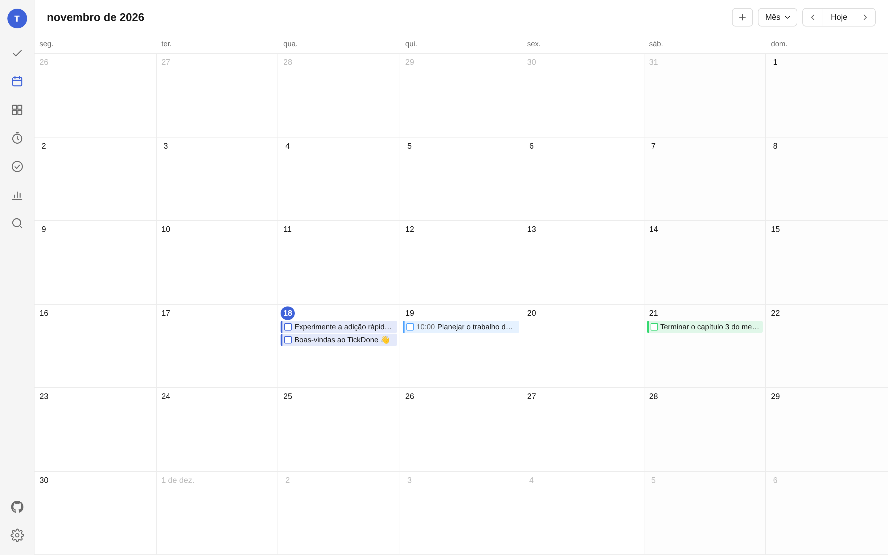</td>
    <td>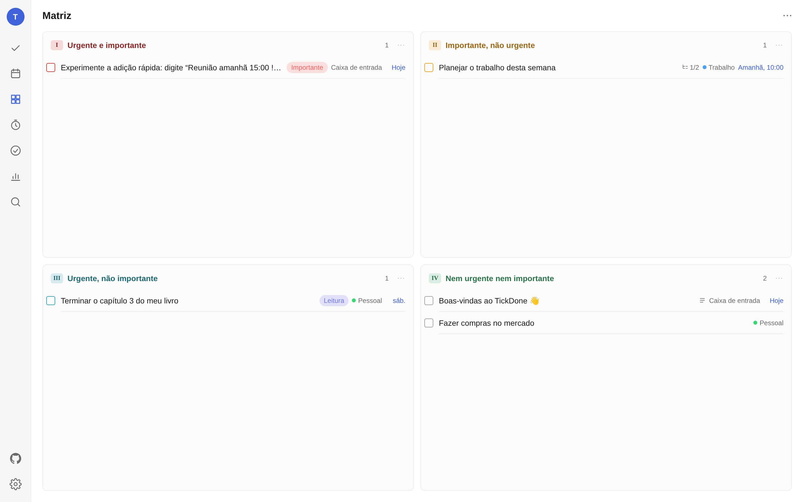</td>
  </tr>
  <tr>
    <th>Foco</th>
    <th>Hábitos</th>
  </tr>
  <tr>
    <td>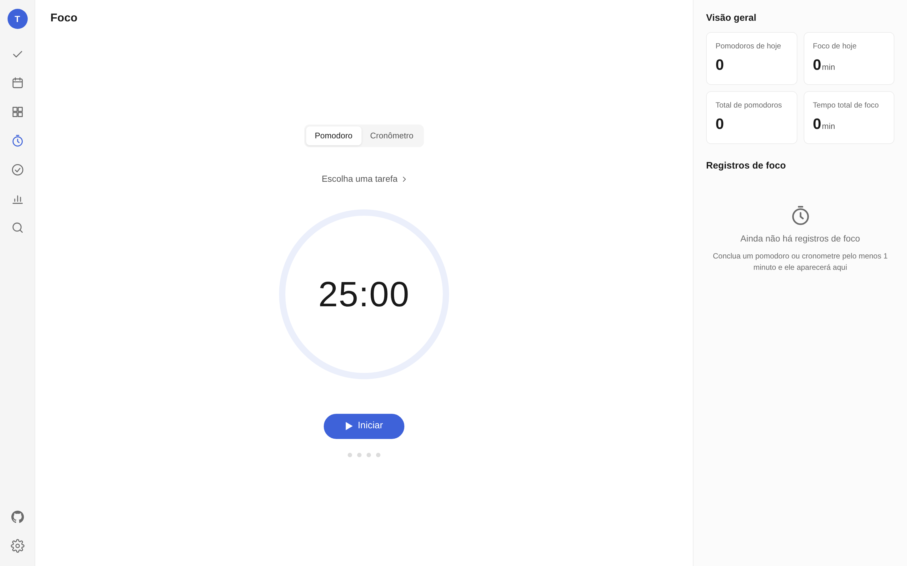</td>
    <td>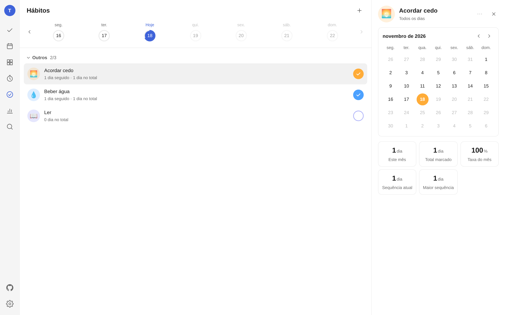</td>
  </tr>
  <tr>
    <th colspan="2">Estatísticas</th>
  </tr>
  <tr>
    <td colspan="2">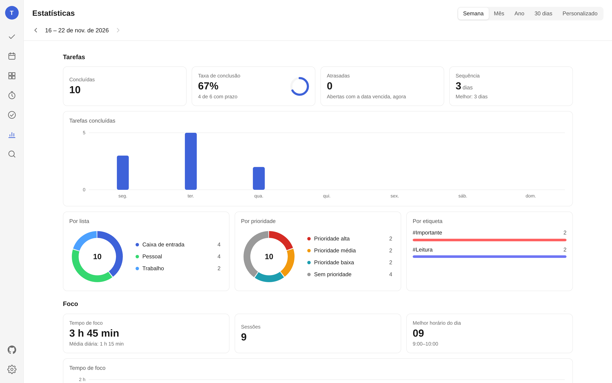</td>
  </tr>
</table>

<table>
  <tr>
    <td>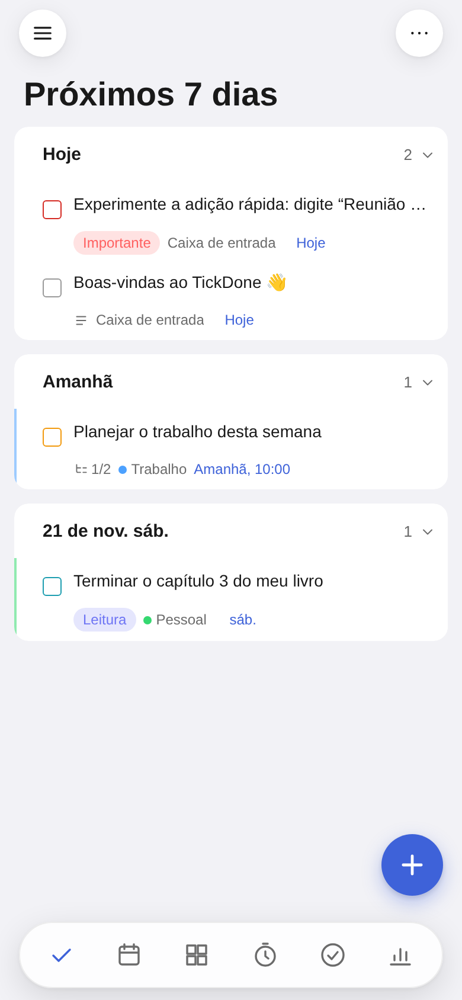</td>
    <td>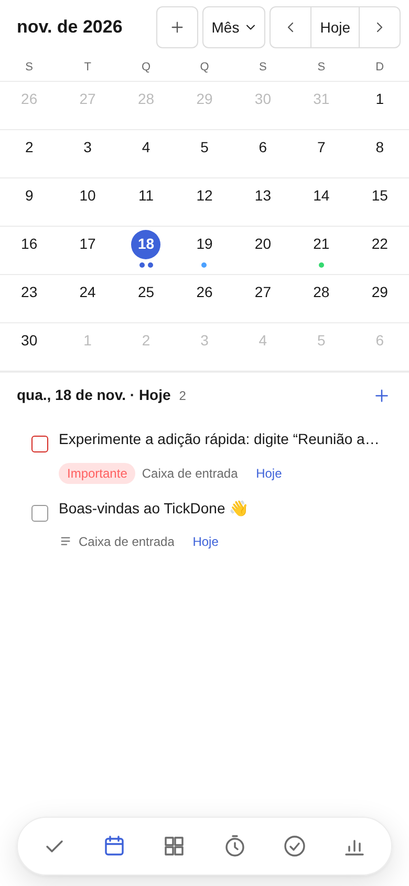</td>
    <td>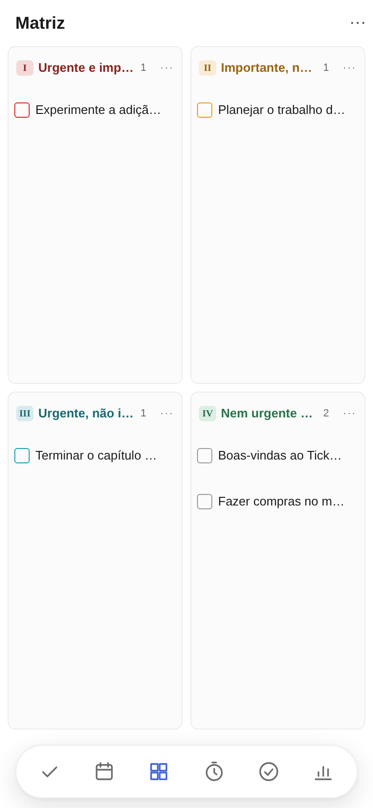</td>
    <td>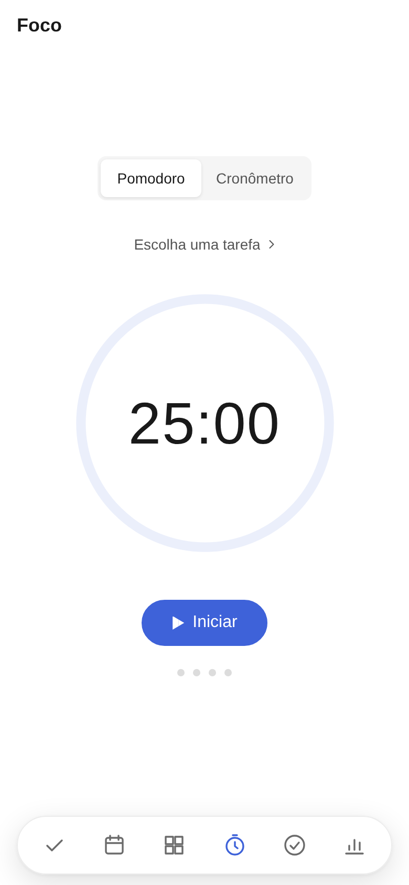</td>
    <td>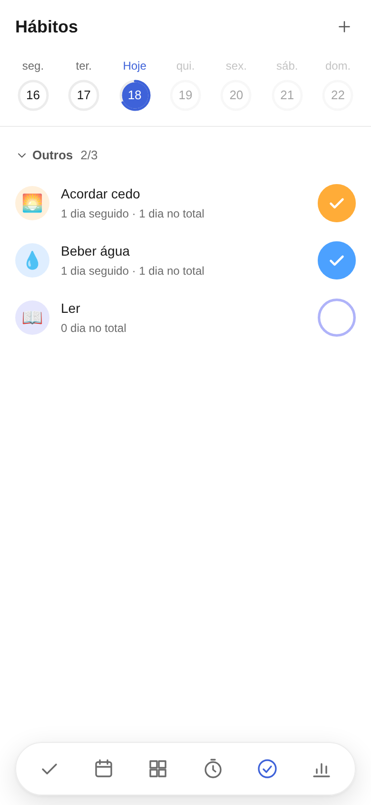</td>
    <td>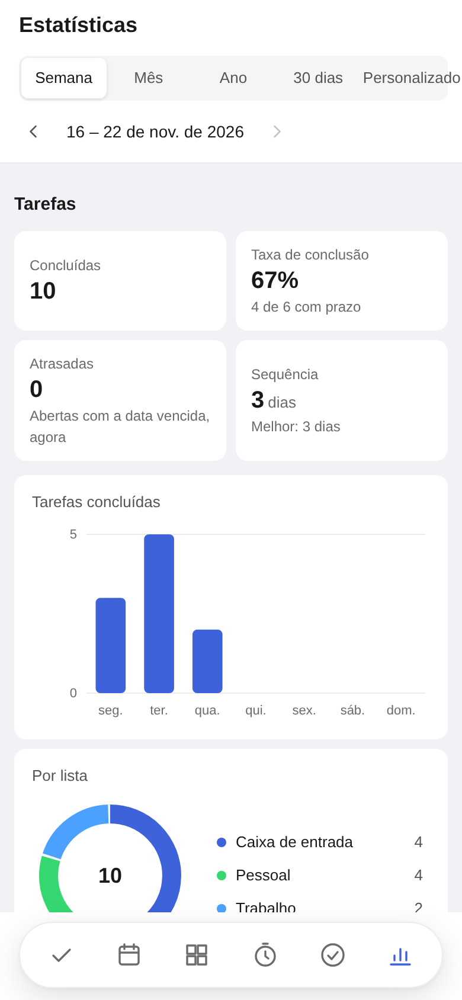</td>
  </tr>
</table>

## 🚀 Começo rápido

**Use on-line:** abra [tickdone.pages.dev](https://tickdone.pages.dev). Não há nada para instalar.

**Rode localmente** (requer Node.js 24):

```sh
git clone https://github.com/suica/tickdone.git
cd tickdone
npm install
npm run dev        # http://localhost:5173
```

## ⌨️ Atalhos de teclado

| Tecla | Ação |
|---|---|
| `N` | Nova tarefa |
| `Ctrl/⌘ F` | Buscar |
| `Alt 1`–`Alt 6` | Trocar de módulo |
| `Ctrl/⌘ Z` | Desfazer, enquanto o aviso de desfazer estiver na tela |
| `Esc` | Limpar a seleção ou fechar os detalhes da tarefa |
| `↑` `↓` / `J` `K` | Tarefa anterior / próxima da lista |
| `Shift ↑` `Shift ↓` | Ampliar a seleção |
| `Ctrl/⌘ Click` | Adicionar uma tarefa à seleção ou tirá-la |
| `Shift Click` | Selecionar um intervalo de tarefas |
| `Ctrl/⌘ A` | Selecionar todas as tarefas da lista |
| `Enter` | Editar o título |
| `Space` / `Ctrl/⌘ Enter` | Concluir ou reabrir |
| `1` `2` `3` `4` | Prioridade: alta, média, baixa, nenhuma |
| `T` / `M` / `W` | Data: hoje, amanhã, semana que vem |
| `D` / `Shift D` | Escolher uma data / remover a data |
| `Delete` / `Backspace` | Mover para a lixeira (dá para desfazer no aviso) |
| `?` | Mostrar todos os atalhos |

## 🌍 Idiomas

Este README está disponível em 10 idiomas: English, 简体中文, 繁體中文, 日本語, 한국어, Español, Français, Deutsch, Português (Brasil) e Русский. Toda a interface está traduzida para esses mesmos 10 idiomas. O TickDone segue o idioma do seu navegador, e você pode trocá-lo quando quiser em Configurações. A adição rápida entende datas escritas em inglês ou chinês e palavras de prioridade nos 10 idiomas.

Encontrou uma tradução estranha? O inglês é o idioma de origem: corrija o texto em `src/i18n/` ou em `README.<locale>.md` e abra um pull request.

## 🗺️ Roadmap

Cada item tem link para a sua issue. Os itens marcados já estão no ar em [tickdone.pages.dev](https://tickdone.pages.dev).

- [x] Tarefas, listas, etiquetas, adição rápida, calendário, matriz de Eisenhower, timer de foco e rastreador de hábitos
- [x] CI com testes unitários e de ponta a ponta ([#7](https://github.com/suica/tickdone/issues/7))
- [x] Código aberto: README em 10 idiomas, licença MIT, regras do projeto ([#10](https://github.com/suica/tickdone/issues/10))
- [x] Layouts para celulares, tablets e telas grandes ([#8](https://github.com/suica/tickdone/issues/8))
- [x] Arrastar e soltar em todo o app ([#9](https://github.com/suica/tickdone/issues/9))
- [x] Animações ([#3](https://github.com/suica/tickdone/issues/3))
- [x] Link do GitHub e seção Sobre no app ([#4](https://github.com/suica/tickdone/issues/4))
- [x] Interface em 10 idiomas ([#14](https://github.com/suica/tickdone/issues/14))
- [x] Refinamento da interface, tela por tela ([#11](https://github.com/suica/tickdone/issues/11))
- [x] Seleção múltipla e edição em lote ([#15](https://github.com/suica/tickdone/issues/15))
- [x] Navegação pelo teclado nas listas de tarefas ([#16](https://github.com/suica/tickdone/issues/16))
- [x] Notificações de lembretes ([#17](https://github.com/suica/tickdone/issues/17))
- [x] Instalar como app e usar offline ([#18](https://github.com/suica/tickdone/issues/18))
- [x] Filtros salvos ([#19](https://github.com/suica/tickdone/issues/19))
- [x] Estatísticas de tarefas, do timer de foco e do rastreador de hábitos ([#20](https://github.com/suica/tickdone/issues/20))
- [x] Markdown nas notas das tarefas ([#21](https://github.com/suica/tickdone/issues/21))
- [x] Visualização em linha do tempo ([#22](https://github.com/suica/tickdone/issues/22))
- [x] Mais regras de repetição ([#23](https://github.com/suica/tickdone/issues/23))
- [x] Arquivar listas ([#24](https://github.com/suica/tickdone/issues/24))
- [x] Acessibilidade ([#25](https://github.com/suica/tickdone/issues/25))
- [x] Rápido mesmo com milhares de tarefas ([#26](https://github.com/suica/tickdone/issues/26))
- [x] Temas e cores de destaque ([#27](https://github.com/suica/tickdone/issues/27))
- [x] Calendário: planejar tarefas sem data, visualização de agenda ([#28](https://github.com/suica/tickdone/issues/28))
- [x] Assinaturas de calendários ([#51](https://github.com/suica/tickdone/issues/51))

## 🧰 Tecnologias

| Parte | Feito com |
|---|---|
| ⚛️ Interface | React 19 e TypeScript |
| 📆 Datas | date-fns, a única dependência de execução além do React |
| ⚡ Build | Vite |
| 💾 Armazenamento | `localStorage` no navegador, sem backend |
| 🧪 Testes | Vitest (unitários) e Playwright (ponta a ponta) |
| 🧹 Lint | oxlint |
| ☁️ Hospedagem | Cloudflare Pages |

## 🛠️ Desenvolvimento

```sh
npm install
npm run dev        # dev server at http://localhost:5173
npm run lint       # oxlint
npm test           # unit tests (Vitest)
npx playwright install chromium
npm run e2e        # end-to-end tests (Playwright)
npm run build      # type check and production build into dist/
```

- 🖼️ O banner e as capturas dos READMEs são gerados a partir de um build de produção: `npm run build` e depois `node scripts/promo/render.mjs` (as opções estão no início do [script](scripts/promo/render.mjs)).
- 🗺️ `node scripts/roadmap.mjs done <issue>` marca um item do roadmap em todos os READMEs.

## 🚢 Deploy

O site no ar está no Cloudflare Pages:

```sh
npm run build
npx wrangler pages deploy dist --project-name tickdone --branch main
```

## 🤝 Como contribuir

Issues e pull requests são bem-vindos! Antes de começar, leia o [AGENTS.md](AGENTS.md). Ele reúne as regras do projeto, tanto para pessoas quanto para agentes de programação:

- 💬 toda mudança começa com uma issue e entra por um pull request que a referencia;
- 🌐 o inglês é o idioma de trabalho, e todo texto visível para o usuário é traduzido para os 10 idiomas;
- 📐 as telas funcionam em qualquer largura, de um celular de 360 px a um monitor de 2560 px, com convenções comuns para animações e arrastar e soltar;
- ✅ a CI (lint, verificação de tipos e build, testes unitários e de ponta a ponta) precisa estar verde antes do merge.

Se o TickDone ajuda você a dar conta das coisas, uma ⭐ no GitHub ajuda outras pessoas a encontrá-lo.

## 📄 Licença

[MIT](LICENSE) © 2026 suica
