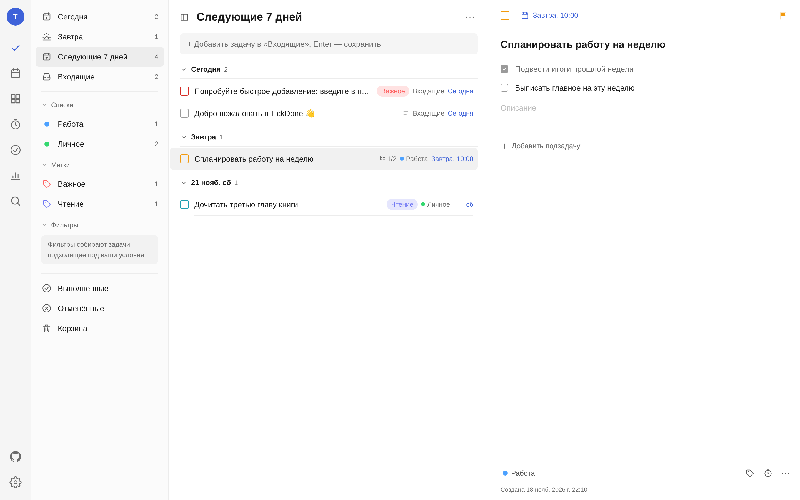
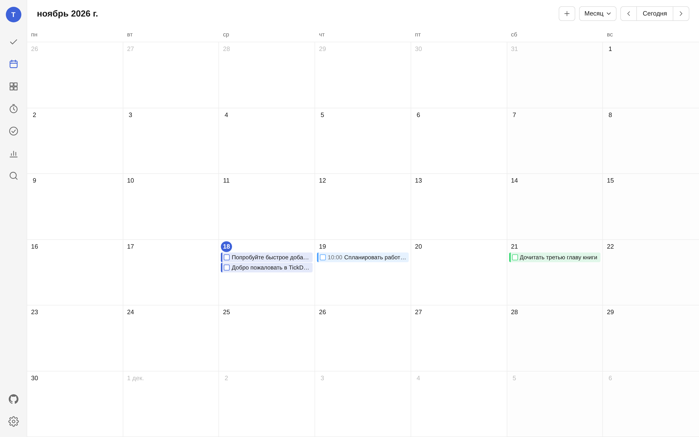
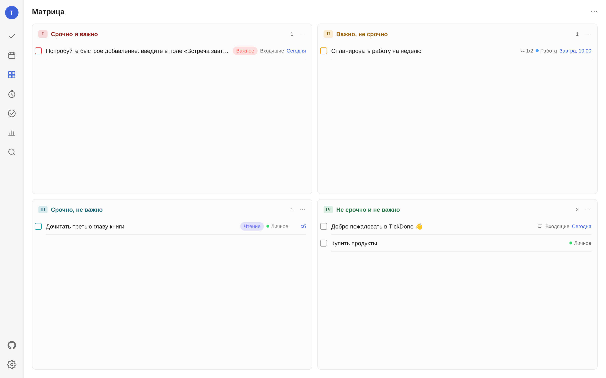
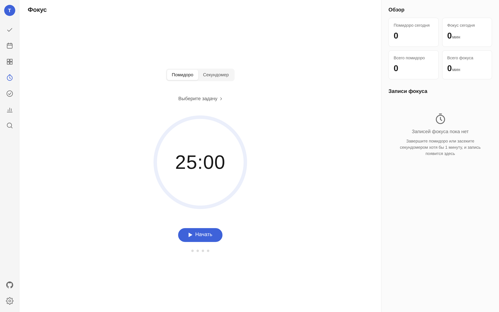
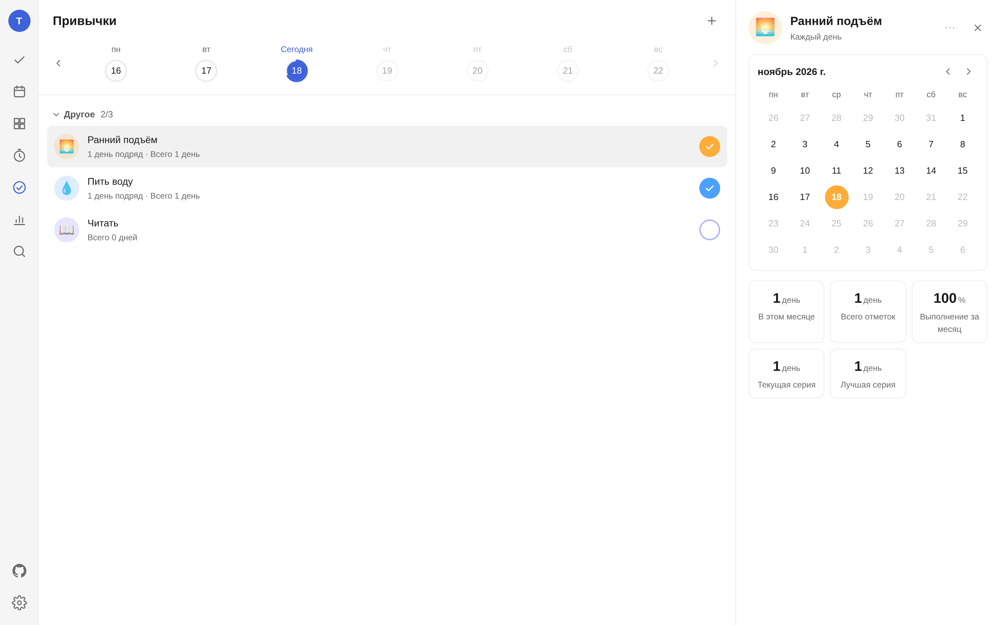
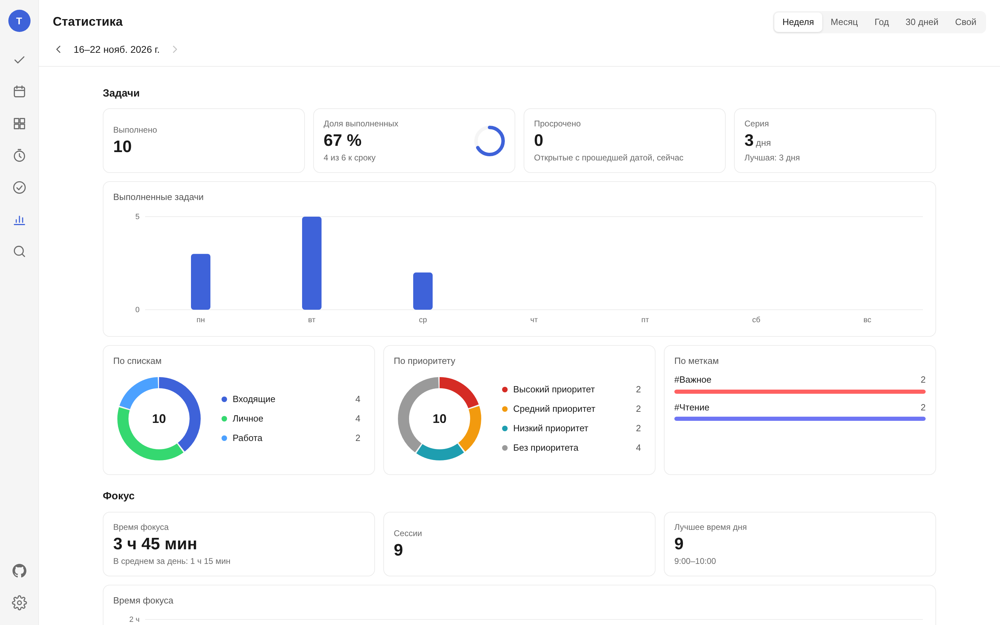
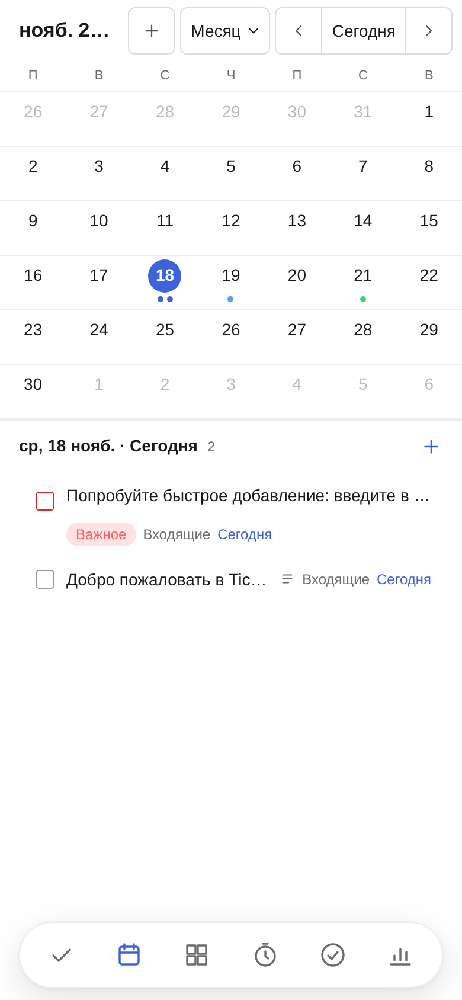
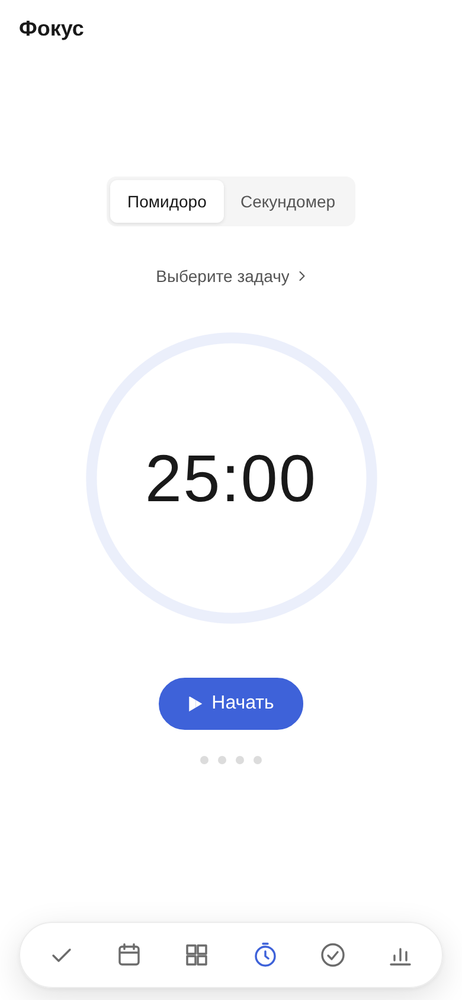
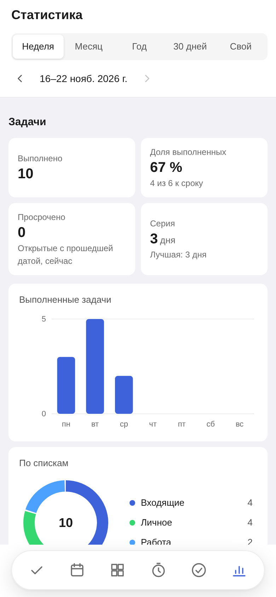

<div align="center">

<a href="https://tickdone.pages.dev"></a>

<h1>TickDone</h1>

<p><b>Планируйте день, сосредоточьтесь на главном и закрепляйте полезные привычки — прямо в браузере.</b></p>

<p>
  <a href="https://github.com/suica/tickdone/actions/workflows/ci.yml"></a>
  <a href="LICENSE"></a>
  <a href="https://tickdone.pages.dev"></a>
  <a href="#-языки"></a>
  <a href="#-участие-в-разработке"></a>
</p>

<p>
  <a href="README.md">English</a> ·
  <a href="README.zh-CN.md">简体中文</a> ·
  <a href="README.zh-TW.md">繁體中文</a> ·
  <a href="README.ja.md">日本語</a> ·
  <a href="README.ko.md">한국어</a> ·
  <a href="README.es.md">Español</a> ·
  <a href="README.fr.md">Français</a> ·
  <a href="README.de.md">Deutsch</a> ·
  <a href="README.pt-BR.md">Português (Brasil)</a> ·
  <b>Русский</b>
</p>

<a href="https://tickdone.pages.dev"></a>

<p>
  <a href="https://tickdone.pages.dev"><b>Открыть приложение</b></a> ·
  <a href="#-возможности"><b>Возможности</b></a> ·
  <a href="#-быстрый-старт"><b>Быстрый старт</b></a> ·
  <a href="#️-дорожная-карта"><b>Дорожная карта</b></a> ·
  <a href="#-участие-в-разработке"><b>Участие в разработке</b></a>
</p>

</div>

TickDone — бесплатный список дел и планировщик времени с открытым исходным кодом, который работает прямо в браузере. Записывайте задачи так, как говорите, расставляйте их в календаре, распределяйте по срочности и важности, выполняйте с таймером фокусировки и не бросайте привычки — всё в одном месте.

> [!NOTE]
> **Ваши данные остаются у вас.** Всё хранится в локальном хранилище браузера: нет ни аккаунта, ни регистрации, и ваши задачи никогда не покидают устройство. Через сервер TickDone проходит только адрес календаря, на который вы подписаны: небольшой прокси загружает его для вас и ничего не сохраняет. Резервную копию можно в любой момент выгрузить в настройках.

## ✨ Возможности

- ✅ **Задачи и списки**: «Сегодня», «Завтра», «Ближайшие 7 дней» и «Входящие», а также «Выполненные», «Не буду делать» и «Корзина»; собственные списки, папки и теги; подзадачи, заметки, приоритеты, сроки с датой и временем, напоминания и правила повторения; закрепление и контекстное меню у каждой задачи.
- ⚡ **Умное быстрое добавление**: введите `call mom tomorrow 3pm !high #family ~Personal`, и TickDone задаст дату, время, приоритет, тег и список, подсвечивая каждую распознанную часть прямо при вводе. Понимает и китайский.
- 🗂️ **Вид списка и канбан-доски** с группировкой и сортировкой.
- 📏 **Вид таймлайна** для списков: задачи — полосы по своим дням (ромб для одного дня), сгруппированные по разделам, с линией «сегодня» и масштабом по дням, неделям и месяцам. Перетаскивайте полосу, чтобы сдвинуть её, её концы — чтобы изменить начало и конец, а задачи без даты — из панели «Без даты»; всё можно отменить. На телефоне показывается список.
- 🗄️ **Архив списков**: завершённый список можно отправить в архив из его меню. Он переезжает в свёрнутый раздел «Архив списков», его задачи пропадают из умных списков, календаря, матрицы и поиска, а сам список открывается только для чтения, пока вы не вернёте его.
- 🔎 **Сохранённые фильтры**: объединяйте списки, метки, приоритеты, даты (просроченные, сегодня, эта неделя, свой период…), ключевые слова и выполненные задачи в собственный умный список с названием, значком и цветом в боковой панели.
- 📝 **Markdown в заметках**: заголовки, жирный, курсив, зачёркивание, код, ссылки, списки, цитаты и чек-листы, которые отмечаются прямо в заметке; `**жирный**`, `# ` или `- [ ] ` оформляются прямо при вводе, а заметка по-прежнему хранится в Markdown.
- 🔁 **Правила повтора**: раз в N дней, недель, месяцев или лет; выбранные дни недели; N-е число, последний день или N-й/последний день недели месяца; дата каждый год; только будни. Окончание после N раз или в дату, отсчёт от срока или от даты выполнения, пропуск одного раза и фразы вроде «every 2 weeks» при быстром добавлении.
- 📅 **Календарь** с режимами «месяц», «неделя», «день» и «список». Перетащите задачу на другой день или время или потяните нижний край блока, чтобы изменить длительность.
- 🗓️ **Планирование в календаре**: панель «Без даты» рядом с видами «Неделя» и «День» (на телефоне — нижняя шторка) показывает открытые задачи без даты с фильтром по списку. Перетащите задачу на день или время, чтобы запланировать её, или обратно на панель, чтобы убрать дату; оба действия можно отменить из уведомления. Вид «Расписание» показывает ближайшие дни одним прокручиваемым списком с задачами и событиями подписанных календарей.
- 🔔 **Подписки на календари**: подпишитесь на любой календарь с адресом iCal (.ics или webcal://) — рабочий, учебный, командный или календарь праздников — и его события появятся в календаре своим цветом, только для чтения. Они обновляются сами и доступны офлайн.
- 🧭 **Матрица Эйзенхауэра**: распределяйте задачи по срочности и важности и перетаскивайте их между квадрантами, чтобы менять приоритет.
- 🍅 **Таймер фокусировки** с режимами помодоро и секундомера и историей прошлых сессий.
- 🔥 **Трекер привычек** с отметками, сериями и статистикой.
- 📊 **Статистика**: выполненные задачи по дням, неделям или месяцам, доля выполненных, просроченные задачи, разбивка по спискам, приоритетам и меткам и ваша серия; время фокуса по дням, сессии, время по задачам и спискам и лучшее время дня; доля отметок и серии привычек. Выберите неделю, месяц, год, последние 30 дней или свой период и наведите курсор или нажмите на график, чтобы увидеть подробности.
- 🔍 **Поиск** по задачам, тегам и спискам.
- ↩️ **Отмена** из уведомления после выполнения, удаления или перемещения задачи.
- ⌨️ **Горячие клавиши**.
- ☑️ **Множественный выбор и пакетное редактирование**: выделяйте задачи с Ctrl/⌘+щелчок, Shift+щелчок или Ctrl/⌘+A, меняйте дату, приоритет, список или метки, завершайте, удаляйте или перетаскивайте их все сразу; одна отмена возвращает всё. На телефоне выбор начинается долгим нажатием.
- 🎨 **Темы и акцентный цвет**: светлая, тёмная или как в системе, и восемь акцентных цветов для кнопок, флажков, выделения и рамки фокуса. Изменения применяются сразу, с предпросмотром в настройках, а экран запуска и значок вкладки меняются вместе с ними.
- ⏰ **Напоминания**: в момент напоминания TickDone показывает карточку, где задачу можно выполнить, отложить (5 мин, 15 мин, 1 час, до завтра) или открыть, а с вашего разрешения — и системное уведомление. У TickDone нет сервера, поэтому напоминания срабатывают, пока он открыт во вкладке или установлен и запущен; пропущенные, пока он был закрыт, появятся при следующем открытии.
- 📲 **Установка как приложения**: добавьте TickDone на главный экран или в док в разделе «Настройки → О приложении» — после первого визита он открывается и без сети. Когда выходит новая версия, появится предложение перезагрузить.
- 💾 **Резервное копирование и восстановление**: выгрузите все данные в JSON-файл и загрузите их обратно.
- 🚀 **Быстро даже с тысячами задач**: длинные списки и результаты поиска рисуют только видимые строки, поэтому список из 5 000 задач прокручивается, переключается и откликается так же быстро, как короткий, а перетаскивание, клавиатура, множественный выбор и анимация выполнения работают как прежде. Изменения сохраняются в фоне.
- ♿ **Доступность**: всё работает с клавиатуры, фокус хорошо виден, есть ссылка для перехода к содержимому; диалоги, меню и панели удерживают фокус внутри и возвращают его при закрытии; программы экранного доступа получают области, заголовки, подписанные кнопки и флажки, а каждое уведомление озвучивается. Задачи можно двигать вверх и вниз через Alt+↑ / Alt+↓ или их меню — замена перетаскиванию. Текст соответствует контрасту WCAG AA в светлой и тёмной темах, учитываются режимы высокой контрастности и уменьшение движения. Автоматическая проверка проходит по каждому экрану.

## 📸 Скриншоты

<table>
  <tr>
    <td colspan="2"></td>
  </tr>
  <tr>
    <th>Календарь</th>
    <th>Матрица</th>
  </tr>
  <tr>
    <td></td>
    <td></td>
  </tr>
  <tr>
    <th>Фокус</th>
    <th>Привычки</th>
  </tr>
  <tr>
    <td></td>
    <td></td>
  </tr>
  <tr>
    <th colspan="2">Статистика</th>
  </tr>
  <tr>
    <td colspan="2"></td>
  </tr>
</table>

<table>
  <tr>
    <td></td>
    <td></td>
    <td></td>
    <td></td>
    <td></td>
    <td></td>
  </tr>
</table>

## 🚀 Быстрый старт

**Онлайн:** откройте [tickdone.pages.dev](https://tickdone.pages.dev). Ничего устанавливать не нужно.

**Локально** (нужен Node.js 24):

```sh
git clone https://github.com/suica/tickdone.git
cd tickdone
npm install
npm run dev        # http://localhost:5173
```

## ⌨️ Горячие клавиши

| Клавиша | Действие |
|---|---|
| `N` | Новая задача |
| `Ctrl/⌘ F` | Поиск |
| `Alt 1`–`Alt 6` | Переключить модуль |
| `Ctrl/⌘ Z` | Отменить, пока видно уведомление об отмене |
| `Esc` | Снять выделение или закрыть подробности задачи |
| `↑` `↓` / `J` `K` | Предыдущая / следующая задача списка |
| `Shift ↑` `Shift ↓` | Расширить выделение |
| `Ctrl/⌘ Click` | Добавить задачу в выделение или убрать её |
| `Shift Click` | Выбрать диапазон задач |
| `Ctrl/⌘ A` | Выбрать все задачи списка |
| `Enter` | Изменить название |
| `Space` / `Ctrl/⌘ Enter` | Выполнить или открыть снова |
| `1` `2` `3` `4` | Приоритет: высокий, средний, низкий, нет |
| `T` / `M` / `W` | Дата: сегодня, завтра, на следующей неделе |
| `D` / `Shift D` | Выбрать дату / убрать дату |
| `Delete` / `Backspace` | В корзину (можно отменить из уведомления) |
| `?` | Показать все горячие клавиши |

## 🌍 Языки

Этот README доступен на 10 языках: English, 简体中文, 繁體中文, 日本語, 한국어, Español, Français, Deutsch, Português (Brasil) и Русский. Весь интерфейс переведён на те же 10 языков. TickDone берёт язык браузера, а сменить его можно в любой момент в настройках. Быстрое добавление понимает даты на английском или китайском и слова приоритета на всех 10 языках.

Нашли неуклюжий перевод? Исходный язык — английский: поправьте текст в `src/i18n/` или в `README.<locale>.md` и откройте pull request.

## 🗺️ Дорожная карта

Каждый пункт ссылается на свой issue. Отмеченные пункты уже работают на [tickdone.pages.dev](https://tickdone.pages.dev).

- [x] Задачи, списки, теги, быстрое добавление, календарь, матрица Эйзенхауэра, таймер фокусировки и трекер привычек
- [x] CI с модульными и сквозными тестами ([#7](https://github.com/suica/tickdone/issues/7))
- [x] Открытый исходный код: README на 10 языках, лицензия MIT, правила проекта ([#10](https://github.com/suica/tickdone/issues/10))
- [x] Вёрстка для телефонов, планшетов и больших экранов ([#8](https://github.com/suica/tickdone/issues/8))
- [x] Перетаскивание во всём приложении ([#9](https://github.com/suica/tickdone/issues/9))
- [x] Анимации ([#3](https://github.com/suica/tickdone/issues/3))
- [x] Ссылка на GitHub и раздел «О программе» в приложении ([#4](https://github.com/suica/tickdone/issues/4))
- [x] Интерфейс на 10 языках ([#14](https://github.com/suica/tickdone/issues/14))
- [x] Шлифовка интерфейса, экран за экраном ([#11](https://github.com/suica/tickdone/issues/11))
- [x] Множественный выбор и массовое редактирование ([#15](https://github.com/suica/tickdone/issues/15))
- [x] Навигация с клавиатуры в списках задач ([#16](https://github.com/suica/tickdone/issues/16))
- [x] Уведомления о напоминаниях ([#17](https://github.com/suica/tickdone/issues/17))
- [x] Установка в виде приложения и работа офлайн ([#18](https://github.com/suica/tickdone/issues/18))
- [x] Сохранённые фильтры ([#19](https://github.com/suica/tickdone/issues/19))
- [x] Статистика по задачам, таймеру фокусировки и трекеру привычек ([#20](https://github.com/suica/tickdone/issues/20))
- [x] Markdown в заметках к задачам ([#21](https://github.com/suica/tickdone/issues/21))
- [x] Вид временной шкалы ([#22](https://github.com/suica/tickdone/issues/22))
- [x] Больше правил повторения ([#23](https://github.com/suica/tickdone/issues/23))
- [x] Архивация списков ([#24](https://github.com/suica/tickdone/issues/24))
- [x] Доступность ([#25](https://github.com/suica/tickdone/issues/25))
- [x] Быстрая работа даже с тысячами задач ([#26](https://github.com/suica/tickdone/issues/26))
- [x] Темы и акцентные цвета ([#27](https://github.com/suica/tickdone/issues/27))
- [x] Календарь: планирование задач без даты, вид «Расписание» ([#28](https://github.com/suica/tickdone/issues/28))
- [x] Подписки на календари ([#51](https://github.com/suica/tickdone/issues/51))

## 🧰 Технологии

| Часть | На чём сделано |
|---|---|
| ⚛️ Интерфейс | React 19 и TypeScript |
| 📆 Даты | date-fns — единственная зависимость времени выполнения, кроме React |
| ⚡ Сборка | Vite |
| 💾 Хранение | `localStorage` в браузере, без бэкенда |
| 🧪 Тесты | Vitest (модульные) и Playwright (сквозные) |
| 🧹 Линтер | oxlint |
| ☁️ Хостинг | Cloudflare Pages |

## 🛠️ Разработка

```sh
npm install
npm run dev        # dev server at http://localhost:5173
npm run lint       # oxlint
npm test           # unit tests (Vitest)
npx playwright install chromium
npm run e2e        # end-to-end tests (Playwright)
npm run build      # type check and production build into dist/
```

- 🖼️ Баннер и скриншоты в README создаются из продакшн-сборки: `npm run build`, затем `node scripts/promo/render.mjs` (параметры описаны в начале [скрипта](scripts/promo/render.mjs)).
- 🗺️ `node scripts/roadmap.mjs done <issue>` отмечает пункт дорожной карты во всех README.

## 🚢 Развёртывание

Рабочий сайт размещён на Cloudflare Pages:

```sh
npm run build
npx wrangler pages deploy dist --project-name tickdone --branch main
```

## 🤝 Участие в разработке

Issues и pull requests приветствуются! Перед началом прочитайте [AGENTS.md](AGENTS.md): там собраны правила проекта — и для людей, и для ИИ-агентов, которые пишут код.

- 💬 каждое изменение начинается с issue и попадает в проект через pull request со ссылкой на него;
- 🌐 рабочий язык — английский, а каждый видимый пользователю текст переводится на все 10 языков;
- 📐 экраны работают при любой ширине, от телефона в 360 px до монитора в 2560 px, а анимации и перетаскивание следуют общим правилам;
- ✅ CI (линтер, проверка типов и сборка, модульные и сквозные тесты) должна быть зелёной до слияния.

Если TickDone помогает вам доводить дела до конца, поставьте ⭐ на GitHub — так другие быстрее его найдут.

## 📄 Лицензия

[MIT](LICENSE) © 2026 suica
