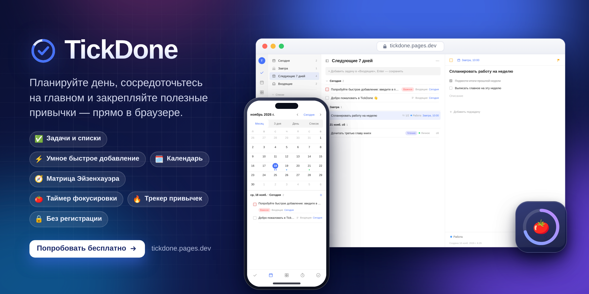
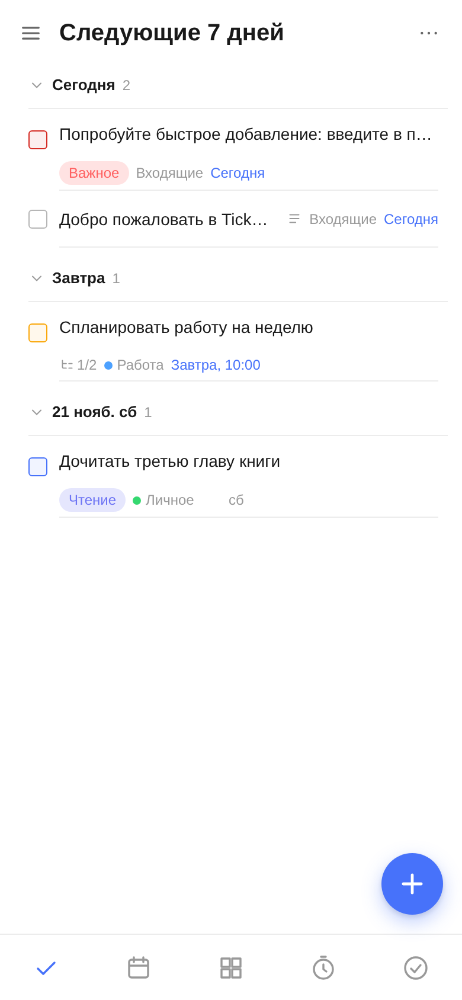
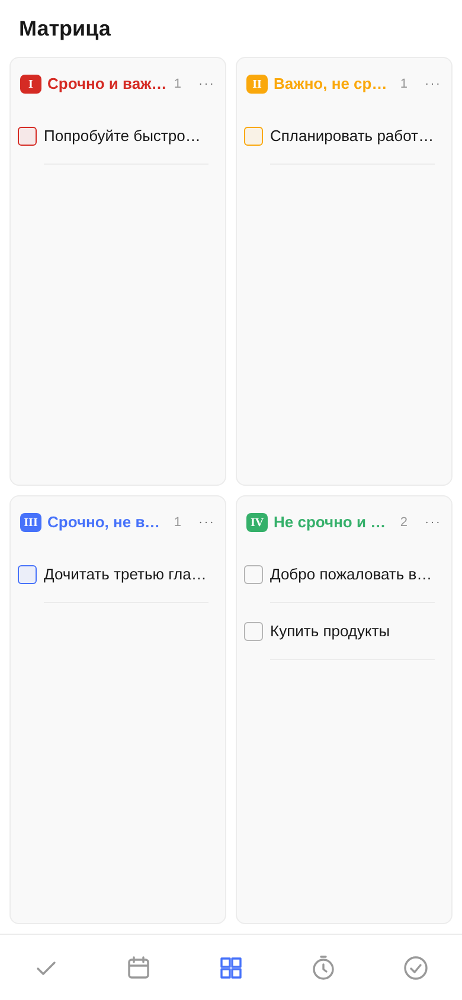
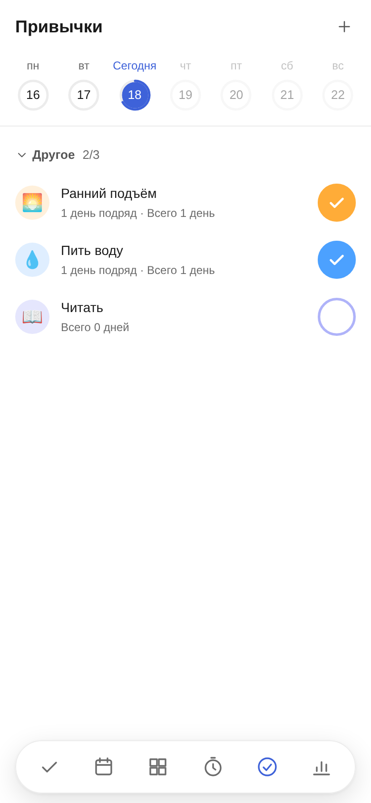

<div align="center">

<a href="https://tickdone.pages.dev"></a>

<h1>TickDone</h1>

<p><b>Планируйте день, сосредоточьтесь на главном и закрепляйте полезные привычки — прямо в браузере.</b></p>

<p>
  <a href="https://github.com/suica/tickdone/actions/workflows/ci.yml"></a>
  <a href="LICENSE"></a>
  <a href="https://tickdone.pages.dev"></a>
  <a href="#-языки"></a>
  <a href="#-участие-в-разработке"></a>
</p>

<p>
  <a href="README.md">English</a> ·
  <a href="README.zh-CN.md">简体中文</a> ·
  <a href="README.zh-TW.md">繁體中文</a> ·
  <a href="README.ja.md">日本語</a> ·
  <a href="README.ko.md">한국어</a> ·
  <a href="README.es.md">Español</a> ·
  <a href="README.fr.md">Français</a> ·
  <a href="README.de.md">Deutsch</a> ·
  <a href="README.pt-BR.md">Português (Brasil)</a> ·
  <b>Русский</b>
</p>

<a href="https://tickdone.pages.dev"></a>

<p>
  <a href="https://tickdone.pages.dev"><b>Открыть приложение</b></a> ·
  <a href="#-возможности"><b>Возможности</b></a> ·
  <a href="#-быстрый-старт"><b>Быстрый старт</b></a> ·
  <a href="#️-дорожная-карта"><b>Дорожная карта</b></a> ·
  <a href="#-участие-в-разработке"><b>Участие в разработке</b></a>
</p>

</div>

TickDone — бесплатный список дел и планировщик времени с открытым исходным кодом, который работает прямо в браузере. Записывайте задачи так, как говорите, расставляйте их в календаре, распределяйте по срочности и важности, выполняйте с таймером фокусировки и не бросайте привычки — всё в одном месте.

> [!NOTE]
> **Ваши данные остаются у вас.** Всё хранится в локальном хранилище браузера: нет ни аккаунта, ни регистрации, ни сервера, и ничего из того, что вы вводите, не покидает ваше устройство. Резервную копию можно в любой момент выгрузить в настройках.

## ✨ Возможности

- ✅ **Задачи и списки**: «Сегодня», «Завтра», «Ближайшие 7 дней» и «Входящие», а также «Выполненные», «Не буду делать» и «Корзина»; собственные списки, папки и теги; подзадачи, заметки, приоритеты, сроки с датой и временем, напоминания и правила повторения; закрепление и контекстное меню у каждой задачи.
- ⚡ **Умное быстрое добавление**: введите `call mom tomorrow 3pm !high #family ~Personal`, и TickDone задаст дату, время, приоритет, тег и список, подсвечивая каждую распознанную часть прямо при вводе. Понимает и китайский.
- 🗂️ **Вид списка и канбан-доски** с группировкой и сортировкой.
- 📅 **Календарь** с режимами «месяц», «неделя», «день» и «список». Перетащите задачу на другой день или время или потяните нижний край блока, чтобы изменить длительность.
- 🧭 **Матрица Эйзенхауэра**: распределяйте задачи по срочности и важности и перетаскивайте их между квадрантами, чтобы менять приоритет.
- 🍅 **Таймер фокусировки** с режимами помодоро и секундомера и историей прошлых сессий.
- 🔥 **Трекер привычек** с отметками, сериями и статистикой.
- 🔍 **Поиск** по задачам, тегам и спискам.
- ↩️ **Отмена** из уведомления после выполнения, удаления или перемещения задачи.
- ⌨️ **Горячие клавиши** и 🌙 **тёмная тема**.
- 💾 **Резервное копирование и восстановление**: выгрузите все данные в JSON-файл и загрузите их обратно.

## 📸 Скриншоты

<table>
  <tr>
    <td colspan="2"></td>
  </tr>
  <tr>
    <th>Календарь</th>
    <th>Матрица</th>
  </tr>
  <tr>
    <td></td>
    <td></td>
  </tr>
  <tr>
    <th>Фокус</th>
    <th>Привычки</th>
  </tr>
  <tr>
    <td></td>
    <td></td>
  </tr>
</table>

<table>
  <tr>
    <td></td>
    <td></td>
    <td></td>
    <td></td>
    <td></td>
  </tr>
</table>

## 🚀 Быстрый старт

**Онлайн:** откройте [tickdone.pages.dev](https://tickdone.pages.dev). Ничего устанавливать не нужно.

**Локально** (нужен Node.js 24):

```sh
git clone https://github.com/suica/tickdone.git
cd tickdone
npm install
npm run dev        # http://localhost:5173
```

## ⌨️ Горячие клавиши

| Клавиша | Действие |
|---|---|
| `N` | Новая задача |
| `Ctrl/⌘ F` | Поиск |
| `Alt 1`–`Alt 6` | Переключить модуль |
| `Ctrl/⌘ Z` | Отменить, пока видно уведомление об отмене |
| `Esc` | Закрыть подробности задачи |
| `?` | Показать все горячие клавиши |

## 🌍 Языки

Этот README доступен на 10 языках: English, 简体中文, 繁體中文, 日本語, 한국어, Español, Français, Deutsch, Português (Brasil) и Русский. Весь интерфейс переведён на те же 10 языков. TickDone берёт язык браузера, а сменить его можно в любой момент в настройках. Быстрое добавление понимает даты на английском или китайском и слова приоритета на всех 10 языках.

Нашли неуклюжий перевод? Исходный язык — английский: поправьте текст в `src/i18n/` или в `README.<locale>.md` и откройте pull request.

## 🗺️ Дорожная карта

Каждый пункт ссылается на свой issue. Отмеченные пункты уже работают на [tickdone.pages.dev](https://tickdone.pages.dev).

- [x] Задачи, списки, теги, быстрое добавление, календарь, матрица Эйзенхауэра, таймер фокусировки и трекер привычек
- [x] CI с модульными и сквозными тестами ([#7](https://github.com/suica/tickdone/issues/7))
- [x] Открытый исходный код: README на 10 языках, лицензия MIT, правила проекта ([#10](https://github.com/suica/tickdone/issues/10))
- [x] Вёрстка для телефонов, планшетов и больших экранов ([#8](https://github.com/suica/tickdone/issues/8))
- [x] Перетаскивание во всём приложении ([#9](https://github.com/suica/tickdone/issues/9))
- [x] Анимации ([#3](https://github.com/suica/tickdone/issues/3))
- [x] Ссылка на GitHub и раздел «О программе» в приложении ([#4](https://github.com/suica/tickdone/issues/4))
- [x] Интерфейс на 10 языках ([#14](https://github.com/suica/tickdone/issues/14))
- [x] Шлифовка интерфейса, экран за экраном ([#11](https://github.com/suica/tickdone/issues/11))
- [ ] Множественный выбор и массовое редактирование ([#15](https://github.com/suica/tickdone/issues/15))
- [ ] Навигация с клавиатуры в списках задач ([#16](https://github.com/suica/tickdone/issues/16))
- [ ] Уведомления о напоминаниях ([#17](https://github.com/suica/tickdone/issues/17))
- [ ] Установка в виде приложения и работа офлайн ([#18](https://github.com/suica/tickdone/issues/18))
- [ ] Сохранённые фильтры ([#19](https://github.com/suica/tickdone/issues/19))
- [ ] Статистика по задачам, таймеру фокусировки и трекеру привычек ([#20](https://github.com/suica/tickdone/issues/20))
- [ ] Markdown в заметках к задачам ([#21](https://github.com/suica/tickdone/issues/21))
- [ ] Вид временной шкалы ([#22](https://github.com/suica/tickdone/issues/22))
- [ ] Больше правил повторения ([#23](https://github.com/suica/tickdone/issues/23))
- [ ] Архивация списков ([#24](https://github.com/suica/tickdone/issues/24))
- [ ] Доступность ([#25](https://github.com/suica/tickdone/issues/25))
- [ ] Быстрая работа даже с тысячами задач ([#26](https://github.com/suica/tickdone/issues/26))
- [ ] Темы и акцентные цвета ([#27](https://github.com/suica/tickdone/issues/27))
- [ ] Календарь: планирование задач без даты, вид «Расписание» ([#28](https://github.com/suica/tickdone/issues/28))

## 🧰 Технологии

| Часть | На чём сделано |
|---|---|
| ⚛️ Интерфейс | React 19 и TypeScript |
| 📆 Даты | date-fns — единственная зависимость времени выполнения, кроме React |
| ⚡ Сборка | Vite |
| 💾 Хранение | `localStorage` в браузере, без бэкенда |
| 🧪 Тесты | Vitest (модульные) и Playwright (сквозные) |
| 🧹 Линтер | oxlint |
| ☁️ Хостинг | Cloudflare Pages |

## 🛠️ Разработка

```sh
npm install
npm run dev        # dev server at http://localhost:5173
npm run lint       # oxlint
npm test           # unit tests (Vitest)
npx playwright install chromium
npm run e2e        # end-to-end tests (Playwright)
npm run build      # type check and production build into dist/
```

- 🖼️ Баннер и скриншоты в README создаются из продакшн-сборки: `npm run build`, затем `node scripts/promo/render.mjs` (параметры описаны в начале [скрипта](scripts/promo/render.mjs)).
- 🗺️ `node scripts/roadmap.mjs done <issue>` отмечает пункт дорожной карты во всех README.

## 🚢 Развёртывание

Рабочий сайт размещён на Cloudflare Pages:

```sh
npm run build
npx wrangler pages deploy dist --project-name tickdone --branch main
```

## 🤝 Участие в разработке

Issues и pull requests приветствуются! Перед началом прочитайте [AGENTS.md](AGENTS.md): там собраны правила проекта — и для людей, и для ИИ-агентов, которые пишут код.

- 💬 каждое изменение начинается с issue и попадает в проект через pull request со ссылкой на него;
- 🌐 рабочий язык — английский, а каждый видимый пользователю текст переводится на все 10 языков;
- 📐 экраны работают при любой ширине, от телефона в 360 px до монитора в 2560 px, а анимации и перетаскивание следуют общим правилам;
- ✅ CI (линтер, проверка типов и сборка, модульные и сквозные тесты) должна быть зелёной до слияния.

Если TickDone помогает вам доводить дела до конца, поставьте ⭐ на GitHub — так другие быстрее его найдут.

## 📄 Лицензия

[MIT](LICENSE) © 2026 suica
