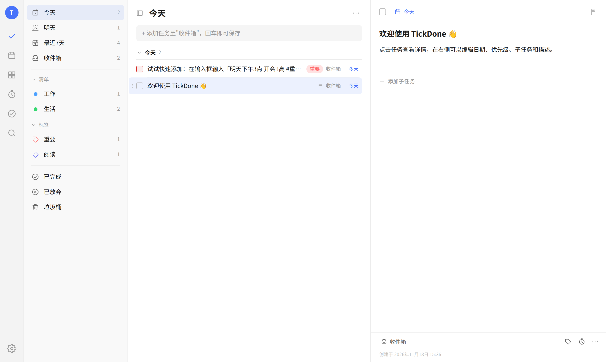

<p align="center"></p>

<h1 align="center">TickDone</h1>

<p align="center">在浏览器中运行的待办清单和时间管理工具：任务、日历、四象限、番茄专注和习惯打卡。</p>

<p align="center"><a href="https://tickdone.pages.dev"><b>打开 TickDone → tickdone.pages.dev</b></a></p>

<p align="center">
  <a href="README.md">English</a> ·
  <b>简体中文</b> ·
  <a href="README.zh-TW.md">繁體中文</a> ·
  <a href="README.ja.md">日本語</a> ·
  <a href="README.ko.md">한국어</a> ·
  <a href="README.es.md">Español</a> ·
  <a href="README.fr.md">Français</a> ·
  <a href="README.de.md">Deutsch</a> ·
  <a href="README.pt-BR.md">Português (Brasil)</a> ·
  <a href="README.ru.md">Русский</a>
</p>



| 日历 | 四象限 |
|---|---|
|  |  |
| **番茄专注** | **习惯打卡** |
|  |  |

## 功能

- **任务**：收件箱、今天、明天、最近 7 天、全部、已完成、已放弃和垃圾桶；自建清单、文件夹和标签；子任务、备注、优先级、截止日期与时间、提醒和重复规则；置顶；每个任务都有右键菜单；完成或删除后可以撤销。
- **快速添加**：识别你输入的内容并高亮显示，一行 `call mom tomorrow 3pm !high #family ~Personal` 就能设置好日期、时间、优先级、标签和清单；也可以直接输入中文，比如 `明天下午3点 开周会 !高 #重要`。
- **列表和看板视图**，支持分组和排序。
- **日历**：月、周、日三种视图。
- **四象限**：按紧急程度和重要程度给任务分类。
- **番茄专注**：番茄钟和正计时两种模式，并保留历史专注记录。
- **习惯打卡**：打卡、连续打卡天数和统计。
- **搜索**、键盘快捷键和深色主题。

数据只保存在你的浏览器中（localStorage）。无需账号，也不会向服务器发送任何内容。

### 键盘快捷键

| 按键 | 操作 |
|---|---|
| `N` | 新建任务 |
| `Ctrl/⌘ F` | 搜索 |
| `Alt 1`–`Alt 6` | 切换模块 |
| `Ctrl/⌘ Z` | 撤销（撤销提示显示期间） |
| `Esc` | 关闭任务详情 |
| `?` | 显示全部快捷键 |

## 开发

需要 Node.js 24。

```sh
npm install
npm run dev        # dev server at http://localhost:5173
npm run lint       # oxlint
npm test           # unit tests (Vitest)
npx playwright install chromium
npm run e2e        # end-to-end tests (Playwright)
npm run build      # type check and production build into dist/
```

基于 React 19、TypeScript、Vite 和 date-fns 构建。

## 部署

线上站点部署在 Cloudflare Pages：

```sh
npm run build
npx wrangler pages deploy dist --project-name tickdone --branch main
```

## 参与贡献

欢迎提交 Issue 和 Pull Request。请先阅读 [AGENTS.md](AGENTS.md)，其中写明了项目规则（以英语为工作语言、为每种支持的语言提供翻译、响应式布局、动效和拖放规范，以及每个 PR 都必须通过的 CI）。

## 许可证

[MIT](LICENSE)
