<div align="center">

<a href="https://tickdone.pages.dev"></a>

<h1>TickDone</h1>

<p><b>规划每一天，专注要事，养成好习惯。打开浏览器就能用。</b></p>

<p>
  <a href="https://github.com/suica/tickdone/actions/workflows/ci.yml"></a>
  <a href="LICENSE"></a>
  <a href="https://tickdone.pages.dev"></a>
  <a href="#-语言"></a>
  <a href="#-参与贡献"></a>
</p>

<p>
  <a href="README.md">English</a> ·
  <b>简体中文</b> ·
  <a href="README.zh-TW.md">繁體中文</a> ·
  <a href="README.ja.md">日本語</a> ·
  <a href="README.ko.md">한국어</a> ·
  <a href="README.es.md">Español</a> ·
  <a href="README.fr.md">Français</a> ·
  <a href="README.de.md">Deutsch</a> ·
  <a href="README.pt-BR.md">Português (Brasil)</a> ·
  <a href="README.ru.md">Русский</a>
</p>

<a href="https://tickdone.pages.dev">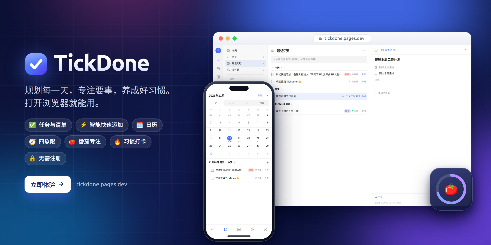</a>

<p>
  <a href="https://tickdone.pages.dev"><b>打开应用</b></a> ·
  <a href="#-功能"><b>功能</b></a> ·
  <a href="#-截图"><b>截图</b></a> ·
  <a href="#-快速开始"><b>快速开始</b></a> ·
  <a href="#️-路线图"><b>路线图</b></a> ·
  <a href="#-参与贡献"><b>参与贡献</b></a>
</p>

</div>

TickDone 是一款免费、开源的待办清单和时间管理工具，直接在浏览器中运行。用一句话记下任务，在日历上安排时间，按紧急和重要程度给任务分类，开个番茄钟专心完成，再坚持每天的习惯打卡，全都在一个地方。

> [!NOTE]
> **数据只属于你。** 所有内容都保存在浏览器的本地存储（localStorage）中：没有账号，无需注册，你的任务不会离开你的设备。唯一经过 TickDone 服务器的是订阅日历的地址：一个小小的代理替你取回日历，不保存任何内容。随时可以在「设置」中导出备份文件。

## ✨ 功能

- ✅ **任务与清单**：今天、明天、最近 7 天、收件箱，以及已完成、已放弃和垃圾桶；自建清单、文件夹和标签；子任务、备注、优先级、截止日期与时间、提醒和重复规则；置顶，每个任务都有右键菜单。
- ⚡ **智能快速添加**：输入 `明天下午3点 开周会 !高 #重要`，TickDone 会设置好日期、时间、优先级和标签，输入时还会高亮识别出的部分；也支持英文，比如 `call mom tomorrow 3pm !high #family ~Personal`。
- 🗂️ **列表和看板视图**，支持分组和排序。
- 📅 **日历**：月、周、日和列表视图。把任务拖到另一天或另一个时间，或者拖动时间块的下边缘调整时长。
- 🔔 **订阅日历**：订阅任何提供 iCal 地址（.ics 或 webcal://）的日历，比如工作、学校、团队或节假日日历，它们的日程会以只读方式、用各自的颜色显示在日历里。会自动更新，离线也能查看。
- 🧭 **四象限**：按紧急和重要程度给任务分类，在象限之间拖动任务即可修改优先级。
- 🍅 **番茄专注**：番茄钟和正计时两种模式，并保留历史专注记录。
- 🔥 **习惯打卡**：打卡、连续天数和统计。
- 🔍 **搜索**任务、标签和清单。
- ↩️ **撤销**：完成、删除或移动任务后，可以在提示条中撤销。
- ⌨️ **键盘快捷键**和 🌙 **深色主题**。
- 💾 **备份与恢复**：把全部数据导出为 JSON 文件，随时再导入。

## 📸 截图

<table>
  <tr>
    <td colspan="2">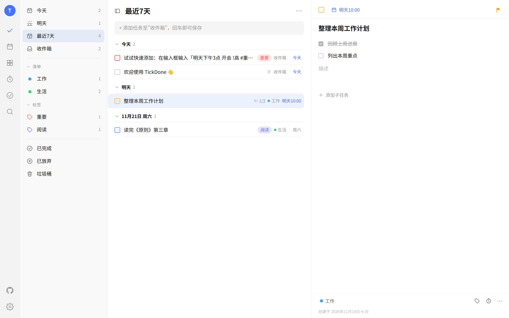</td>
  </tr>
  <tr>
    <th>日历</th>
    <th>四象限</th>
  </tr>
  <tr>
    <td>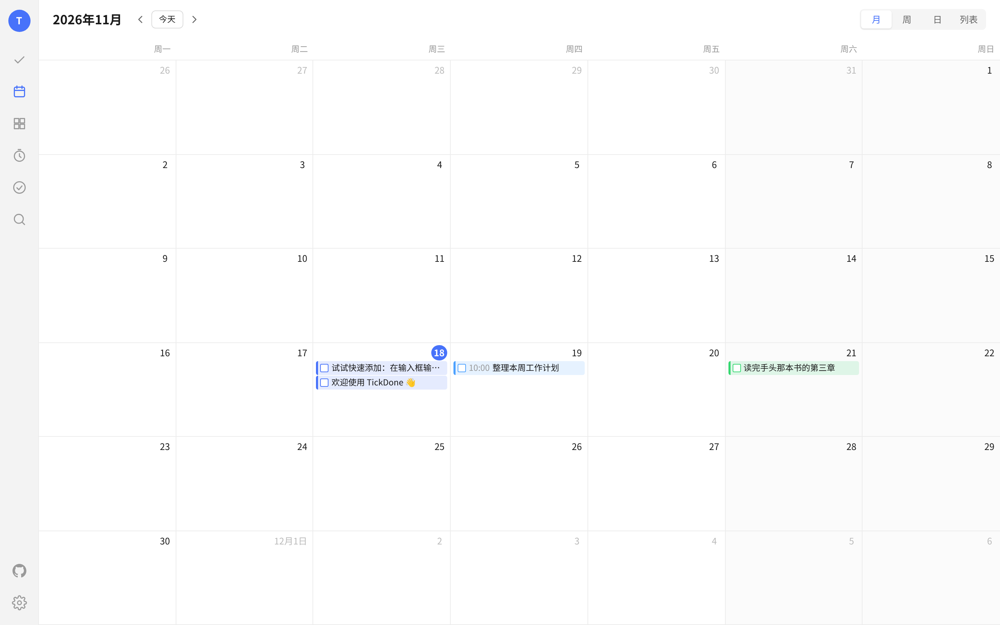</td>
    <td>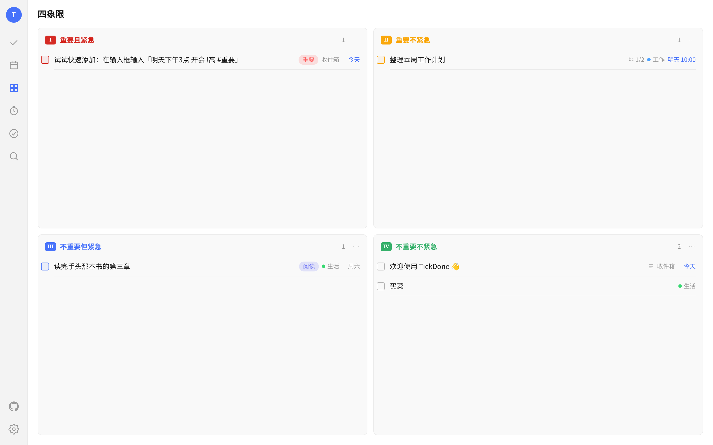</td>
  </tr>
  <tr>
    <th>番茄专注</th>
    <th>习惯打卡</th>
  </tr>
  <tr>
    <td>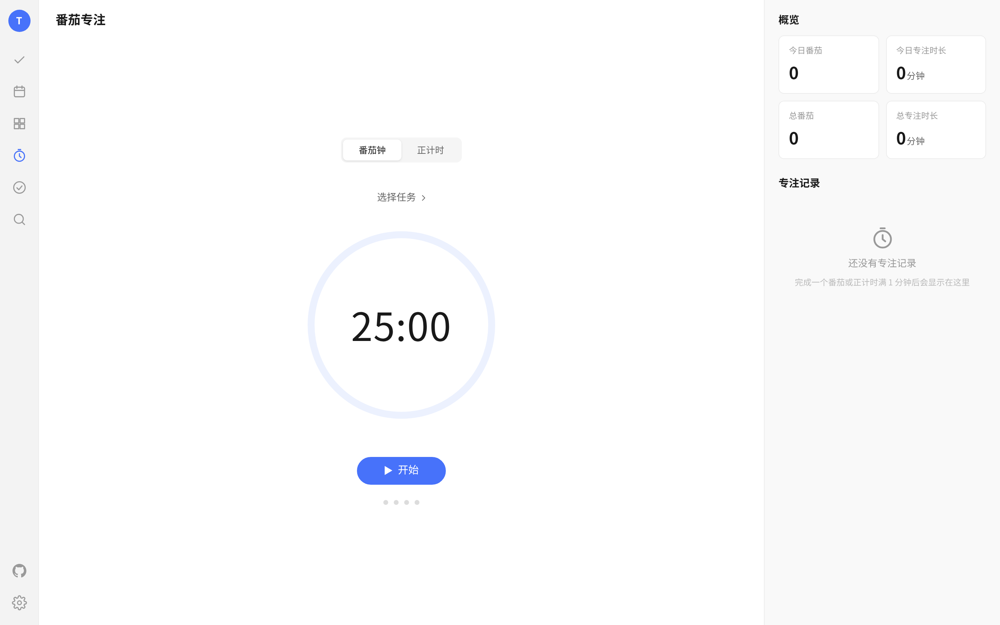</td>
    <td>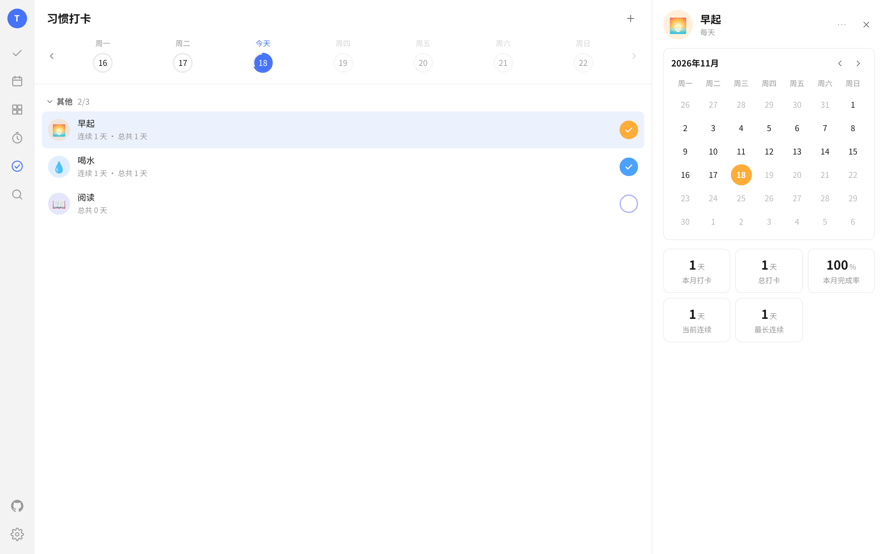</td>
  </tr>
</table>

<table>
  <tr>
    <td>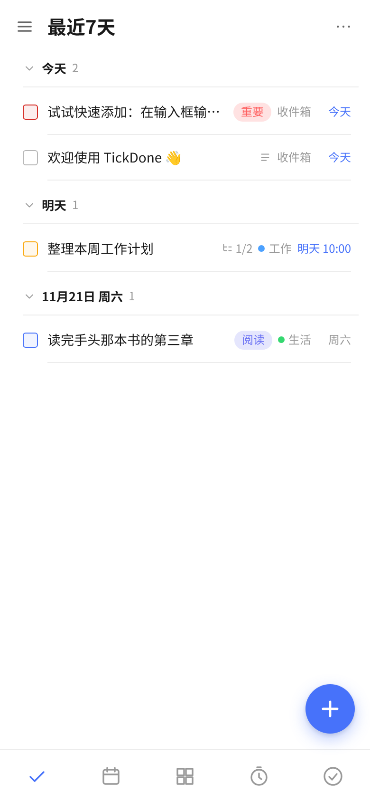</td>
    <td>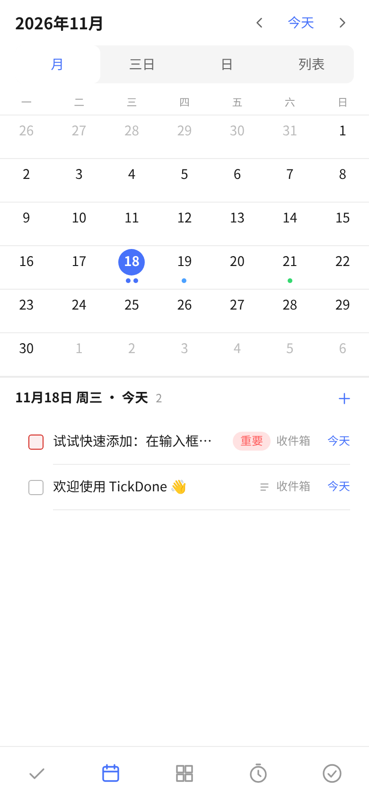</td>
    <td>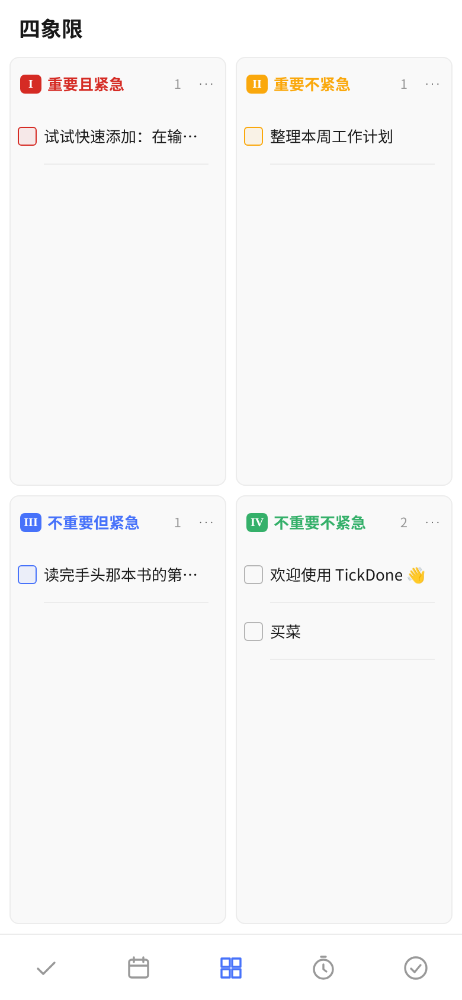</td>
    <td>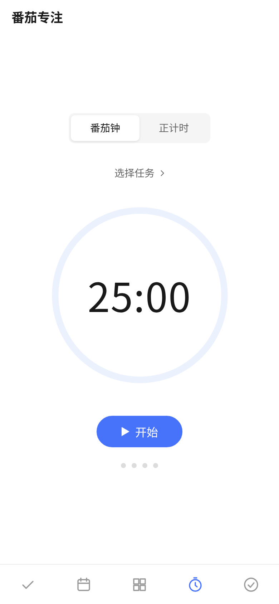</td>
    <td>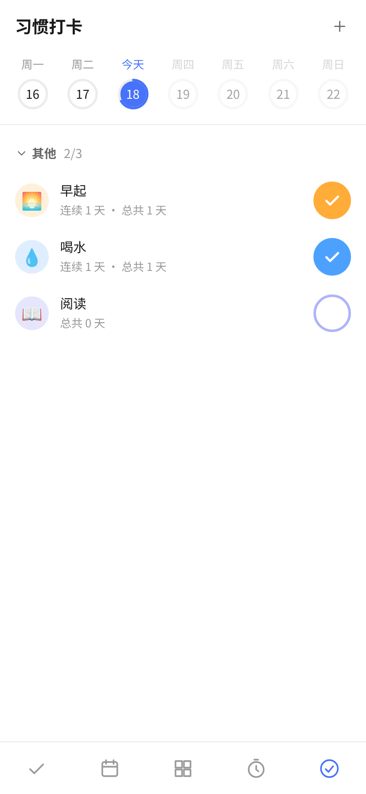</td>
  </tr>
</table>

## 🚀 快速开始

**在线使用**：打开 [tickdone.pages.dev](https://tickdone.pages.dev)，无需安装。

**本地运行**（需要 Node.js 24）：

```sh
git clone https://github.com/suica/tickdone.git
cd tickdone
npm install
npm run dev        # http://localhost:5173
```

## ⌨️ 键盘快捷键

| 按键 | 操作 |
|---|---|
| `N` | 新建任务 |
| `Ctrl/⌘ F` | 搜索 |
| `Alt 1`–`Alt 6` | 切换模块 |
| `Ctrl/⌘ Z` | 撤销（撤销提示显示期间） |
| `Esc` | 关闭任务详情 |
| `?` | 显示全部快捷键 |

## 🌍 语言

本 README 提供 10 种语言版本：English、简体中文、繁體中文、日本語、한국어、Español、Français、Deutsch、Português (Brasil) 和 Русский。整个界面已翻译成同样的 10 种语言。TickDone 默认跟随浏览器语言，也可以随时在设置里切换。快速添加能识别用中文或英文写的日期，以及 10 种语言的优先级词。

发现翻译不够地道？英文是源语言：直接修改 `src/i18n/` 或对应的 `README.<locale>.md`，然后提交 Pull Request。

## 🗺️ 路线图

每一项都链接到对应的 Issue。勾选的项目已在 [tickdone.pages.dev](https://tickdone.pages.dev) 上线。

- [x] 任务、清单、标签、快速添加、日历、四象限、番茄专注和习惯打卡
- [x] CI：单元测试与端到端测试 ([#7](https://github.com/suica/tickdone/issues/7))
- [x] 开源：10 种语言的 README、MIT 许可证、项目规则 ([#10](https://github.com/suica/tickdone/issues/10))
- [ ] 适配手机、平板和大屏幕的布局 ([#8](https://github.com/suica/tickdone/issues/8))
- [ ] 全面支持拖放 ([#9](https://github.com/suica/tickdone/issues/9))
- [ ] 动效 ([#3](https://github.com/suica/tickdone/issues/3))
- [x] 应用内的 GitHub 链接和“关于”页面 ([#4](https://github.com/suica/tickdone/issues/4))
- [x] 界面支持 10 种语言 ([#14](https://github.com/suica/tickdone/issues/14))
- [ ] 逐个页面打磨界面 ([#11](https://github.com/suica/tickdone/issues/11))
- [ ] 多选和批量编辑 ([#15](https://github.com/suica/tickdone/issues/15))
- [ ] 任务列表的键盘导航 ([#16](https://github.com/suica/tickdone/issues/16))
- [ ] 提醒通知 ([#17](https://github.com/suica/tickdone/issues/17))
- [ ] 可安装为应用并离线使用 ([#18](https://github.com/suica/tickdone/issues/18))
- [ ] 可保存的筛选条件 ([#19](https://github.com/suica/tickdone/issues/19))
- [ ] 任务、番茄专注和习惯打卡的统计 ([#20](https://github.com/suica/tickdone/issues/20))
- [ ] 任务备注支持 Markdown ([#21](https://github.com/suica/tickdone/issues/21))
- [ ] 时间线视图 ([#22](https://github.com/suica/tickdone/issues/22))
- [ ] 更多重复规则 ([#23](https://github.com/suica/tickdone/issues/23))
- [ ] 归档清单 ([#24](https://github.com/suica/tickdone/issues/24))
- [ ] 无障碍 ([#25](https://github.com/suica/tickdone/issues/25))
- [ ] 上千个任务依然流畅 ([#26](https://github.com/suica/tickdone/issues/26))
- [ ] 主题和强调色 ([#27](https://github.com/suica/tickdone/issues/27))
- [ ] 日历：安排无日期的任务、日程视图 ([#28](https://github.com/suica/tickdone/issues/28))
- [x] 订阅日历 ([#51](https://github.com/suica/tickdone/issues/51))

## 🧰 技术栈

| 部分 | 使用的技术 |
|---|---|
| ⚛️ 界面 | React 19 和 TypeScript |
| 📆 日期 | date-fns，除 React 之外唯一的运行时依赖 |
| ⚡ 构建 | Vite |
| 💾 存储 | 浏览器的 `localStorage`，没有后端 |
| 🧪 测试 | Vitest（单元测试）和 Playwright（端到端测试） |
| 🧹 代码检查 | oxlint |
| ☁️ 托管 | Cloudflare Pages |

## 🛠️ 开发

```sh
npm install
npm run dev        # dev server at http://localhost:5173
npm run lint       # oxlint
npm test           # unit tests (Vitest)
npx playwright install chromium
npm run e2e        # end-to-end tests (Playwright)
npm run build      # type check and production build into dist/
```

- 🖼️ README 中的横幅和截图由生产构建生成：先运行 `npm run build`，再运行 `node scripts/promo/render.mjs`（参数说明见[脚本](scripts/promo/render.mjs)开头）。
- 🗺️ `node scripts/roadmap.mjs done <issue>` 会在所有 README 中勾选对应的路线图条目。

## 🚢 部署

线上站点部署在 Cloudflare Pages：

```sh
npm run build
npx wrangler pages deploy dist --project-name tickdone --branch main
```

## 🤝 参与贡献

欢迎提交 Issue 和 Pull Request！开始之前请先阅读 [AGENTS.md](AGENTS.md)，其中是面向所有人（包括编程智能体）的项目规则：

- 💬 每项改动都从一个 Issue 开始，并通过引用该 Issue 的 Pull Request 合入；
- 🌐 以英语为工作语言，每条面向用户的文字都要翻译成全部 10 种语言；
- 📐 从 360 px 的手机到 2560 px 的显示器，每种宽度下界面都要正常，动效和拖放遵循统一的规范；
- ✅ CI（代码检查、类型检查与构建、单元测试和端到端测试）全部通过后才能合并。

如果 TickDone 帮你把事情做完了，欢迎在 GitHub 上点个 ⭐，让更多人发现它。

## 📄 许可证

[MIT](LICENSE) © 2026 suica
