<div align="center">

<a href="https://tickdone.pages.dev"></a>

<h1>TickDone</h1>

<p><b>規劃每一天，專注要事，養成好習慣。打開瀏覽器就能用。</b></p>

<p>
  <a href="https://github.com/suica/tickdone/actions/workflows/ci.yml"></a>
  <a href="LICENSE"></a>
  <a href="https://tickdone.pages.dev"></a>
  <a href="#-語言"></a>
  <a href="#-參與貢獻"></a>
</p>

<p>
  <a href="README.md">English</a> ·
  <a href="README.zh-CN.md">简体中文</a> ·
  <b>繁體中文</b> ·
  <a href="README.ja.md">日本語</a> ·
  <a href="README.ko.md">한국어</a> ·
  <a href="README.es.md">Español</a> ·
  <a href="README.fr.md">Français</a> ·
  <a href="README.de.md">Deutsch</a> ·
  <a href="README.pt-BR.md">Português (Brasil)</a> ·
  <a href="README.ru.md">Русский</a>
</p>

<a href="https://tickdone.pages.dev">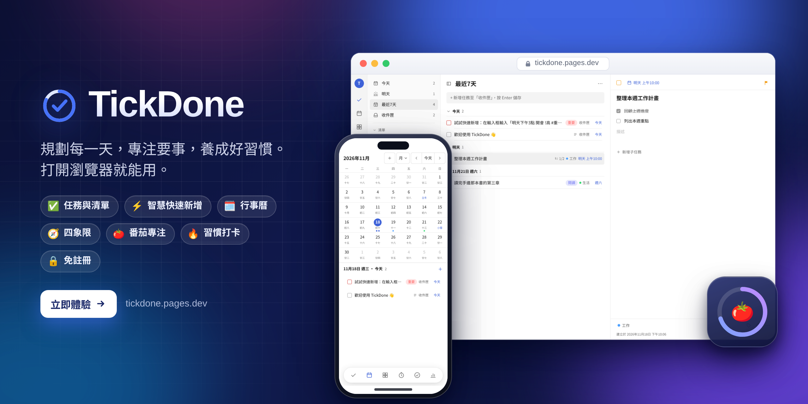</a>

<p>
  <a href="https://tickdone.pages.dev"><b>開啟應用程式</b></a> ·
  <a href="#-功能"><b>功能</b></a> ·
  <a href="#-截圖"><b>截圖</b></a> ·
  <a href="#-快速開始"><b>快速開始</b></a> ·
  <a href="#️-路線圖"><b>路線圖</b></a> ·
  <a href="#-參與貢獻"><b>參與貢獻</b></a>
</p>

</div>

TickDone 是一款免費、開源的待辦清單與時間管理工具，直接在瀏覽器中執行。用一句話記下任務，在行事曆上安排時間，依緊急程度和重要性為任務分類，開個番茄鐘專心完成，再持續每天的習慣打卡，全都在同一個地方。

> [!NOTE]
> **資料只屬於你。** 所有內容都儲存在瀏覽器的本機儲存空間（localStorage）：沒有帳號，不必註冊，你的任務不會離開你的裝置。唯一經過 TickDone 伺服器的是訂閱日曆的網址：一個小小的代理替你取回日曆，不儲存任何內容。隨時可以在「設定」中匯出備份檔。

## ✨ 功能

- ✅ **任務與清單**：今天、明天、未來 7 天、收件匣，以及已完成、已放棄和垃圾桶；自訂清單、資料夾和標籤；子任務、備註、優先順序、截止日期與時間、提醒和重複規則；置頂，每個任務都有右鍵選單。
- ⚡ **智慧快速新增**：輸入 `call mom tomorrow 3pm !high #family ~Personal`，TickDone 就會設定好日期、時間、優先順序、標籤和清單，輸入時還會標示出辨識到的部分；也支援簡體中文輸入，例如 `明天下午3点 开周会 !高 #重要`。
- 🗂️ **列表與看板檢視**，可分組和排序。
- 📏 **時間軸檢視**：任務以長條顯示在它涵蓋的日期上（單日任務是菱形），依分組排列，有今天線，可依日、週、月縮放。拖動長條移動任務，拖兩端改開始和結束日期，還能從「無日期」面板把任務拖進來；每次拖放都能復原。手機上以列表顯示。
- 🗄️ **封存清單**：在清單選單中封存已完成的清單。它會移到收合的「已封存清單」分組，其中的任務不再出現在智慧清單、行事曆、四象限和搜尋中，開啟時為唯讀，取消封存即可恢復。
- 🔎 **篩選器**：組合清單、標籤、優先順序、日期（已逾期、今天、本週、自訂範圍……）、關鍵字和已完成的任務，做成你自己的智慧清單，並在側欄顯示名稱、圖示和顏色。
- 📝 **描述支援 Markdown**：標題、粗體、斜體、刪除線、程式碼、連結、清單、引用，以及可以直接勾選的待辦清單；輸入 `**粗體**`、`# ` 或 `- [ ] ` 時立即顯示格式，描述仍以 Markdown 儲存。
- 🔁 **重複規則**：每 N 天、週、月、年；指定星期幾；每月第 N 天、最後一天或第 N 個/最後一個星期幾；每年某一天；僅工作日。可在 N 次後或某天結束，從截止日期或完成日期起算，可跳過本次，快速新增時還能直接輸入「每2週」「每月最後一個週五」。
- 📅 **行事曆**：月、週、日和列表檢視。把任務拖到另一天或另一個時間，或拖曳時間區塊的下緣來調整時長。
- 🗓️ **在行事曆裡做計畫**：週檢視和日檢視旁的「未安排」面板（手機上是底部面板）列出還沒有日期的未完成任務，可以依清單篩選。把任務拖到某一天或某個時間就安排好了，拖回面板就清除日期，都能在提示裡復原。議程檢視把接下來的日子排成一個可以捲動的列表，包括你的任務和訂閱行事曆的活動。
- 🔔 **訂閱日曆**：訂閱任何提供 iCal 網址（.ics 或 webcal://）的日曆，例如工作、學校、團隊或節假日日曆，它們的行程會以唯讀方式、用各自的顏色顯示在行事曆裡。會自動更新，離線也能查看。
- 🧭 **四象限**：依緊急程度和重要性為任務分類，在象限之間拖曳任務即可變更優先順序。
- 🍅 **番茄專注**：番茄鐘和碼錶兩種模式，並保留過往的專注紀錄。
- 🔥 **習慣打卡**：打卡、連續天數和統計。
- 📊 **統計**：每天、每週或每月完成的任務數、完成率、逾期任務、依清單、優先順序和標籤的分布，以及連續完成天數；每天的專注時長、專注次數、各任務和清單的專注時長與最佳專注時段；習慣的打卡率和連續打卡天數。可以依週、月、年、近 30 天或自訂時間範圍檢視，懸停或點按圖表查看詳情。
- 🔍 **搜尋**任務、標籤和清單。
- ↩️ **復原**：完成、刪除或移動任務後，可以在提示訊息中復原。
- ⌨️ **鍵盤快速鍵**。
- 🎨 **主題與強調色**：淺色、深色或跟隨系統，另有八種強調色，用於按鈕、核取方塊、選取狀態和焦點框。修改即時生效，設定裡可即時預覽，啟動畫面和分頁圖示也會跟著變。
- ⏰ **提醒**：到了任務的提醒時間，TickDone 會顯示提醒卡片，可以完成、稍後提醒（5 分鐘、15 分鐘、1 小時、明天）或開啟任務；允許通知後還會顯示系統通知。TickDone 沒有伺服器，所以提醒只在它於分頁中開啟、或已安裝並正在執行時觸發；關閉期間到時的提醒，會在下次開啟時顯示。
- 📲 **安裝為應用程式**：在「設定 → 關於」中把 TickDone 加到主畫面或 Dock，首次造訪後即可離線開啟。有新版本時，會顯示提示讓你重新載入。
- 💾 **備份與還原**：把全部資料匯出成 JSON 檔，隨時再匯入。
- 🚀 **上千筆任務也流暢**：長清單和搜尋結果只繪製畫面上的列，5,000 筆任務的清單捲動、切換和回應都和短清單一樣快，拖放、鍵盤、多選和完成動畫照常可用。修改會在背景儲存。

## 📸 截圖

<table>
  <tr>
    <td colspan="2">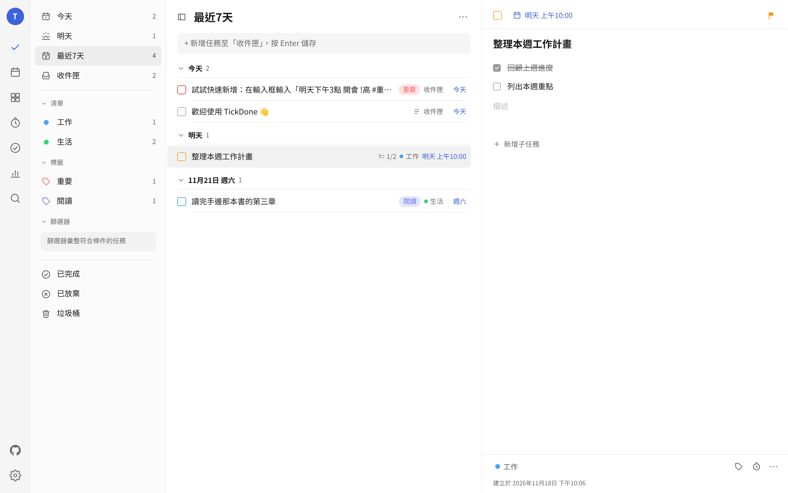</td>
  </tr>
  <tr>
    <th>行事曆</th>
    <th>四象限</th>
  </tr>
  <tr>
    <td>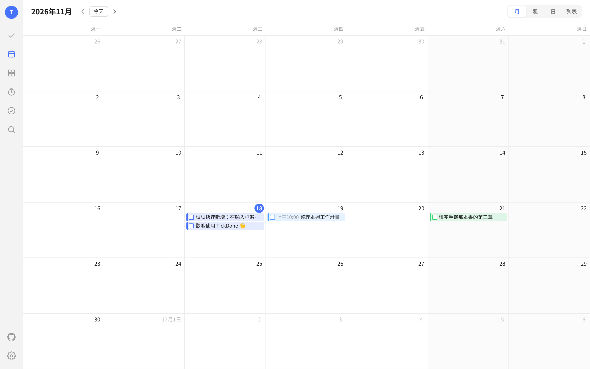</td>
    <td>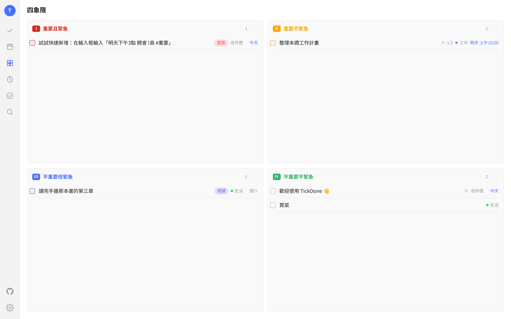</td>
  </tr>
  <tr>
    <th>番茄專注</th>
    <th>習慣打卡</th>
  </tr>
  <tr>
    <td>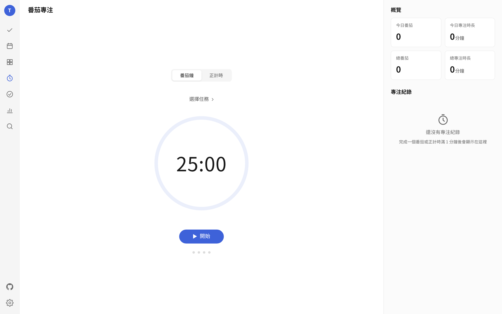</td>
    <td>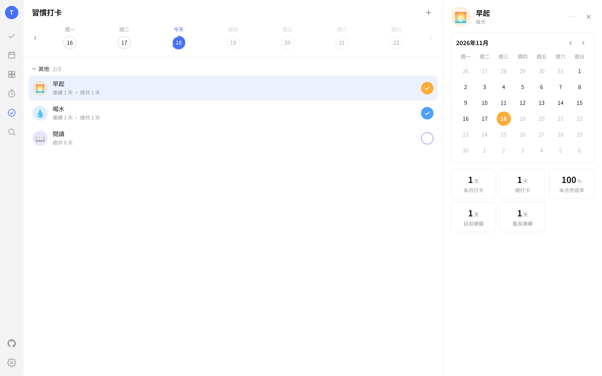</td>
  </tr>
</table>

<table>
  <tr>
    <td>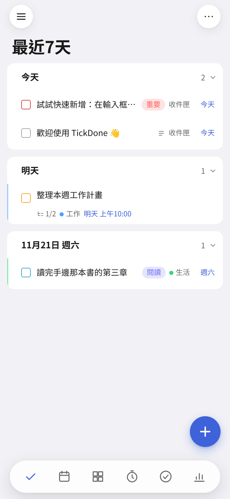</td>
    <td>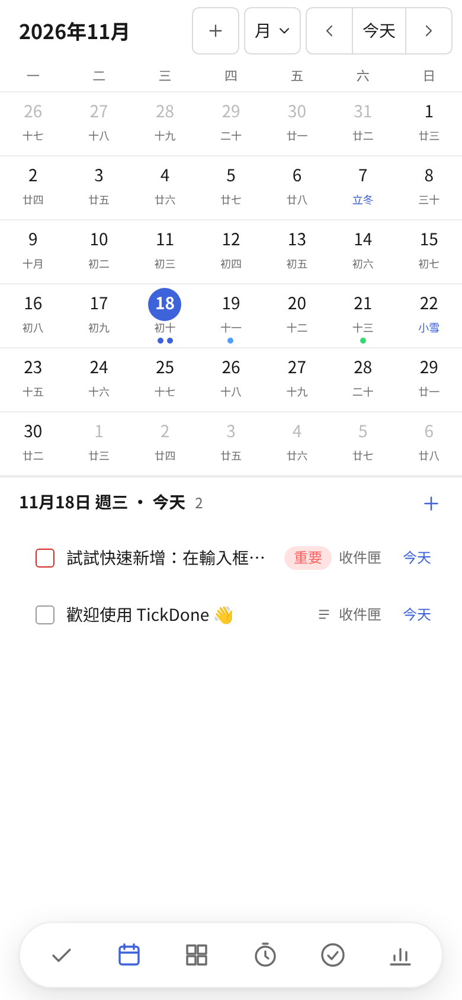</td>
    <td>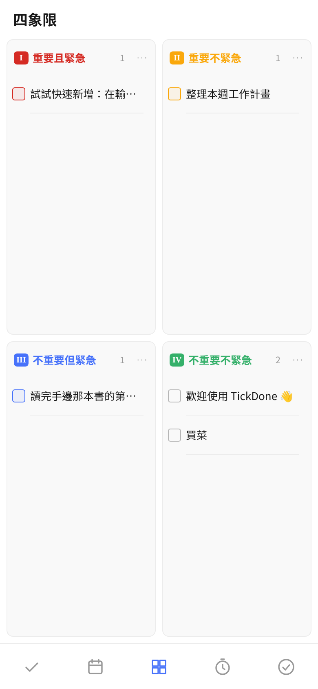</td>
    <td>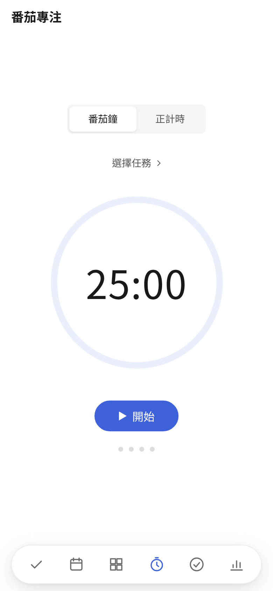</td>
    <td>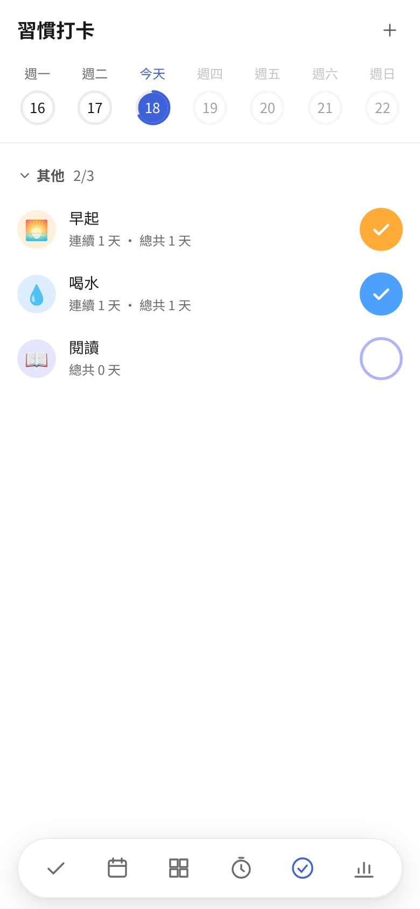</td>
  </tr>
</table>

## 🚀 快速開始

**線上使用**：開啟 [tickdone.pages.dev](https://tickdone.pages.dev)，不必安裝任何東西。

**在本機執行**（需要 Node.js 24）：

```sh
git clone https://github.com/suica/tickdone.git
cd tickdone
npm install
npm run dev        # http://localhost:5173
```

## ⌨️ 鍵盤快速鍵

| 按鍵 | 動作 |
|---|---|
| `N` | 新增任務 |
| `Ctrl/⌘ F` | 搜尋 |
| `Alt 1`–`Alt 6` | 切換模組 |
| `Ctrl/⌘ Z` | 復原（復原提示顯示期間） |
| `Esc` | 取消選取，或關閉任務詳情 |
| `↑` `↓` / `J` `K` | 清單中的上一個 / 下一個任務 |
| `Shift ↑` `Shift ↓` | 擴大選取範圍 |
| `Ctrl/⌘ Click` | 把任務加入選取，或從選取中移除 |
| `Shift Click` | 選取一段任務 |
| `Ctrl/⌘ A` | 選取清單中的所有任務 |
| `Enter` | 編輯標題 |
| `Space` / `Ctrl/⌘ Enter` | 完成或重新開啟 |
| `1` `2` `3` `4` | 優先順序：高、中、低、無 |
| `T` / `M` / `W` | 日期：今天、明天、下週 |
| `D` / `Shift D` | 選擇日期 / 清除日期 |
| `Delete` / `Backspace` | 移到垃圾桶（可在提示中復原） |
| `?` | 顯示所有快速鍵 |

## 🌍 語言

本 README 提供 10 種語言版本：English、简体中文、繁體中文、日本語、한국어、Español、Français、Deutsch、Português (Brasil) 和 Русский。整個介面已翻譯成同樣的 10 種語言。TickDone 預設跟隨瀏覽器語言，也可以隨時在設定裡切換。快速新增能辨識用中文或英文寫的日期，以及 10 種語言的優先順序詞。

發現翻譯不夠道地？英文是來源語言：直接修改 `src/i18n/` 或對應的 `README.<locale>.md`，再送出 Pull Request。

## 🗺️ 路線圖

每一項都連結到對應的 Issue。打勾的項目已在 [tickdone.pages.dev](https://tickdone.pages.dev) 上線。

- [x] 任務、清單、標籤、快速新增、行事曆、四象限、番茄專注和習慣打卡
- [x] CI：單元測試與端對端測試 ([#7](https://github.com/suica/tickdone/issues/7))
- [x] 開源：10 種語言的 README、MIT 授權條款、專案規則 ([#10](https://github.com/suica/tickdone/issues/10))
- [x] 適用手機、平板和大螢幕的版面 ([#8](https://github.com/suica/tickdone/issues/8))
- [x] 全面支援拖放 ([#9](https://github.com/suica/tickdone/issues/9))
- [x] 動畫 ([#3](https://github.com/suica/tickdone/issues/3))
- [x] App 內的 GitHub 連結與「關於」頁面 ([#4](https://github.com/suica/tickdone/issues/4))
- [x] 介面支援 10 種語言 ([#14](https://github.com/suica/tickdone/issues/14))
- [x] 逐一打磨每個畫面 ([#11](https://github.com/suica/tickdone/issues/11))
- [x] 多選與批次編輯 ([#15](https://github.com/suica/tickdone/issues/15))
- [x] 任務列表的鍵盤導覽 ([#16](https://github.com/suica/tickdone/issues/16))
- [x] 提醒通知 ([#17](https://github.com/suica/tickdone/issues/17))
- [x] 可安裝為 App 並離線使用 ([#18](https://github.com/suica/tickdone/issues/18))
- [x] 可儲存的篩選條件 ([#19](https://github.com/suica/tickdone/issues/19))
- [x] 任務、番茄專注和習慣打卡的統計 ([#20](https://github.com/suica/tickdone/issues/20))
- [x] 任務備註支援 Markdown ([#21](https://github.com/suica/tickdone/issues/21))
- [x] 時間軸檢視 ([#22](https://github.com/suica/tickdone/issues/22))
- [x] 更多重複規則 ([#23](https://github.com/suica/tickdone/issues/23))
- [x] 封存清單 ([#24](https://github.com/suica/tickdone/issues/24))
- [ ] 更多重複規則 ([#23](https://github.com/suica/tickdone/issues/23))
- [x] 封存清單 ([#24](https://github.com/suica/tickdone/issues/24))
- [ ] 無障礙 ([#25](https://github.com/suica/tickdone/issues/25))
- [x] 上千個任務依然流暢 ([#26](https://github.com/suica/tickdone/issues/26))
- [x] 主題與強調色 ([#27](https://github.com/suica/tickdone/issues/27))
- [x] 行事曆：安排沒有日期的任務、議程檢視 ([#28](https://github.com/suica/tickdone/issues/28))
- [x] 訂閱日曆 ([#51](https://github.com/suica/tickdone/issues/51))

## 🧰 技術架構

| 部分 | 使用的技術 |
|---|---|
| ⚛️ 介面 | React 19 和 TypeScript |
| 📆 日期 | date-fns，除了 React 之外唯一的執行階段相依套件 |
| ⚡ 建置 | Vite |
| 💾 儲存 | 瀏覽器的 `localStorage`，沒有後端 |
| 🧪 測試 | Vitest（單元測試）和 Playwright（端對端測試） |
| 🧹 程式碼檢查 | oxlint |
| ☁️ 託管 | Cloudflare Pages |

## 🛠️ 開發

```sh
npm install
npm run dev        # dev server at http://localhost:5173
npm run lint       # oxlint
npm test           # unit tests (Vitest)
npx playwright install chromium
npm run e2e        # end-to-end tests (Playwright)
npm run build      # type check and production build into dist/
```

- 🖼️ README 裡的橫幅和截圖由正式版建置產生：先執行 `npm run build`，再執行 `node scripts/promo/render.mjs`（參數說明在[腳本](scripts/promo/render.mjs)開頭）。
- 🗺️ `node scripts/roadmap.mjs done <issue>` 會在所有 README 中勾選對應的路線圖項目。

## 🚢 部署

正式網站部署在 Cloudflare Pages：

```sh
npm run build
npx wrangler pages deploy dist --project-name tickdone --branch main
```

## 🤝 參與貢獻

歡迎提交 Issue 和 Pull Request！開始之前請先閱讀 [AGENTS.md](AGENTS.md)，裡面是寫給所有人（包括程式設計代理）的專案規則：

- 💬 每項變更都從一個 Issue 開始，並透過引用該 Issue 的 Pull Request 合併；
- 🌐 以英文為工作語言，每段面向使用者的文字都要翻譯成全部 10 種語言；
- 📐 從 360 px 的手機到 2560 px 的螢幕，每種寬度的畫面都要正常，動畫和拖放遵循一致的規範；
- ✅ CI（程式碼檢查、型別檢查與建置、單元測試和端對端測試）全部通過後才能合併。

如果 TickDone 幫你把事情做完，歡迎在 GitHub 上給個 ⭐，讓更多人發現它。

## 📄 授權

[MIT](LICENSE) © 2026 suica
